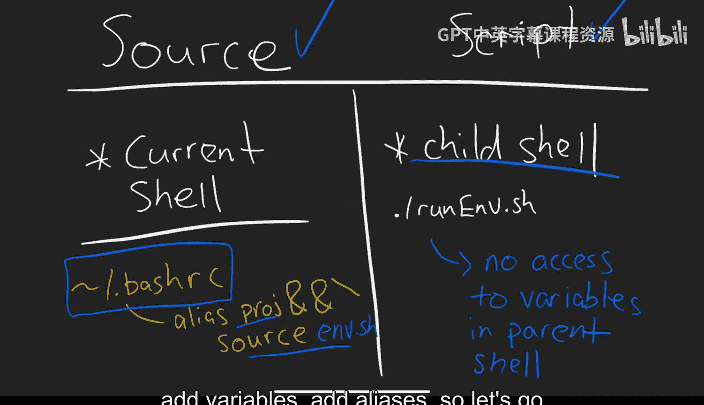
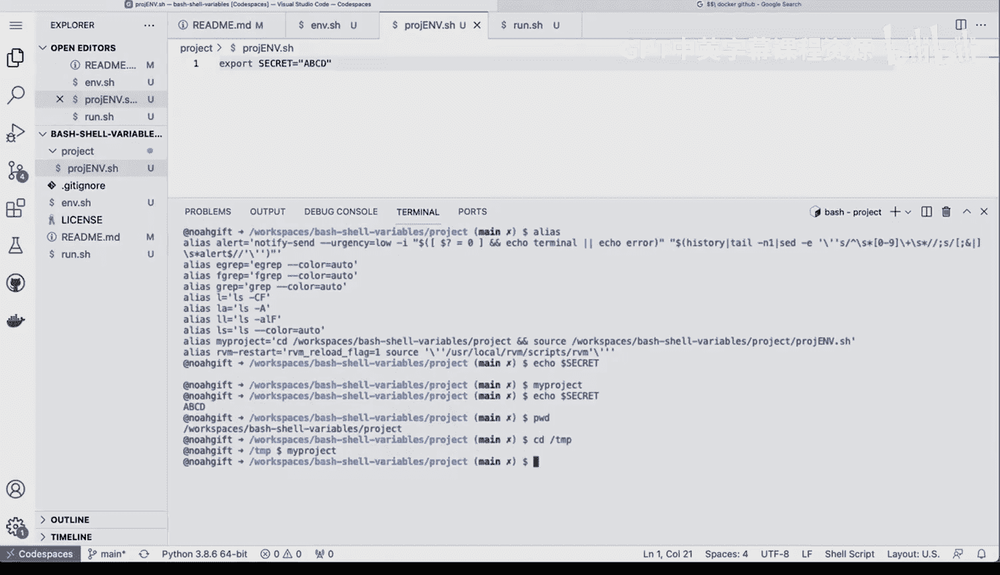

# 数据工程基础：2-4：Bash脚本中的Shell变量使用 🐚


在本节课中，我们将学习在Bash环境中执行代码的两种核心方式：`source`命令与直接运行脚本。我们将重点探讨它们如何影响Shell变量的作用域，并学习如何利用这些特性来高效地管理项目环境。

## 两种执行方式的对比

上一节我们介绍了Shell变量的基本概念，本节中我们来看看如何让这些变量在不同的上下文中生效。关键在于理解代码的执行方式。

**`source`命令**（或简写为`.`）用于在当前Shell环境中执行脚本文件。这意味着脚本中定义的变量、别名和函数会直接加载到您当前的终端会话中，并在此后持续可用。其核心行为可以用以下命令表示：
```bash
source script.sh
# 或
. script.sh
```

**直接运行脚本**（通常使用`./script.sh`）则会创建一个新的子Shell来执行脚本。脚本中定义的任何变量都只存在于这个临时的子Shell中，当脚本运行结束，子Shell及其所有变量都会被销毁，不会影响父Shell环境。其核心行为可以用以下命令表示：
```bash
chmod +x script.sh  # 确保脚本有执行权限
./script.sh
```

以下是两种方式的核心区别总结：
*   **`source`**：旨在**改进当前环境**。它会添加上下文、变量和别名，效果是持久的。
*   **运行脚本**：旨在**运行并遗忘**。它适合执行独立任务，其内部变量不会污染父Shell环境。

## 实践：变量作用域演示



理解了理论，让我们通过一个简单的例子来直观感受这两种方式的区别。

假设我们有两个脚本文件：
1.  `env.sh`：用于定义环境变量。
2.  `run.sh`：一个可执行脚本，它会调用`env.sh`并尝试使用其中定义的变量。

首先，我们创建一个定义变量的环境文件。以下是`env.sh`的内容：
```bash
#!/bin/bash
export FOOD="pizza"
export ANIMAL="cat"
```

接着，我们创建一个可执行脚本`run.sh`，它会输出这些变量。以下是`run.sh`的内容：
```bash
#!/bin/bash
source env.sh  # 在子Shell中加载变量
echo "My favorite animal is: $ANIMAL"
echo "Inside the script, food is: $FOOD"
```

现在，让我们在终端中观察不同执行方式的结果。

**场景一：直接运行脚本**
1.  为`run.sh`添加执行权限：`chmod +x run.sh`
2.  运行脚本：`./run.sh`
3.  脚本会成功打印出动物和食物的信息。
4.  然而，在脚本运行结束后，在终端中尝试回显变量：`echo $FOOD`
5.  你会发现终端中没有任何输出，因为`$FOOD`变量只存在于运行脚本时创建的子Shell中，父Shell无法访问。

**场景二：使用`source`命令**
1.  在终端中直接加载环境文件：`source env.sh`
2.  现在，尝试回显变量：`echo $FOOD`
3.  终端会成功输出“pizza”。因为`source`命令将`env.sh`中的变量直接导入了当前的Shell会话，使其立即可用。

这个对比清晰地展示了：**直接运行脚本时，变量是隔离的；使用`source`时，变量会融入当前环境。**

## 应用：创建项目环境上下文

那么，如何利用这个特性来优化我们的工作流呢？一个常见的实践是为不同的项目创建独立的环境上下文。

我们可以这样做：
1.  为每个项目创建一个环境变量文件（例如`project_env.sh`），其中定义项目专用的变量。
2.  在`~/.bashrc`文件中设置一个别名（alias）。
3.  这个别名能实现两个功能：首先切换到项目目录，然后自动`source`该项目的环境变量文件。

以下是具体步骤：

第一步，创建项目目录和环境变量文件。
```bash
mkdir my_project
cd my_project
echo 'export PROJECT_SECRET="ABCD1234"' > project_env.sh
```

第二步，编辑`~/.bashrc`文件，添加一个智能别名。
```bash
alias myproject='cd /path/to/my_project && source project_env.sh'
```
请将`/path/to/my_project`替换为你实际的**项目绝对路径**。你可以通过在项目目录下运行`pwd`命令来获取这个路径。

第三步，使别名生效。
```bash
source ~/.bashrc
```

现在，每当你想要进入`my_project`的工作环境时，只需在终端输入`myproject`。这个命令会：
1.  将你的工作目录切换到项目文件夹。
2.  自动加载`project_env.sh`中定义的所有变量（例如`$PROJECT_SECRET`）。

这样，你的主Shell环境就不会被所有项目的变量所“污染”。变量只在需要它们的项目上下文中被激活，实现了环境的清晰隔离和快速切换。

## 总结

本节课中我们一起学习了Bash中管理Shell变量的两种关键方法。
*   我们明确了`source`命令与直接运行脚本的本质区别：前者将变量导入**当前Shell**，后者则在**子Shell**中运行且变量随之消亡。
*   我们通过实践演示，验证了变量作用域的不同。
*   最后，我们应用这些知识，构建了一个实用的工作流——通过结合`alias`、`cd`和`source`命令，创建了能够一键切换并加载特定环境变量的项目上下文快捷方式。



掌握这些技巧，能帮助你更干净、更高效地组织和管理命令行环境，尤其是在处理多个不同配置的项目时。