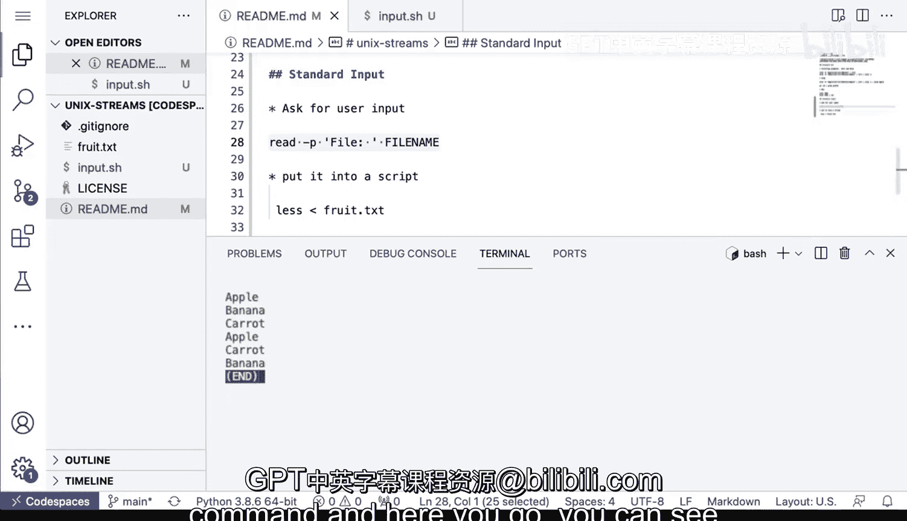

# 数据工程基础：2-4：标准输入的使用 📥


在本节课中，我们将学习如何在Bash脚本中使用标准输入。标准输入是Shell与用户或程序交互的一种基本方式，掌握它对于编写自动化脚本至关重要。我们将通过具体的例子，学习如何提示用户输入、如何将文件内容作为输入传递给命令。

## 从用户获取输入

上一节我们介绍了标准输入的基本概念，本节中我们来看看如何从用户那里获取输入。`read`命令是实现这一功能的核心工具。

`read`命令会等待用户输入，并将输入的内容存储到一个变量中。其基本语法是：
```bash
read -p "提示信息" 变量名
```
其中，`-p`选项用于指定提示用户的信息。

例如，以下命令会提示用户输入一个文件名，并将输入的值存储在`filename`变量中：
```bash
read -p "请输入文件名: " filename
```
执行后，用户输入的内容（例如`fruit.txt`）就会被赋值给变量`filename`。之后，你可以通过`echo $filename`来使用这个变量。

## 一个实用的脚本示例

理解了基础用法后，我们可以将其应用到实际的脚本中。以下是一个完整的脚本示例，它演示了如何结合`read`命令和其他命令完成一个实用任务。

以下是`input.sh`脚本的内容：
```bash
#!/bin/bash
# 提示用户输入文件名
read -p "请输入要处理的文件名: " filename
# 使用readlink命令获取文件的完整绝对路径
fpath=$(readlink -f "$filename")
# 输出完整路径
echo "文件的完整路径是: $fpath"
```

使用这个脚本前，需要先赋予其执行权限：
```bash
chmod +x input.sh
```
然后运行脚本：
```bash
./input.sh
```
脚本会提示你输入一个文件名（例如`fruit.txt`），然后它会计算出该文件的完整系统路径并显示出来。这种方式在需要处理文件绝对路径的自动化任务中非常有用。

## 将文件内容作为命令输入

除了从用户获取输入，标准输入的另一个强大功能是将一个命令或文件的内容直接作为另一个命令的输入。这可以通过管道`|`或输入重定向`<`来实现。

例如，我们有一个名为`fruit.txt`的文件。如果想用`less`命令分页查看其内容，通常的做法是：
```bash
less fruit.txt
```
另一种等价的写法是使用输入重定向，将文件内容“喂给”`less`命令：
```bash
less < fruit.txt
```
这两种方式都使得`fruit.txt`的内容成为了`less`命令的标准输入，从而实现了分页浏览。

## 课程总结



本节课中我们一起学习了Bash中标准输入的核心用法。我们首先介绍了如何使用`read -p`命令与用户交互，获取输入并存入变量。然后，我们通过一个获取文件绝对路径的脚本实例，展示了如何将用户输入应用到实际任务中。最后，我们了解了如何将文件内容作为另一个命令的输入，这体现了Linux“一切皆文件”和管道思想的灵活性。掌握这些标准输入的操作，是编写高效、交互式Bash脚本的基础。