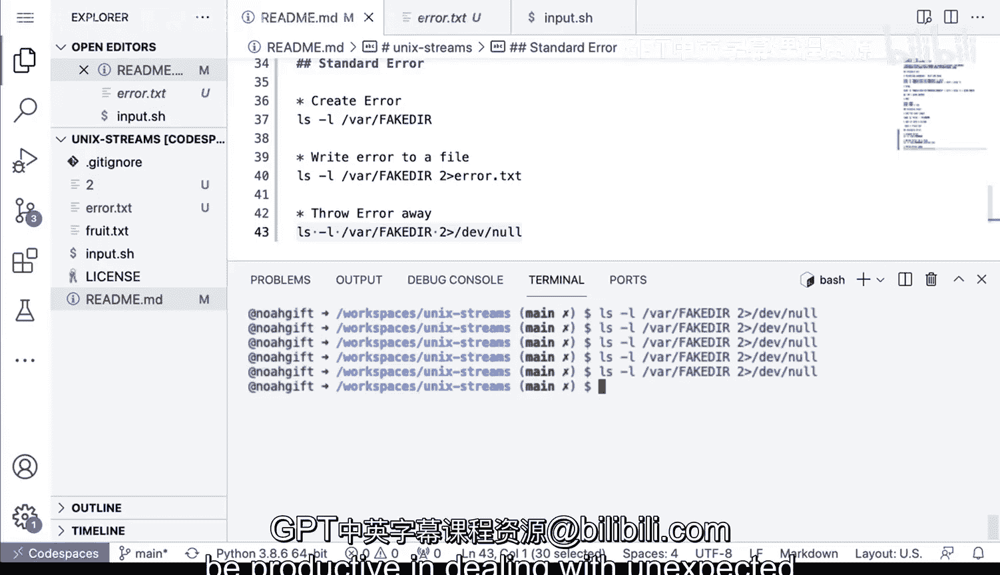

# 数据工程基础：2-4：标准错误的使用 📝


在本节课中，我们将学习标准错误（Standard Error）的概念及其在脚本编写中的重要性。标准错误是程序输出错误信息的通道，理解如何管理它对于编写健壮的脚本至关重要。

## 理解标准错误

上一节我们介绍了标准输出，本节中我们来看看标准错误。观察标准错误行为的一个有效方法是运行一个必定会失败的假命令。

例如，运行 `ls` 命令并指定一个不存在的路径：
```bash
ls /some/nonexistent/path
```
命令执行后会显示错误信息：“ls: cannot access '/some/nonexistent/path': No such file or directory”。

如果你运行的脚本会输出许多路径，其中一些有效，一些无效，你可能不希望所有这些错误信息都混杂在标准输出中。此时，你可以将标准错误重定向到另一个位置。

## 重定向标准错误到文件

以下是重定向标准错误的方法。使用 `2>` 来引用标准错误，然后可以将其管道传输到一个文件中。

例如，将错误信息重定向到 `errors.txt` 文件：
```bash
ls /some/nonexistent/path 2> errors.txt
```
执行后，错误信息不再显示在终端，而是被写入 `errors.txt` 文件。查看该文件内容，可以看到具体的错误信息。

如果希望追加错误信息而不是覆盖文件，可以使用 `2>>`：
```bash
ls /another/fake/path 2>> errors.txt
```
每次运行此命令，错误信息都会追加到 `errors.txt` 文件中。这在编写需要检查多个路径有效性的脚本时非常有用，你可以将所有错误收集到一个文件中，便于后续分析和调试。

## 丢弃标准错误

在某些情况下，例如处理服务器任务时，你可能出于多种原因（如避免磁盘空间被无关日志占满）不希望显示任何错误信息。此时，可以将标准错误重定向到 `/dev/null`。

`/dev/null` 是一个特殊的设备文件，它会丢弃所有写入其中的数据。这是一种常见的模式，用于忽略脚本运行过程中的所有错误输出。

执行以下命令：
```bash
ls /some/nonexistent/path 2> /dev/null
```
错误信息将完全消失，被系统丢弃。这在你确信某些错误无关紧要，或者不希望它们干扰主要输出时非常有用。

## 核心技巧总结

在处理标准错误时，有几个关键技巧需要掌握：

以下是两种主要的处理方法：
1.  **捕获并记录**：使用 `2>` 或 `2>>` 将错误重定向到文件，便于后续审查和调试。
2.  **丢弃忽略**：使用 `2> /dev/null` 将错误输出丢弃，保持输出界面的整洁或避免无关日志累积。

掌握这些处理标准错误的简单技巧，你就能有效地应对脚本运行中出现的意外情况，提升脚本的健壮性和可维护性。



本节课中我们一起学习了标准错误的概念，以及如何通过重定向来捕获或丢弃错误信息。这些技能是编写可靠数据工程脚本的基础。