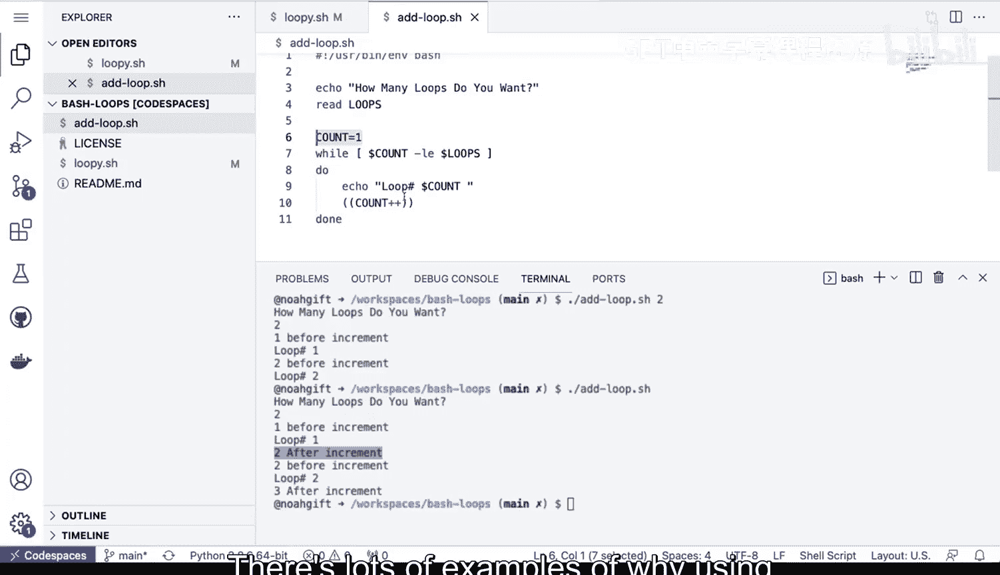

# Bash脚本编程：2-4：Shell循环的使用 🔄


在本节课中，我们将要学习Bash脚本中两种核心的循环结构：`for`循环和`while`循环。循环是自动化处理重复任务的关键，例如遍历文件列表或执行特定次数的操作。我们将通过简单的例子来理解它们的工作原理。

## 理解循环的概念

循环的概念类似于去杂货店购物。你拿一个购物篮，把商品放进去，然后在结账时，你需要把篮子里的东西一件件拿出来。循环就是这样一个过程：从一个“篮子”（例如数组或计数器）中逐个“取出”项目并进行处理。

## 使用 `for` 循环遍历数组

以下是使用`for`循环遍历数组的典型方法。首先，我们需要创建一个“篮子”——也就是数组，然后使用循环来逐个处理其中的元素。

**代码示例：**
```bash
#!/bin/bash
# 声明一个数组
declare -a array=("apple" "pear" "cherry")

# 使用for循环遍历数组
for item in "${array[@]}"
do
    echo "This $item is delicious"
done
```
**执行结果：**
```
This apple is delicious
This pear is delicious
This cherry is delicious
```

**工作原理：**
1.  `#!/bin/bash` 指定脚本使用Bash解释器执行。
2.  `declare -a array=(...)` 声明并初始化一个名为`array`的数组，其中包含三个水果。
3.  `for item in "${array[@]}"` 开始一个`for`循环。`"${array[@]}"`表示展开数组的所有元素。循环会依次将每个元素赋值给临时变量`item`。
4.  `do`和`done`之间的代码是循环体，对每个`item`执行一次。这里只是简单地打印一条消息。
5.  你可以轻松地向数组中添加更多元素（如“strawberry”），循环会自动处理所有项。

`for`循环非常适合处理已知的、离散的项目集合，例如文件列表或配置项。

## 使用 `while` 循环与计数器

上一节我们介绍了用于遍历集合的`for`循环。本节中我们来看看另一种循环——`while`循环，它特别适合在满足某个条件时重复执行操作，通常与计数器结合使用来控制循环次数。

**代码示例：**
```bash
#!/bin/bash
echo "How many loops do you want?"
read loops

# 初始化计数器
count=1

# while循环：当 count <= loops 时执行
while [ $count -le $loops ]
do
    echo "Loop $count"
    # 递增计数器
    ((count++))
done
```
**执行结果（用户输入4）：**
```
How many loops do you want?
4
Loop 1
Loop 2
Loop 3
Loop 4
```

**工作原理：**
1.  `read loops` 从用户输入获取希望循环的次数，并存储在变量`loops`中。
2.  `count=1` 初始化计数器变量`count`。
3.  `while [ $count -le $loops ]` 是循环条件。`-le`表示“小于等于”。只要`count`的值小于等于`loops`的值，循环就会继续。
4.  在循环体内，`echo "Loop $count"`打印当前循环次数。
5.  `((count++))` 是关键步骤，它使用算术运算将计数器`count`的值增加1。没有这一步，`count`永远不会改变，循环将无限进行下去。
6.  每次循环结束后，都会重新检查`while`条件。当`count`递增到大于`loops`时，条件不再满足，循环结束。

为了更清晰地理解执行顺序，可以添加调试信息：

**带调试信息的代码：**
```bash
#!/bin/bash
echo "How many loops do you want?"
read loops

count=1
while [ $count -le $loops ]
do
    echo "Count before increment: $count"
    echo "Loop $count"
    ((count++))
    echo "Count after increment: $count"
done
```
**执行结果（用户输入2）：**
```
How many loops do you want?
2
Count before increment: 1
Loop 1
Count after increment: 2
Count before increment: 2
Loop 2
Count after increment: 3
```
通过输出，你可以清晰地看到变量`count`在循环开始、打印信息后以及递增后的值变化过程。

掌握`while`循环和计数器对于实现重试机制（如尝试连接网络）、统计匹配项数量（如查找重复文件）等场景至关重要。

## 课程总结

本节课中我们一起学习了Bash脚本中两种强大的循环结构：
*   **`for` 循环**：用于遍历一个已知的项目列表（如数组中的元素、目录中的文件）。它简洁明了，是处理集合的首选。
*   **`while` 循环**：只要给定条件为真，就会持续执行。当与计数器结合时，它可以精确控制循环执行的次数，适用于需要动态控制或条件判断的重复任务。




理解并熟练运用这两种循环，将极大提升你使用Bash进行数据工程和自动化任务的能力。