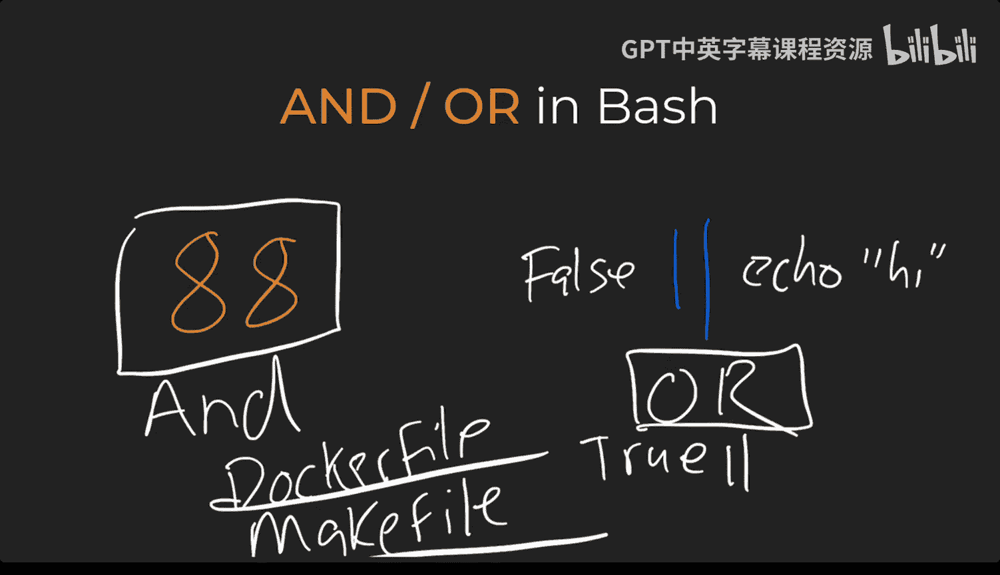
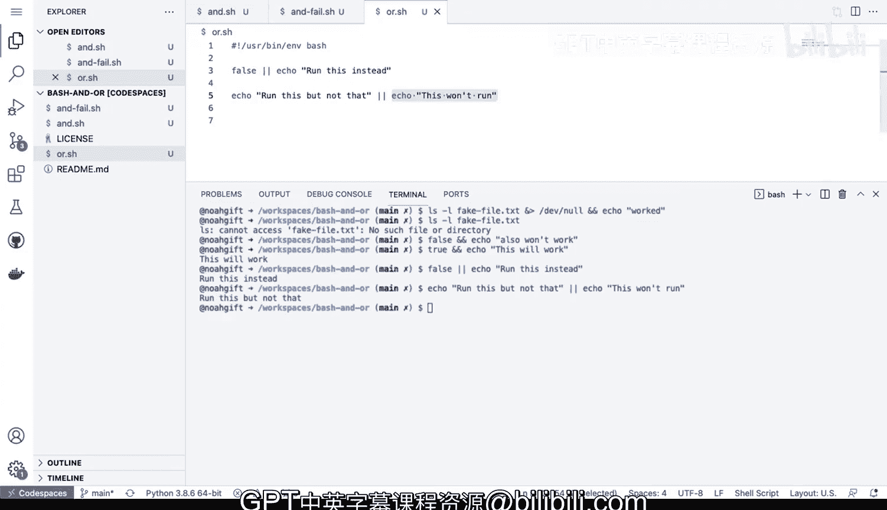

# 数据工程基础：2-4：Bash中的条件判断


在本节课中，我们将要学习Bash脚本中两个非常重要的逻辑运算符：`&&`（逻辑与）和 `||`（逻辑或）。它们允许你根据前一个命令的执行结果来决定是否执行后续的命令，这在编写复杂的脚本、Dockerfile或Makefile时非常有用。

## 逻辑与运算符（&&）

上一节我们介绍了课程主题，本节中我们来看看第一个核心概念：逻辑与运算符。

在Bash中，双与符号 `&&` 代表“逻辑与”。它的核心思想是：**只有当前一个命令成功执行（返回退出状态码0）时，才会执行 `&&` 后面的命令**。这是一种将多个命令链接在一起执行的方式，常用于确保一系列操作按顺序且无错误地执行。



以下是 `&&` 运算符的基本语法：
```bash
command1 && command2
```
在这个结构中，只有当 `command1` 成功执行后，`command2` 才会运行。

这种模式在Dockerfile和Makefile中非常常见。例如，在Dockerfile中，你可能会看到这样的结构，它确保了一系列安装步骤只有在前一步成功后才继续。

## 逻辑或运算符（||）

了解了“与”操作后，我们再来看看它的互补操作：逻辑或运算符。

双竖线符号 `||` 代表“逻辑或”。它的行为与 `&&` 相反：**只有当前一个命令执行失败（返回非零退出状态码）时，才会执行 `||` 后面的命令**。这可以用来提供备选方案或错误处理。

以下是 `||` 运算符的基本语法：
```bash
command1 || command2
```
在这个结构中，只有当 `command1` 执行失败时，`command2` 才会运行。如果 `command1` 成功，则 `command2` 会被跳过。

## 实践与应用

理论需要结合实践来巩固。让我们通过一些具体的例子来看看这两个运算符是如何工作的。

### 查看Dockerfile中的实例

学习 `&&` 和 `||` 的一个好方法是研究真实的Dockerfile。例如，在Docker Hub的官方Python镜像页面，你可以看到大量使用 `&&` 的范例。它们通常的格式是使用反斜杠 `\` 将长命令换行，并在每一行的末尾使用 `&&`，确保所有步骤顺序执行且任何一步失败都会停止构建。这种风格保证了整个安装过程的原子性。

### 在脚本中实践

我们创建一个简单的脚本来演示。假设我们想连续创建三个文件，然后列出它们。

以下是使用 `&&` 链式执行命令的示例：
```bash
touch file1.txt && touch file2.txt && touch file3.txt && ls *.txt
```
这段脚本会依次创建 `file1.txt`、`file2.txt`、`file3.txt`，只有前一个 `touch` 命令成功，下一个才会执行。最后，如果所有创建都成功，就会执行 `ls` 命令列出所有文本文件。

现在，让我们看看失败的情况。如果我们尝试列出一个不存在的文件：
```bash
ls non_existent_file.txt && echo “This will not print”
```
由于 `ls` 命令会失败（文件不存在），`&&` 后面的 `echo` 命令将不会执行。

对于 `||` 运算符，我们可以这样测试：
```bash
false || echo “This will print because the first command failed”
```
`false` 命令总是返回失败状态，因此 `||` 后面的 `echo` 命令会执行。
```bash
true || echo “This will NOT print because the first command succeeded”
```
`true` 命令总是返回成功状态，因此 `||` 后面的 `echo` 命令不会执行。

## 总结

本节课中我们一起学习了Bash中两个关键的条件判断运算符。
*   **`&&`（逻辑与）**：用于命令链，只有前一个命令成功，才执行下一个命令。这是构建可靠、顺序操作序列的基础。
*   **`||`（逻辑或）**：用于提供备选路径，只有前一个命令失败，才执行下一个命令。这常用于错误处理或提供默认行为。



掌握这两个运算符对于编写健壮的Bash脚本、理解Dockerfile和Makefile至关重要。通过观察官方镜像的Dockerfile并自己动手实践，你将能快速掌握它们的用法，并应用到自己的自动化任务中。