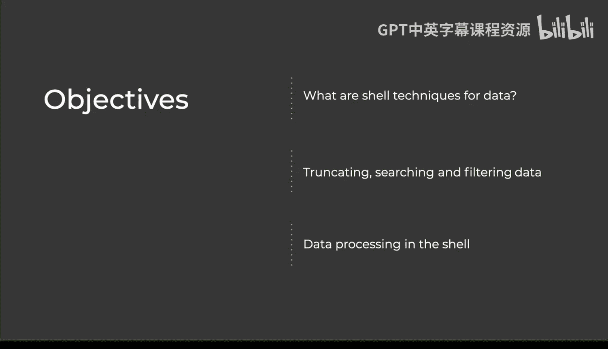

# 数据工程基础：2-4：Bash Shell 数据操作入门 🐚

在本节课中，我们将学习如何在 Bash Shell 环境中操作数据。Shell 提供了许多经过长时间发展的强大工具，能让你非常方便地对数据进行各种操作。掌握这些基础技能，是构建更复杂数据处理流程的第一步。


## 概述


本节课将分为三个主要部分。首先，我们将介绍用于数据操作的基础 Shell 技巧。然后，我们会学习如何截断、搜索和过滤数据。最后，我们将把这些技巧结合起来，在 Shell 中构建实际的数据处理流程。

---

## Shell 数据操作技巧

首先，我们来看看能立即用于解决问题的基本 Shell 技巧。这些命令是处理文本和数据文件的核心。

以下是几个最常用和强大的命令：

*   **`cat`**：用于查看文件内容。
    *   示例：`cat data.txt`
*   **`head`** 与 **`tail`**：分别用于查看文件的开头或结尾部分。
    *   示例：`head -n 10 data.txt` （查看前10行）
*   **`wc`**：用于统计文件的行数、单词数和字符数。
    *   示例：`wc -l data.txt` （统计行数）
*   **`sort`**：用于对文件内容进行排序。
    *   示例：`sort data.txt`
*   **`uniq`**：用于报告或忽略重复的行，通常与 `sort` 结合使用。
    *   示例：`sort data.txt | uniq`

---

## 数据的截断、搜索与过滤

上一节我们介绍了一些基础命令，本节中我们来看看如何对数据进行更精确的控制，包括截取特定部分、搜索内容以及按条件过滤行。

一旦掌握了这三项核心操作，你就能轻松创建更复杂的数据处理流程了。

以下是实现这些功能的关键命令：

*   **截断数据**：使用 `cut` 命令可以从每行中提取特定的字段或字符。
    *   示例：`cut -d‘，’ -f1，3 file.csv` （以逗号为分隔符，提取第1和第3列）
*   **搜索数据**：使用 `grep` 命令可以搜索包含特定模式的行。
    *   示例：`grep “error” logfile.txt` （搜索包含“error”的行）
    *   示例：`grep -v “debug” logfile.txt` （搜索**不**包含“debug”的行）
*   **过滤数据**：使用 `awk` 命令可以进行更复杂的文本分析和处理，它是一种强大的编程语言。
    *   示例：`awk ‘$3 > 100 {print $1}’ data.txt` （如果第三列值大于100，则打印第一列）

---

## 在 Shell 中进行数据处理

最后，我们将学习如何组合使用这些工具，通过管道（`|`）构建数据流水线，以解决实际问题。管道能将一个命令的输出直接作为另一个命令的输入。

例如，要找出一个日志文件中出现频率最高的错误信息，你可以组合多个命令：

```bash
grep “ERROR” application.log | cut -d‘ ’ -f4- | sort | uniq -c | sort -nr | head -5
```

这个流水线的步骤如下：
1.  `grep “ERROR” application.log`：过滤出所有包含“ERROR”的行。
2.  `cut -d‘ ’ -f4-`：从每行中提取出从第四个字段开始的内容（即错误信息本身）。
3.  `sort`：对错误信息进行排序，为下一步去重做准备。
4.  `uniq -c`：统计每条唯一错误信息出现的次数。
5.  `sort -nr`：按出现次数进行数字降序排序。
6.  `head -5`：显示出现次数最多的前5条错误信息。

通过这种方式，你可以将简单的命令串联起来，执行非常强大的数据分析任务。

---



## 总结

本节课中我们一起学习了 Bash Shell 环境下的数据操作。我们从基础的 `cat`、`head`、`sort` 等命令开始，然后深入学习了如何使用 `cut`、`grep` 和 `awk` 来截断、搜索和过滤数据。最后，我们看到了如何通过管道将这些工具组合成强大的数据处理流水线来解决实际问题。掌握这些技能，将为你在命令行中高效处理数据打下坚实的基础。