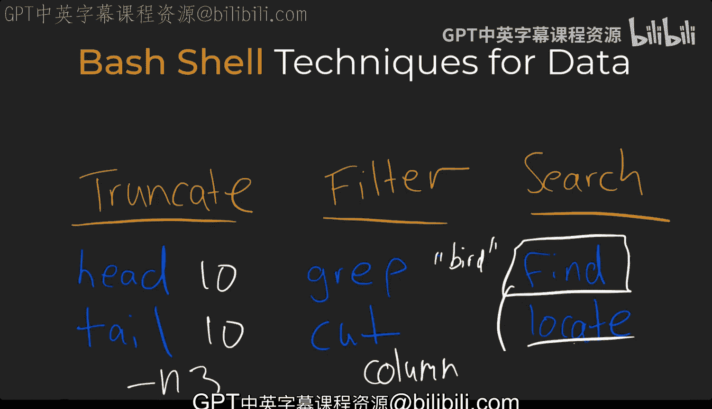

# 杜克大学｜Python、Bash和SQL数据工程基础 2-4：Bash Shell数据处理技巧 🛠️


在本节课中，我们将学习一些Bash Shell的数据处理技巧。这些技巧能帮助数据工程师更高效地处理文件和数据，就像使用工具箱中的不同工具一样。我们将介绍截取、过滤、提取和搜索等核心操作，并通过具体示例展示如何组合使用这些工具来解决实际问题。


---

## 截取文件内容

上一节我们介绍了本课程的目标，本节中我们来看看第一个常用技巧：截取文件内容。`head`和`tail`命令是你的得力助手，它们分别用于查看文件的开头或结尾部分。默认情况下，它们会显示文件的前10行或后10行。

如果你想指定查看的行数，可以使用`-n`参数。例如，要查看文件的前3行，命令如下：

```bash
head -n3 filename.txt
```

同样，要查看文件的后5行，命令如下：

```bash
tail -n5 filename.txt
```

---

## 过滤文件内容

接下来，我们看看如何过滤文件内容。`grep`命令是一个非常强大的工具，用于在文件中搜索特定的文本模式。

例如，如果你想在一个文件中查找单词“bird”，只需运行：

```bash
grep "bird" filename.txt
```

该命令会输出所有包含“bird”的行。`grep`支持正则表达式，可以进行更复杂的模式匹配。

---

## 提取特定列

现在，我们来学习如何从文件中提取特定的列。`cut`命令非常适合处理具有多列数据的文件，例如CSV或TSV文件。

假设你有一个以逗号分隔的文件，并且只想查看第一列，可以使用以下命令：

```bash
cut -d',' -f1 filename.csv
```

这里，`-d','`指定分隔符为逗号，`-f1`表示提取第一列。`cut`命令功能丰富，但提取列是其最常见的用途之一。

---

## 搜索文件系统

最后，我们探讨在文件系统中搜索文件的技巧。`find`命令允许你实时搜索文件系统，功能非常强大。

例如，要在当前目录及其子目录中查找所有扩展名为`.txt`的文件，可以运行：

```bash
find . -name "*.txt"
```

另一个有用的命令是`locate`，它基于预先构建的索引进行搜索，因此速度非常快。例如：

```bash
locate filename.txt
```

在某些系统（如OS X）上，还有一个名为`mdfind`的命令，可以搜索文件的元数据。这些搜索工具各有优势，在构建复杂解决方案时都非常有帮助。

---

## 总结



本节课中，我们一起学习了Bash Shell中几种核心的数据处理技巧。我们介绍了如何使用`head`和`tail`截取文件内容，使用`grep`过滤特定模式，使用`cut`提取数据列，以及使用`find`和`locate`搜索文件系统。掌握这些工具并能灵活组合它们，将极大提升你作为数据工程师处理日常任务的能力。