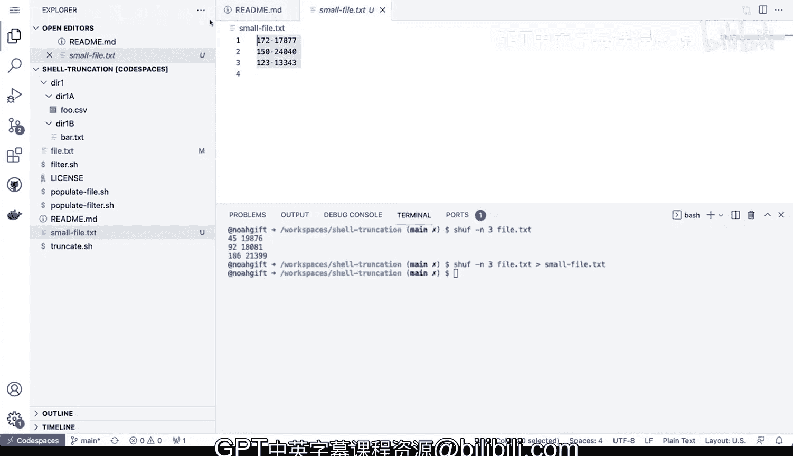

# 数据工程基础：2-4：Bash数据截断


在本节课中，我们将学习如何使用Bash命令来处理大型数据文件，特别是如何查看文件的开头、结尾以及进行随机采样。这些技巧对于高效地预览和操作大数据集至关重要。

## 截断的概念

上一节我们介绍了Bash脚本的基础。本节中，我们来看看数据截断。截断是处理大数据文件时的一个重要概念。它允许我们只查看或处理文件的特定部分，而不是整个文件，这在处理无法一次性加载到内存或屏幕的大型文件时非常有用。

## 生成示例文件

为了演示截断操作，我们首先需要一个示例文件。以下是一个名为`populate_file`的脚本，它可以生成一个包含多行数据的文件，以便我们练习如何获取文件的顶部、底部以及随机行。

```bash
# 这是一个生成示例文件的脚本
# 它会询问用户想要创建多少行数据
```

运行此脚本，并创建一个包含200行的文件。使用`wc -l`命令可以验证文件确实有200行。

## 查看文件内容

如果直接使用`cat`命令查看整个文件，由于输出内容过多，我们无法在屏幕上看到所有信息。因此，我们需要使用截断技术。

### 使用`head`命令

`head`命令允许我们查看文件的开头部分。默认情况下，它会显示文件的前10行。

```bash
head filename.txt
```

如果只想查看前几行，可以使用`-n`选项指定行数。

```bash
head -n 5 filename.txt
```

以下是使用`head`命令查看文件前几行的步骤：
1.  打开终端。
2.  导航到文件所在目录。
3.  输入`head filename.txt`查看前10行。
4.  或输入`head -n [行数] filename.txt`查看指定行数。

### 使用`tail`命令

`tail`命令与`head`相反，它用于查看文件的末尾部分。默认显示最后10行。

```bash
tail filename.txt
```

同样，可以使用`-n`选项来指定要查看的行数，例如只查看最后一行。

```bash
tail -n 1 filename.txt
```

`tail`命令在需要快速检查日志文件最新记录或文件结尾内容时非常有用。

## 随机采样数据

在处理超大型数据集（例如TB级数据）时，我们可能没有足够的资源用特定工具处理全部数据，或者需要先创建一个较小的样本来测试流程。这时可以使用`shuffle`命令（在Linux系统中通常是`shuf`）。

`shuffle`命令可以随机打乱文件中的行，并允许我们选择其中的一部分。这对于创建机器学习训练数据的随机样本或初步测试数据处理管道非常有效。

```bash
# 随机打乱文件行并输出前N行作为样本
shuf -n [样本行数] filename.txt
```

例如，从大文件中随机选取5行并保存到一个小文件中：

```bash
shuf -n 5 large_data.txt > sample.txt
```

然后可以使用`cat sample.txt`来查看这个小型样本文件的内容。

## 命令总结

本节课中我们一起学习了三个用于数据截断和采样的核心Bash命令。

*   **`head`**：用于查看文件的开头部分。
*   **`tail`**：用于查看文件的结尾部分。
*   **`shuf`**：用于对文件行进行随机打乱和采样。



掌握这些命令能帮助你在命令行中高效地预览和初步处理大型数据文件，为后续的数据工程任务打下基础。