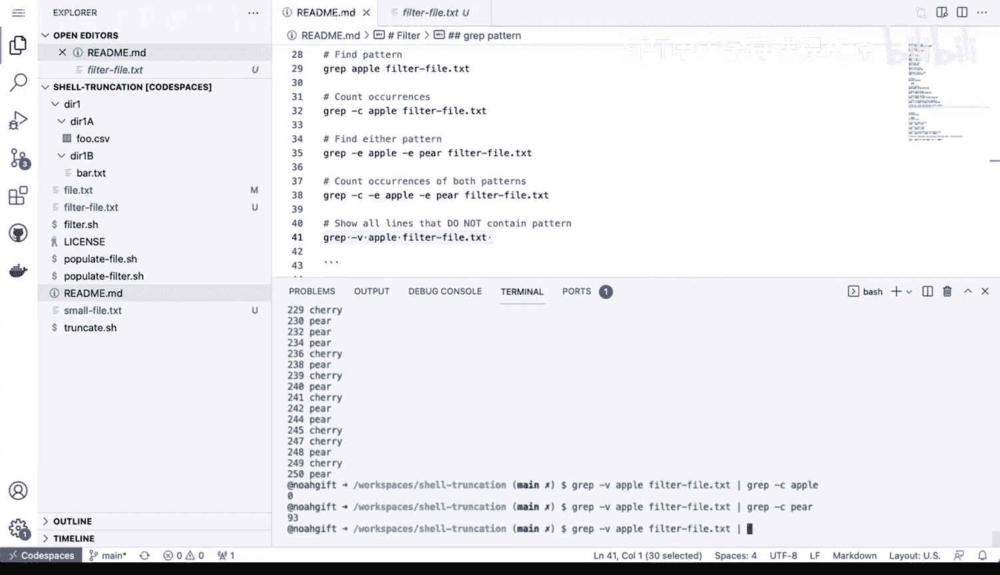

# 数据工程基础：2-4：Bash数据过滤 🔍


在本节课中，我们将要学习如何使用Bash命令`grep`来过滤和分析文本文件中的数据。这对于处理大型日志文件、数据集或任何需要快速查找特定信息的文本场景非常有用。

---

上一节我们介绍了Bash的基础操作，本节中我们来看看如何使用`grep`命令进行数据过滤。首先，我们有一个脚本，它能生成一个包含随机字符串的文件。这些字符串是“apple”、“pear”或“cherry”中的一个。

运行脚本后，我们得到一个名为`filter_file`的文件，其中包含250行数据。每行有一个行号和一个随机选择的字符串。

现在，我们可以开始过滤这些数据。这在数据科学中很常见，例如当你有一个巨大的文件并想初步了解其内容时。

以下是使用`grep`进行过滤的基本操作：

**查找特定字符串**
要查找文件中所有包含“apple”的行，可以使用命令：
```bash
grep apple filter_file
```
这个命令会输出所有包含“apple”的行及其行号。

**统计出现次数**
如果你想知道“apple”出现了多少次，可以加上`-c`选项：
```bash
grep -c apple filter_file
```
例如，结果显示“apple”出现了76次。这在快速估算数据集中某个类别的数量时非常方便。

**查找多个模式**
有时，你可能想同时查找多个模式。使用`-e`选项可以指定多个模式：
```bash
grep -e apple -e pear filter_file
```
这个命令会找出所有包含“apple”或“pear”的行。

**统计多个模式的出现次数**
要统计多个模式总共出现了多少次，可以结合使用`-e`和`-c`：
```bash
grep -c -e apple -e pear filter_file
```
结果显示，在250行中，共有169行包含“apple”或“pear”。

**反向过滤（排除特定模式）**
在某些情况下，你可能希望排除包含特定字符串的行。例如，日志文件中可能有很多重复的无关信息，你想忽略它们。这时可以使用`-v`选项：
```bash
grep -v apple filter_file
```
这个命令会显示所有**不包含**“apple”的行。

**组合使用过滤**
你还可以将多个`grep`命令组合起来，进行更复杂的过滤。例如，先排除“apple”，再在结果中查找“pear”：
```bash
grep -v apple filter_file | grep -c pear
```
这个管道命令先过滤掉所有含“apple”的行，然后统计剩余行中“pear”的出现次数。

---




本节课中我们一起学习了`grep`命令在Bash中的数据过滤功能。我们掌握了如何查找特定字符串、统计出现次数、同时匹配多个模式、排除不需要的内容，以及通过命令组合进行复杂过滤。这些技巧是处理和分析文本数据的强大工具，能帮助你在海量信息中快速定位关键内容。