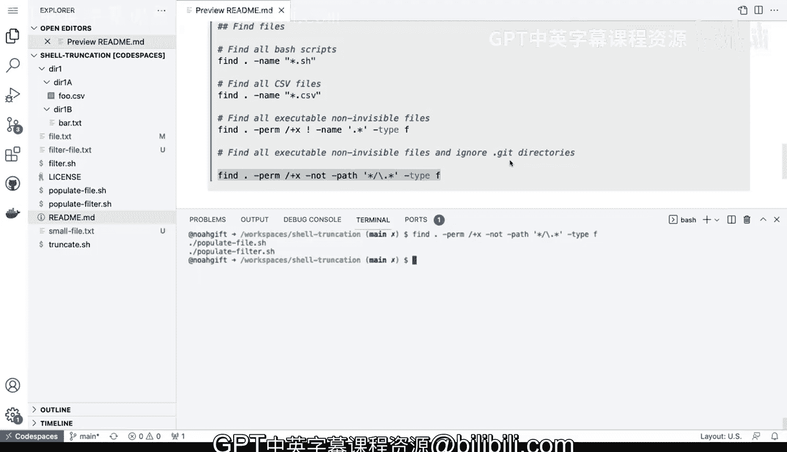

# Bash数据工程基础：2-4：Bash文件系统搜索 🔍


在本节课中，我们将学习如何在Bash终端中使用 `find` 命令来搜索文件系统。这对于处理包含大量文件和目录的数据工程或机器学习项目至关重要，它能帮助你快速定位所需文件。

---

## 概述

当你在处理一个庞大的数据目录树时，例如来自机器学习或数据工程项目的文件，一个常见的问题是如何找到特定文件的位置。幸运的是，Bash终端提供了一个名为 `find` 的命令，它能让搜索变得非常简单。本节我们将深入探讨 `find` 命令的基本用法和一些高级技巧。

---

## 按名称和扩展名搜索文件

首先，我们来看一个基本用法：搜索当前工作目录中所有具有特定扩展名的文件。

**命令示例：**
```bash
find . -name "*.sh"
```

在这个命令中：
*   `find` 是命令本身。
*   `.` 指定了搜索的起始位置，即当前工作目录。
*   `-name "*.sh"` 是搜索条件，表示查找所有以 `.sh` 结尾的文件。

运行此命令后，你可能会看到类似以下的输出：
```
./truncate_script.sh
./filter_script.sh
./populate_file_script.sh
./pop_filter_script.sh
```
这表明命令成功找到了四个匹配的脚本文件。这是一个非常有用的模式：指定搜索位置和文件名（或扩展名）模式。

---

## 递归搜索与模式匹配

那么，如果你想递归地搜索所有CSV文件呢？方法非常相似。

**命令示例：**
```bash
find . -name "*.csv"
```

通过使用 `.` 作为起始点，`find` 命令会从当前位置开始，**递归地**向下搜索所有子目录。你会看到它遍历了当前目录下的所有文件夹，最终找到并列出所有包含 `.csv` 扩展名的文件。这是递归遍历文件系统并查找特定模式的绝佳方式。

---

## 按文件类型和权限搜索

另一个常见需求，尤其是在编写脚本时，是专门查找具有特定属性的文件，例如可执行文件。

**命令示例：**
```bash
find . -type f -executable ! -path '*/.*'
```

让我们分解这个命令：
*   `find .`：从当前目录开始搜索。
*   `-type f`：只查找文件（`f` 代表 file），排除目录。
*   `-executable`：查找设置了可执行权限的文件。
*   `! -path '*/.*'`：这是一个排除条件。`!` 表示“非”，`-path '*/.*'` 匹配所有以点开头的隐藏文件或目录路径。因此，这部分的作用是**不搜索**隐藏文件/目录。

运行此命令，你将只得到你真正关心的那些显式的可执行文件，而不会看到像 `.git/` 这样的版本控制系统的隐藏目录，从而减少了输出中的“噪音”。

---

## 总结

本节课我们一起学习了 `find` 命令的强大功能。我们掌握了如何：
1.  **按名称搜索**：使用 `-name` 参数和通配符来查找特定文件。
2.  **递归搜索**：通过指定目录起点（如 `.`），`find` 可以遍历整个目录树。
3.  **按类型和权限过滤**：结合 `-type`、`-executable` 等参数精确查找目标。
4.  **排除干扰项**：使用 `! -path` 来忽略不需要搜索的路径（如隐藏目录）。



`find` 是处理数据工程项目时一个非常重要且实用的工具，熟练使用它能极大提升你在文件系统中定位和管理数据的效率。