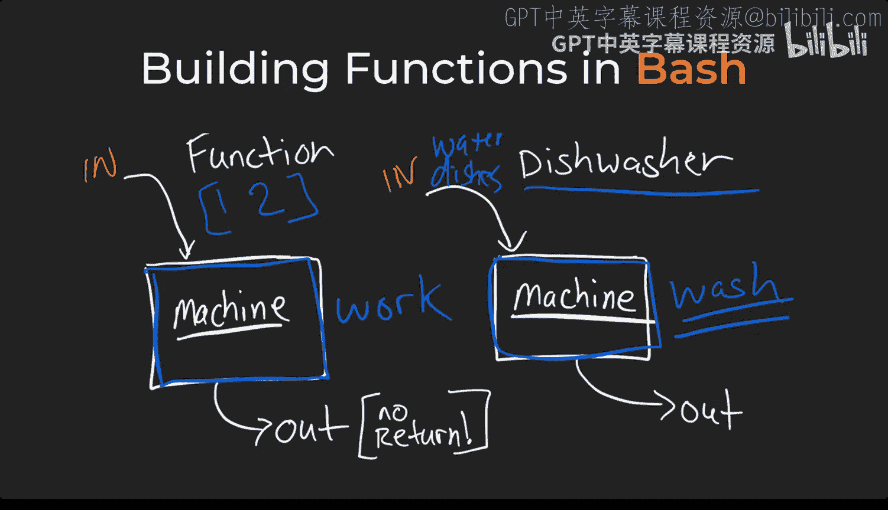
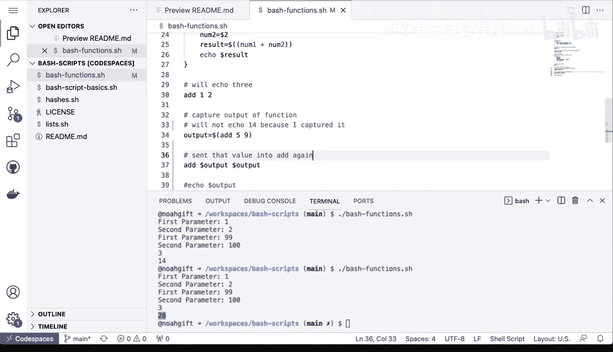

# 数据工程基础：2-4：构建Bash函数 🛠️


在本节课中，我们将要学习Bash脚本中一个非常强大的概念：函数。我们将了解函数是什么、为什么需要它们，以及如何在Bash中创建和使用函数。

## 概述

Bash函数就像一台小型机器，它接收输入，执行一系列操作，然后产生输出。理解这个概念是编写高效、可重用脚本的关键。本节我们将通过具体示例，学习如何构建和使用Bash函数。

## 理解Bash函数：一台小型机器

让我们来看看Bash函数。一个很好的理解方式是，把它们想象成你家中的小机器。

例如，你有一台洗碗机。什么东西会进入洗碗机呢？我们有水，还有碗碟。这些就是进入机器的输入。机器运转，清洗所有东西，然后你得到一个输出，那就是干净的碗碟，你可以把它放进碗柜。

同样地，在Bash或任何编程语言中，你也有类似的东西。例如，你有一个数字1，也许还有一个数字2，它们进入机器，被加在一起。这里与其他编程语言的区别在于，Bash中没有显式的`return`语句。你不能直接返回例如1和2相加的值。不过，你可以做的是，将结果`echo`出来，然后捕获这个`echo`。这与其他编程语言略有不同。

但总的来说，核心概念是把函数看作一台机器。那么，你为什么想要一台洗碗机呢？因为你可以反复使用它。同样地，你为什么想要一个Bash函数呢？因为你可以反复使用它，这允许你重用你的代码。



## 构建你的第一个Bash函数

让我们来看一个例子。

以下是构建一个简单Bash函数的基本结构：

```bash
#!/bin/bash

# 这是一个简单的函数示例
function mimic() {
    echo $1
    echo $2
}
```

在这个脚本的开头，有一个Shebang行（`#!/bin/bash`），它告诉系统应该用Bash来运行这个脚本。然后我写了一些注释。我所做的就是放置了一个函数的基本结构：函数名、括号，然后是花括号，花括号内部是你运行代码的地方。因此，在Bash中构建一个函数真的非常简单。

这是一个你能构建的最简单的函数之一，一个模仿函数。它所做的就是回显你传入的第一个参数和第二个参数。

那么它是如何工作的呢？如果我们在这里调用它，传入`mimic one two`，它就会在这个语句内部打印出`one`和`two`。

类似地，在Bash中构建函数的整个要点在于，当你往下看，想要第二次调用同一个函数时，注意我不需要重写代码。这就是可重用性，这是在Bash中编写函数的核心概念。再次调用时，它会回显`99`和`100`。

现在让我们运行这个脚本，看看它是如何工作的。运行`bash functions.sh`，我们可以看到它首先打印了`first`和`second`，第二次调用时，它做了同样的事情。

所以，如果你要构建一个备份脚本，你肯定不希望每次备份时都重写所有代码。你只想传入，比如说，一个要备份的路径。这就是构建逻辑的核心思想：你可以重用代码。

## 处理函数的输出：捕获与传递

现在，让我们看一个更复杂的函数，并了解Bash的一些独特特性，因为Bash没有`return`的概念。

获取结果的唯一方法要么是捕获`echo`的输出，要么是做一些更复杂的操作。

在这个例子中，我将定义一个名为`add`的函数。在函数内部，我将第一个参数赋值给一个变量，将第二个参数赋值给另一个变量。然后，我将这两个东西相加。这是一个非常简单的计算，将两个数字相加。接着，我在这里回显结果。

所以，基本上，在我完成计算后，获取这个值的唯一方法就是查看函数的**标准输出**。因此，如果我们这样做，它将回显单词`three`。

这里需要注意的一点是，我不必显式地让结果输出到标准输出。实际上，我可以捕获它并将其赋值给另一个变量。

以下是一个很好的示例，说明我如何做到这一点：

```bash
output=$(add 4 9)
```

我运行那个`add`函数，传入`4`和`9`。将要发生的是，结果会被捕获到这个变量`output`中。然后我就可以用它做任何我想做的事情。比如说，我需要把它传递给另一个函数，这完全没问题。

事实上，这样做可能很有趣。我们为什么不这样做呢？我们为什么不把这个输出拿过来，再次调用`add`呢？不过，这次我将把`output`变量本身作为两个参数传入。

那么会发生什么呢？这个`output`值（即13）会再次进入函数。然后这个函数应该返回`13 + 13`，也就是`26`。

让我们运行这个脚本。运行`bash functions.sh`，我们可以看到，事实上我成功地重用了那个值。它没有打印出`13`，因为我没有回显它。所以，这不会回显`13`，因为我捕获了它。相反，我所做的是，我把那个值再次发送给了`add`函数。

所以，这就是Bash函数的核心概念：**可重用性**。你甚至可以捕获输出，如果你对`echo`做一些巧妙处理的话，然后你可以再次将它发送给同一个函数或另一个函数。

## 总结




本节课中我们一起学习了Bash函数。我们了解到Bash函数就像可重复使用的机器，它接收输入并产生输出。我们学习了如何定义函数的基本结构，如何向函数传递参数，以及如何通过`echo`和命令替换`$()`来捕获和处理函数的输出。关键在于，函数的核心价值在于**代码的可重用性**，这能帮助我们编写更简洁、更易维护的脚本。