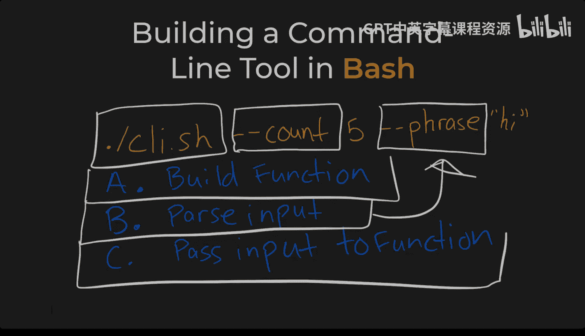
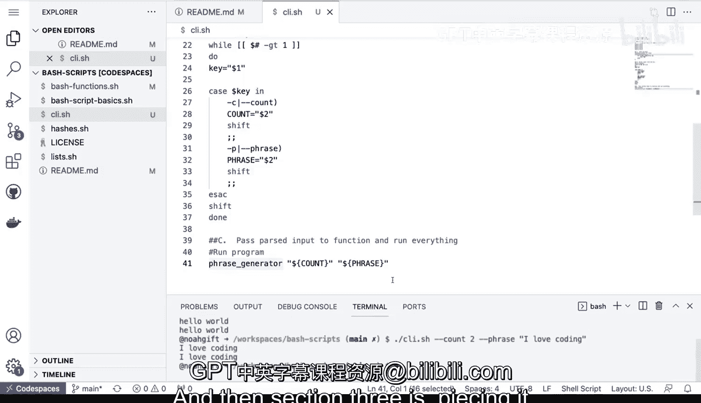

# 数据工程基础：2-4：构建Bash命令行工具 🛠️


在本节课中，我们将学习如何构建一个Bash命令行工具。我们将了解命令行工具的基本结构，并学习一个通用的构建公式，该公式包含定义功能、解析输入以及将两者整合三个核心步骤。

## 什么是Bash命令行工具？

一个Bash命令行工具通常包含几个部分。首先是脚本的名称。其次是传递给脚本的选项，用于收集值。例如，我们可能会看到 `-count` 这样的选项及其关联的值，或者 `-phrase` 这样的选项。因此，我的代码需要能够解析这些选项。

## 构建命令行工具的通用公式

我总结了一个公式，你可以将其应用于几乎任何Bash命令行工具的构建。这个公式分为三个清晰的步骤。

以下是构建Bash命令行工具的三个核心步骤：

1.  **构建代码功能**：首先，你需要构建代码的核心功能。这可能是一个加法函数、计数函数，或者你正在构建的任何功能，例如一个备份脚本。你需要将其构建成一个Bash函数。
2.  **解析输入**：其次，你需要编写能够解析输入的代码。具体来说，你需要能够解析从命令行传入的参数和选项。
3.  **整合与执行**：一旦你完成了前两步，就准备就绪了。你只需要将所有部分整合在一起，并将收集到的输入传递给第一步中定义的函数。

这个公式是构建命令行工具的一个绝佳方法。接下来，让我们通过一个实例来观察它是如何运作的。

## 实例解析：一个短语生成器工具

让我们仔细看看我之前展示的那个命令行工具，并对照我们的公式进行分析。首先，我们再次看到脚本的名称，这里是 `ci.sh`。我希望它能解析一些选项，并且能够运行某些逻辑代码。

### 第一步：定义功能（A部分）

这里是A部分，其功能是多次生成短语。让我们逐步分解这一步。`generate_phrases` 是函数的名称。实际的工作是一个 `for` 循环，我根据用户传入的值计数循环次数，然后将其回显输出。

```bash
generate_phrases() {
    for ((i=0; i<$1; i++)); do
        echo "$2"
    done
}
```

### 第二步：解析输入（B部分）



现在来到B部分，这里将设置选项解析。这部分可以相当公式化。这里使用了一个 `case` 语句，允许我在不同的值之间进行切换。它被包含在一个 `while` 循环中，基本逻辑是：只要还有一个或多个参数，就进入循环，捕获 `-count` 和 `-phrase` 选项的值，完成后结束整个循环。

```bash
while [[ $# -gt 0 ]]; do
    case $1 in
        -count)
            COUNT="$2"
            shift 2
            ;;
        -phrase)
            PHRASE="$2"
            shift 2
            ;;
        *)
            echo "未知选项: $1"
            exit 1
            ;;
    esac
done
```

### 第三步：整合与执行（C部分）

最后，既然我已经获取了所有输入，我只需要将它们传递给我之前定义的函数。在这个例子中，我只是打印出计数和短语。

```bash
generate_phrases "$COUNT" "$PHRASE"
```

## 工具运行演示

那么这个工具如何工作呢？我们可以直接从命令行运行它。我们输入 `ci`（脚本名称），然后有一个选项 `-count 5`，以及另一个选项 `-phrase Hello`。

我们可以改变这些值，例如将计数改为2，并使用不同的短语，比如 `I love coding`。运行后，工具应该能给我们输出两次“I love coding”。

这确实是一个我强烈推荐的优秀公式。当你构建命令行工具时，请思考A、B、C三个部分：A部分是核心功能，B部分是输入解析，C部分则是将所有部分整合在一起并运行你的代码。

## 总结



本节课中，我们一起学习了构建Bash命令行工具的完整流程。我们首先了解了命令行工具的基本构成，然后掌握了一个包含三个步骤的通用构建公式：**定义功能函数**、**编写输入解析逻辑**以及**最终整合执行**。通过一个生成短语的实例，我们逐步实践了这个公式。记住这个结构，你就能更有条理地创建出功能清晰、易于使用的Bash脚本工具。