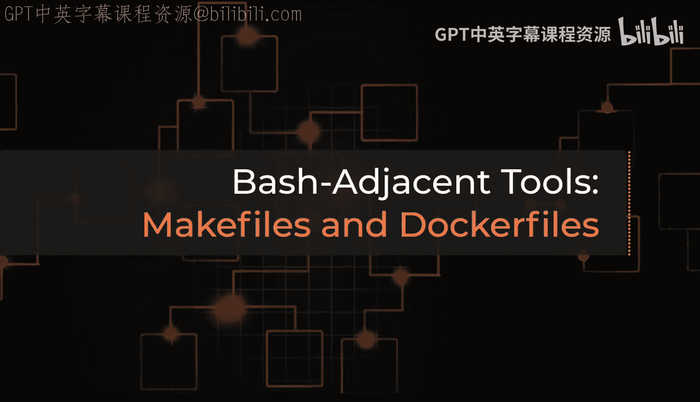
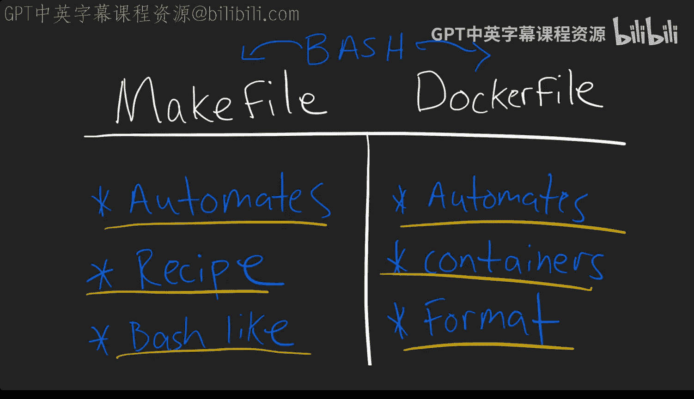
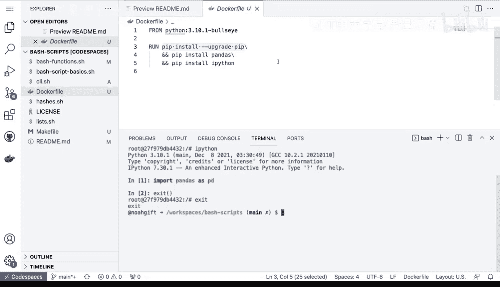

# 数据工程基础：2-4：Makefile与Dockerfile 🔧🐳




在本节课中，我们将要学习两个在数据工程和软件开发中至关重要的自动化工具：Makefile 和 Dockerfile。它们都深受 Bash 脚本的影响，是构建、测试和部署工作流的核心。理解它们将帮助你更高效地封装和交付你的数据工程解决方案。

## Makefile：自动化构建的配方 📜

上一节我们介绍了Bash脚本的基础，本节中我们来看看如何利用Makefile将一系列命令组织成可复用的自动化任务。Makefile的核心思想非常简单：它由一系列“目标”和对应的“配方”组成。

**基本公式**如下：
```makefile
目标: 依赖项
    [Tab]配方命令1
    [Tab]配方命令2
```



以下是Makefile的一个简单示例：
```makefile
all: hello goodbye

hello:
    echo “Hello, World!”

goodbye:
    echo “Goodbye for now!”
```

在这个例子中，`hello` 和 `goodbye` 是两个目标（或称为“配方”）。每个目标下面的行（必须以Tab键开头）定义了要执行的Bash命令。`all` 是一个特殊目标，它依赖于 `hello` 和 `goodbye`，运行 `make all` 或直接 `make` 会依次执行这两个目标。

在实际操作中，你只需在包含 `Makefile` 的目录下运行 `make` 命令。系统会列出所有可用的目标。运行 `make hello` 会执行 `echo “Hello, World!”` 命令。Makefile的威力在于，你可以将复杂的构建、测试、清理和部署步骤封装成简单的命令，例如 `make test` 或 `make deploy`。对于数据科学家和工程师来说，使用Makefile管理项目流程是提升效率的关键一步。

## Dockerfile：容器化应用的蓝图 🐳

理解了基于配方的自动化后，我们来看看如何将整个应用环境打包。Dockerfile 是用于构建 Docker 镜像的文本文件，它定义了一个可重复、可移植的容器环境。它的许多指令本质上就是在运行Bash命令。

Dockerfile 的基本结构是一系列指令，每条指令都会在镜像中创建一层。一个典型的Dockerfile可能如下所示：

```dockerfile
# 使用官方Python镜像作为基础
FROM python:3.10-slim

# 设置工作目录
WORKDIR /app

# 将依赖文件复制到容器中
COPY requirements.txt .

# 安装Python依赖（这里运行的是Bash命令）
RUN pip install --upgrade pip && \
    pip install -r requirements.txt

# 复制应用代码
COPY . .

# 定义容器启动时执行的命令
CMD [“python”, “app.py”]
```

在这个Dockerfile中，关键指令是 `RUN`。`RUN pip install …` 就是在容器内执行Bash命令来安装软件包。`&&` 符号是Bash中的逻辑与操作符，确保前一个命令成功后才执行下一个。`FROM` 指令指定了基础镜像（如某个Linux发行版），这意味着你继承了该镜像的所有功能和Bash环境。

要使用这个Dockerfile，你需要在同一目录下运行构建命令：
```bash
docker build -t my-python-app .
```
此命令会读取Dockerfile，逐步执行指令，最终生成一个名为 `my-python-app` 的Docker镜像。之后，你可以使用 `docker run` 命令来启动一个基于该镜像的容器，并进入其Bash终端进行交互或运行应用。

## 总结 📝

本节课中我们一起学习了Makefile和Dockerfile这两个强大的工具。

*   **Makefile** 是一个自动化任务运行器，它使用目标-配方的模式来组织Bash命令，极大地简化了复杂的项目工作流，如编译、测试和部署。
*   **Dockerfile** 是一个容器镜像构建蓝图，它通过一系列指令（特别是 `RUN` 指令执行Bash命令）来定义一个完整、一致的应用运行环境，实现了应用及其依赖的完美封装与移植。




它们的共同点在于都深深植根于Bash和Unix哲学。一旦你掌握了Bash，理解和编写Makefile与Dockerfile就会变得容易得多。熟练运用这两个工具，将能帮助你高效地构建、打包和交付可靠的数据工程解决方案。