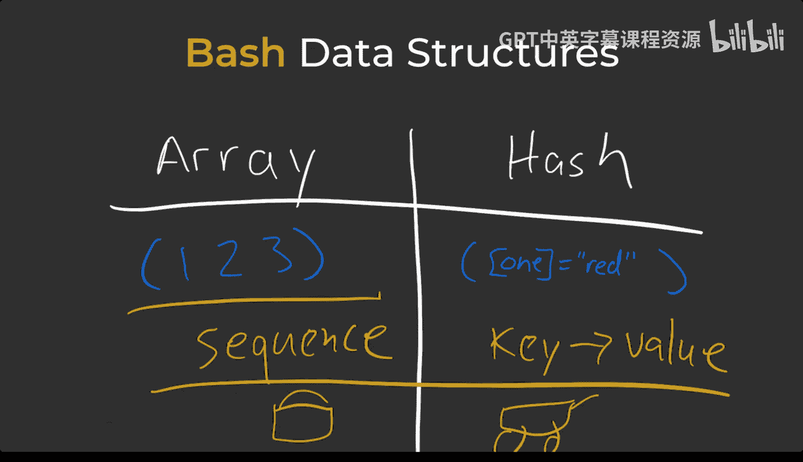
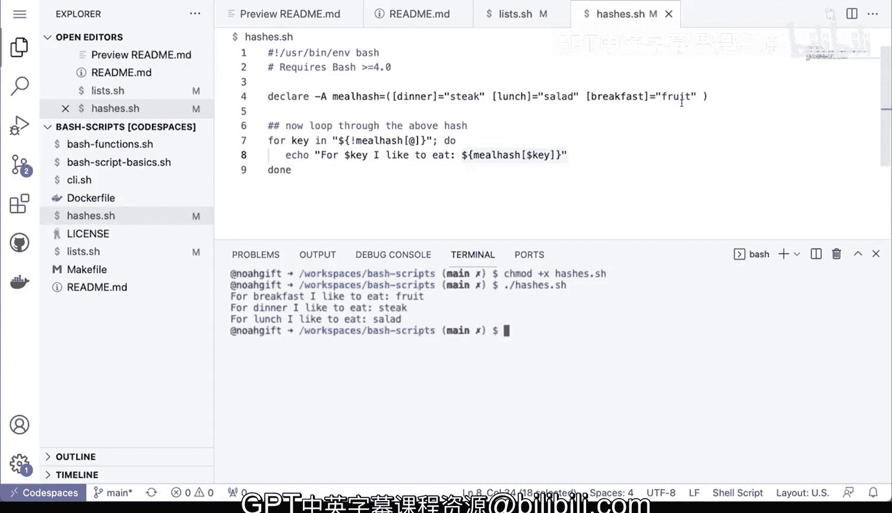

# 数据工程基础：2-4：Bash数据结构 📚


在本节课中，我们将学习Bash脚本中两种用于存储信息的数据结构：数组和哈希。理解这两种结构是编写高效、强大脚本的基础。

## 概述

在编程中，数据结构是组织和存储数据的方式。Bash提供了两种核心数据结构：数组和哈希。数组在其他语言（如Python）中常被称为列表，而哈希则类似于字典。掌握它们能帮助你更有效地处理数据集合。

## 数组：简单的数据序列 🧺

数组是一种序列结构，你可以将一系列项目放入其中。当需要处理这些项目时，可以编写一个循环，逐个取出并执行操作。这种方法非常适用于需要批量处理多个项目的场景，例如备份或处理一系列文件。

以下是数组的基本概念和用法。

### 数组示例与循环

让我们看一个数组的简单例子。以下代码声明了一个包含几种水果的数组，并使用`for`循环遍历它们。

```bash
#!/bin/bash
# 声明一个数组
fruits=("apple" "pear" "cherry")

# 使用for循环遍历数组
for fruit in "${fruits[@]}"
do
  echo "This $fruit is delicious."
done
```



执行这段脚本，输出结果如下：
```
This apple is delicious.
This pear is delicious.
This cherry is delicious.
```

这个过程就像从购物篮中一次取出一个物品。数组结构简单直观，是处理有序项目集的理想选择。

## 哈希：强大的键值对结构 🛒

哈希（也称为关联数组或字典）比数组更复杂，但也更强大。在哈希中，你需要通过一个唯一的“键”来访问对应的“值”。这就像在超市使用购物车：虽然比篮子复杂，但容量更大，功能更强，使用起来也更方便。

Bash从4.0版本开始支持哈希。大多数云系统都具备这个功能。哈希在需要建立映射关系或确保唯一性的场景中非常有用。

### 哈希示例与循环

以下是如何声明和使用哈希的示例。我们创建一个表示三餐的哈希，然后遍历它的所有键值对。

```bash
#!/bin/bash
# 声明一个关联数组（哈希）。注意‘-A’选项。
declare -A meal_hash

# 为哈希赋值
meal_hash["dinner"]="steak"
meal_hash["lunch"]="salad"
meal_hash["breakfast"]="fruit"

# 遍历哈希的所有键
for meal in "${!meal_hash[@]}"
do
  # 通过键获取对应的值
  food="${meal_hash[$meal]}"
  echo "For $meal, I like to eat $food."
done
```

执行这段脚本，输出结果可能如下（顺序可能不同）：
```
For breakfast, I like to eat fruit.
For dinner, I like to eat steak.
For lunch, I like to eat salad.
```

在这个循环中，每次迭代都会处理一个键值对。这种结构功能强大，例如，你可以用它来存储网络中的所有主机名并对其执行操作，或者检查某个键是否存在以决定后续逻辑。

## 总结

本节课我们一起学习了Bash中的两种核心数据结构。

*   **数组**：一种简单的序列结构，适用于存储和顺序处理项目列表。其语法简单，是基础任务的好帮手。
*   **哈希**：一种基于键值对的关联数组，功能更强大。它允许你通过唯一的键来高效地存储和检索数据，适用于需要映射关系或确保数据唯一性的复杂场景。



理解数组的简易性与哈希的强大功能之间的权衡，将帮助你在不同的脚本编写任务中选择最合适的数据结构。