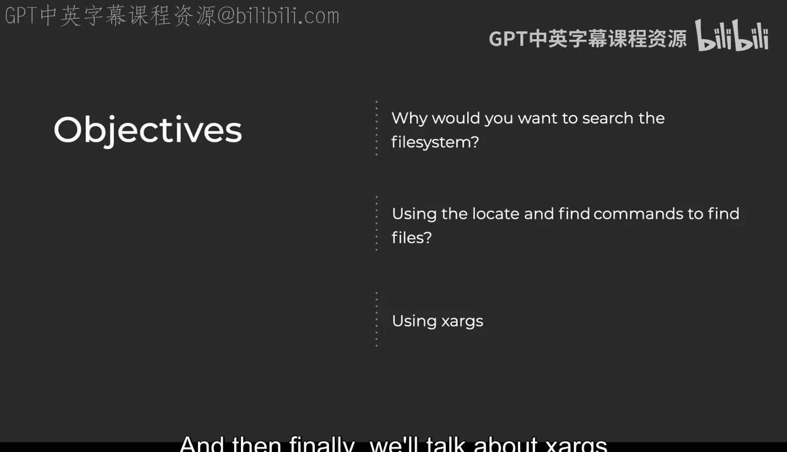
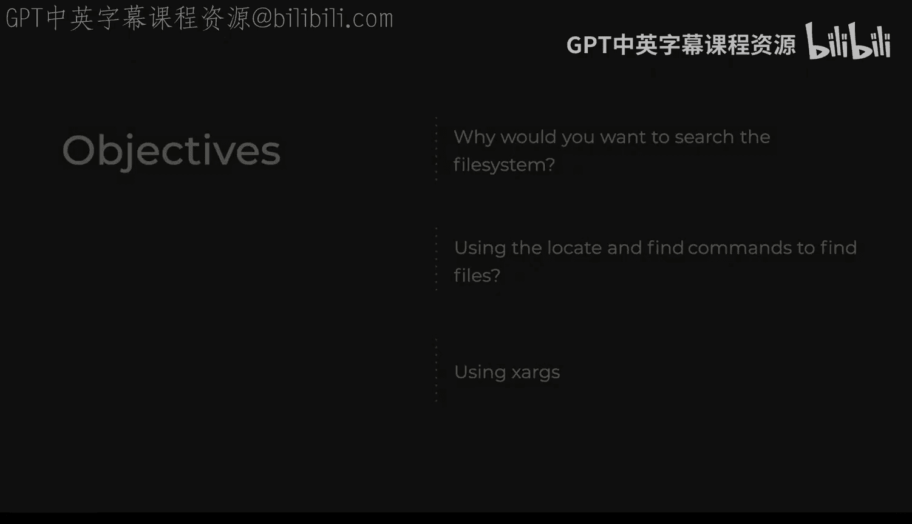

# 数据工程基础：2-4：Linux文件系统搜索简介 🔍

在本节课中，我们将学习如何在Linux文件系统中进行高效搜索。搜索是系统管理和数据工程中的一项核心技能，它能帮助我们快速定位文件、管理数据以及执行自动化任务。

## 概述


搜索文件系统有很多实际原因，例如查找重复文件、归档特定数据或定位配置文件。掌握有效的搜索工具可以极大提升工作效率。本节将介绍两个强大的命令行工具：`locate`和`find`，并探讨如何使用正则表达式进行高级搜索。最后，我们将了解`xargs`命令，它能增强命令行参数的处理能力。


## 为何需要搜索文件系统？

搜索文件系统的原因多种多样。例如，你可能需要查找重复文件以释放磁盘空间，或者需要归档特定日期创建的所有日志文件。有效的搜索能帮助你快速定位所需文件，从而进行后续的管理或分析操作。

## 使用 `locate` 和 `find` 命令

`locate`和`find`是Linux中用于定位和搜索文件的两个主要命令。它们各有特点，适用于不同的场景。

### `locate` 命令

`locate`命令基于一个预先构建的数据库来快速查找文件，因此速度非常快。但它可能无法找到刚刚创建的文件，因为数据库需要定期更新。

**基本语法**：
```bash
locate [选项] 文件名
```

### `find` 命令

与`locate`不同，`find`命令会实时遍历文件系统来查找文件，因此功能更强大、更灵活，但速度可能稍慢。它支持根据名称、类型、大小、修改时间等多种条件进行搜索。

**基本语法**：
```bash
find [路径] [选项] [操作]
```

## 使用正则表达式进行搜索

正则表达式是一种强大的模式匹配工具，可以与`find`等命令结合使用，进行更复杂、更精确的搜索。

例如，以下命令使用`find`和正则表达式在当前目录下查找所有以`.txt`或`.log`结尾的文件：
```bash
find . -regex ".*\.\(txt\|log\)$"
```

## 利用 `xargs` 增强命令行

`xargs`命令用于从标准输入构建并执行命令行。它通常与管道（`|`）结合使用，将上一个命令的输出作为参数传递给下一个命令，从而处理大量文件或参数。



例如，以下命令查找所有`.tmp`文件并将其删除：
```bash
find /path/to/search -name "*.tmp" | xargs rm
```



## 总结

本节课我们一起学习了Linux文件系统搜索的基础知识。我们了解了搜索文件系统的常见原因，掌握了使用`locate`和`find`命令进行文件定位的方法，并探讨了如何结合正则表达式进行高级搜索。最后，我们介绍了`xargs`命令，它能有效地处理命令行参数，将搜索与其他操作串联起来。掌握这些工具将帮助你更高效地管理和处理文件系统中的数据。