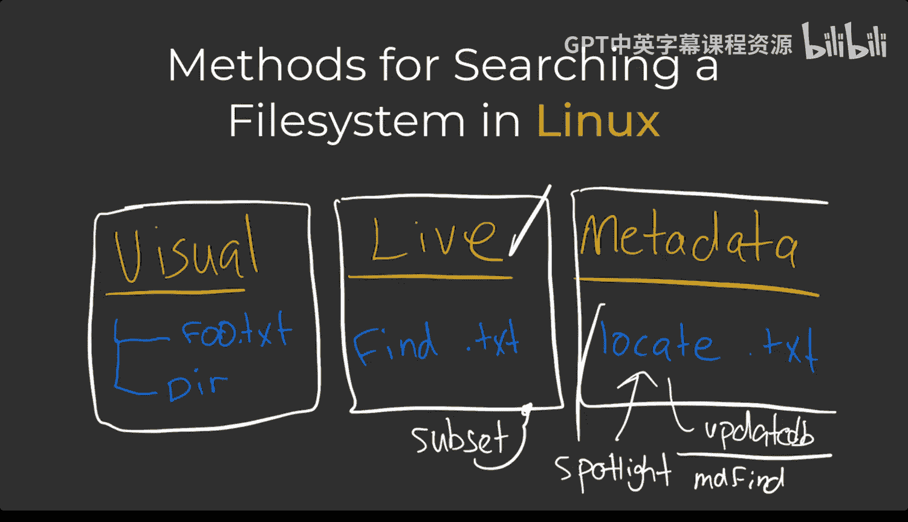

# 数据工程基础：2-4：Linux文件系统搜索方法 🔍

在本节课中，我们将要学习在Linux文件系统中搜索文件和数据的三种主要方法。理解这些方法及其适用场景，对于高效地管理和定位数据至关重要。

## 概述

为什么需要搜索文件系统？原因很简单：为了找到东西。当文件数量很少时，例如在桌面上，查找很容易。但当文件数量达到数百甚至更多时，定位特定文件就变得困难。在数据工程中，面对庞大的文件系统，掌握有效的搜索方法是一项核心技能。

## 三种文件系统搜索方法

接下来，我们将逐一探讨这三种搜索模式。每种方法都有其独特的优势和适用场景。

### 1. 可视化搜索 👁️

上一节我们介绍了搜索的基本需求，本节中我们来看看第一种方法：可视化搜索。

这种方法不仅限于桌面环境。文件系统通常采用**分层结构**（即树状结构），数据被逻辑地组织到树的特定分支中。许多组织会创建这种逻辑结构，例如将图片放在一个目录，按日期分类的文件放在另一个目录。你可以通过视觉浏览这个结构来查找文件。

这通常是你在文件系统中寻找东西时首先会使用的方法。

### 2. 实时搜索（线性搜索） ⏳

当数据量增长时，显然搜索文件系统所需的时间会越来越长。这是一个 **O(n)** 复杂度的问题：可用数据越多，搜索耗时越长。

以下是防止搜索时间过长的几种策略：
*   **限制搜索范围**：可以只搜索数据的一个子集，而无需遍历整个大数据集。
*   **按文件类型筛选**：同时结合数据子集进行搜索。

`find` 命令在此类搜索中极其有用。所有数据工程师和数据科学家都应该理解如何使用它。最重要的是要明白，这种搜索是**实时**的，并且需要时间来完成。

### 3. 元数据库搜索 🗃️

最后要提到的是元数据库搜索的概念。这是笔者个人最喜欢的方法，因为甚至无需触及实际文件系统，只需查询一个包含了文件系统上所有项目信息的文件即可。

对于 `locate` 命令，你需要运行一个名为 `updatedb` 的命令来更新这个数据库。通常，人们会通过**定时任务**（如每晚）自动运行此命令来扫描文件系统并查找更新。但有时此功能不可用，需要手动更新。

在更复杂的文件系统如 macOS 中，有一个名为 **Spotlight** 的功能，它使用类似的实用程序 `mdfind`。这个命令能够搜索整个文件系统并基于查询返回结果。

## 总结

本节课中我们一起学习了查看和搜索文件系统的三种不同方法。了解并掌握在何种问题场景下使用何种方法，对于高效的数据管理工作至关重要。