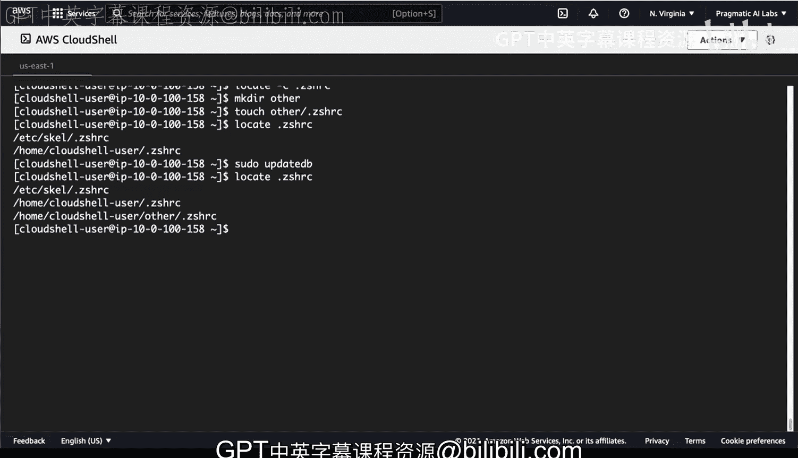

# Linux 文件管理：2-4：使用 locate 命令查找文件 🔍


在本节课中，我们将学习如何在 Linux 系统中使用 `locate` 命令来快速查找文件。`locate` 命令通过查询一个预建的数据库来工作，因此速度非常快，但需要了解其更新机制。

## 安装与更新数据库

首先，我们需要确保系统上安装了 `locate` 命令。安装方法因 Linux 发行版而异。在基于 Debian 的系统（如 Ubuntu）上，可以使用以下命令安装：

```bash
sudo apt install locate
```

安装完成后，`locate` 命令需要一个数据库来索引文件系统。这个数据库不会自动实时更新。为了获得最新的搜索结果，我们需要手动更新它：

```bash
sudo updatedb
```

这个命令会扫描文件系统，并将最新的文件信息更新到 `locate` 使用的数据库中。

## 基本文件查找

上一节我们介绍了如何安装和更新数据库，本节中我们来看看如何使用 `locate` 进行基本搜索。

使用 `locate` 命令非常简单，只需在命令后跟上要查找的文件名或模式即可。例如，查找所有名为 `.zshrc` 的配置文件：

```bash
locate .zshrc
```

执行后，命令会返回系统中所有匹配该名称的文件路径。

## 统计查找结果数量

有时我们不仅想找到文件，还想知道有多少个匹配项。以下是结合 `wc` 命令统计结果数量的方法：

我们可以通过管道将 `locate` 的输出传递给 `wc -l` 命令来统计行数，从而知道找到了多少个匹配的文件。

```bash
locate .zshrc | wc -l
```

这个命令会先执行 `locate .zshrc` 查找所有 `.zshrc` 文件，然后通过管道 `|` 将结果传递给 `wc -l` 命令进行行数统计，最终输出一个数字。

## 进行不区分大小写的搜索

默认情况下，`locate` 命令是区分大小写的。这意味着搜索 `.zshrc` 和 `.ZSHRC` 会得到不同的结果。

如果希望进行不区分大小写的搜索，可以使用 `-i` 选项。

```bash
locate -i .ZSHRC
```

使用 `-i` 选项后，`locate` 将忽略大小写差异，返回所有匹配 `zshrc` 的文件，无论其字母大小写如何。

## 理解 locate 命令的局限性

`locate` 命令非常高效，但它有一个重要的限制：它只能找到在最后一次更新数据库时已存在的文件。

例如，如果你在更新数据库后创建了一个新文件，`locate` 将无法立即找到它。你需要再次运行 `sudo updatedb` 来更新数据库，新文件的信息才会被纳入索引。

因此，在查找最新创建的文件时，可能需要先更新数据库。

## 总结



本节课中我们一起学习了 `locate` 命令的核心用法。我们首先介绍了如何安装和初始化其依赖的数据库。接着，我们探索了基本文件查找、统计结果数量以及进行不区分大小写搜索的方法。最后，我们了解了 `locate` 命令基于数据库工作的原理及其局限性：它无法实时反映文件系统的变化，需要定期手动更新数据库才能包含最新文件。尽管有此限制，`locate` 在已知文件系统中快速定位文件方面依然是一个极其强大和常用的工具。