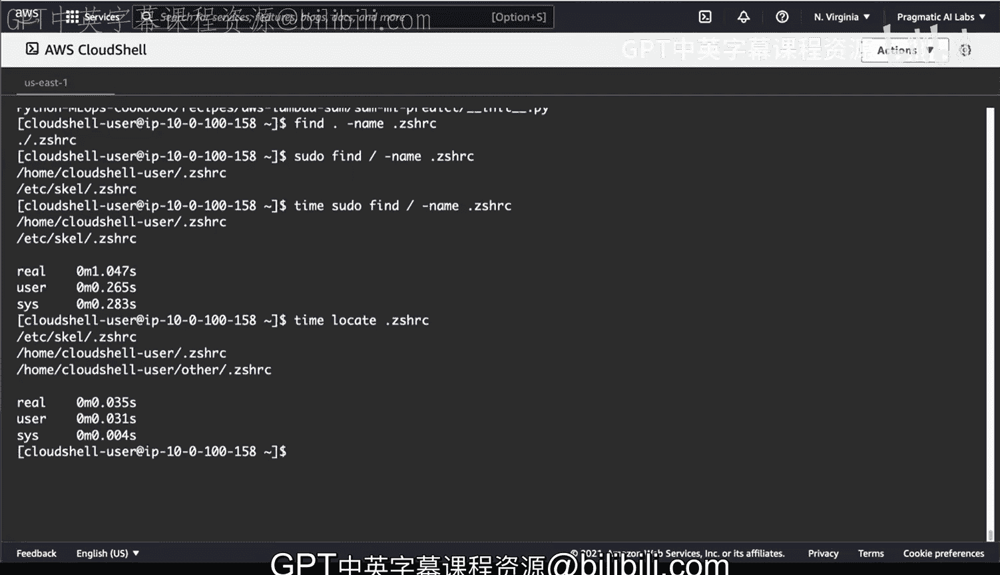

# Linux 文件管理：2-4：使用 find 命令查找文件 🔍


在本节课中，我们将要学习 Linux 系统中一个强大的实时文件搜索工具——`find` 命令。我们将了解它的基本用法、优势、局限性，以及如何根据场景选择它或 `locate` 命令。


---

## 认识 find 命令

`find` 命令允许你实时搜索文件系统。因此，对于需要在文件系统中查找特定模式或文件的用户来说，它成为了最实用的工具之一。

要开始使用，你可以输入 `find`，后跟要搜索的位置。例如，如果我输入 `find .`，表示我想查看当前工作目录及其子目录。

## 按名称查找文件

接下来，我们可以指定查找条件。例如，使用 `-name` 选项按文件名查找。假设我想查找所有名为 `.zshrc` 的文件，命令如下：

```bash
find . -name .zshrc
```

执行后，它会找到当前目录及子目录中所有名为 `.zshrc` 的文件。我们可以看到它确实找到了一个。

## 搜索整个文件系统

然而，我的文件系统上可能不止一个 `.zshrc` 文件。如何找到它们呢？需要注意的是，要搜索整个文件系统，我可能需要使用 `sudo` 命令，因为它能赋予我更高的权限，访问用户可能无权访问的所有位置。

为此，我会输入：

```bash
sudo find / -name .zshrc
```

这里，`/` 代表文件系统的根目录。执行后，我们找到了第二个 `.zshrc` 文件。这正是 `find` 命令的强大之处——它能实时查找文件。

## find 命令的性能考量

不过，这种强大并非没有代价。`find` 命令存在一些问题，其中之一是性能。为了直观感受，我们可以使用 `time` 命令来测量其执行时间。

运行以下命令：

```bash
time sudo find / -name .zshrc
```

你会发现，搜索整个文件系统大约需要一秒钟。这是一个相当耗时的命令。

## 与 locate 命令对比

现在，让我们将其与 `locate` 命令进行对比。`locate` 命令通过查询预构建的数据库来查找文件，速度通常快得多。

运行以下命令：

```bash
time locate .zshrc
```

你会发现，这种方式的速度快了上百倍，大约只需 0.03 秒。因为它能够查询数据库来快速定位文件。

## 如何选择使用哪个命令

因此，你必须根据情况选择使用哪一个命令。

以下是选择建议：
*   当你需要**实时**、**精确**地搜索文件，或者需要基于文件属性（如修改时间、大小、权限）进行复杂查找时，使用 `find` 命令。
*   当你只需要**快速**根据文件名进行查找，并且可以接受数据库可能不是最新（新创建的文件可能暂时查不到）时，使用 `locate` 命令。

`find` 命令是我推荐大家掌握的工具。除了需要注意其搜索速度，也要留意你指定的搜索范围。除此之外，它是一个非常出色的工具，应该成为你技能工具箱的一部分。

---



本节课中，我们一起学习了 `find` 命令的基本用法，了解了它实时搜索的强大功能，也认识了其相对较慢的缺点。通过将其与 `locate` 命令对比，我们明白了在不同场景下如何选择合适的文件搜索工具：追求实时性和灵活性时用 `find`，追求速度时用 `locate`。