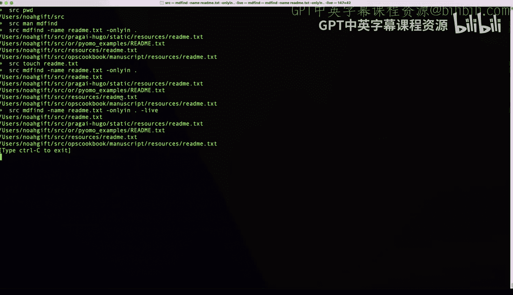
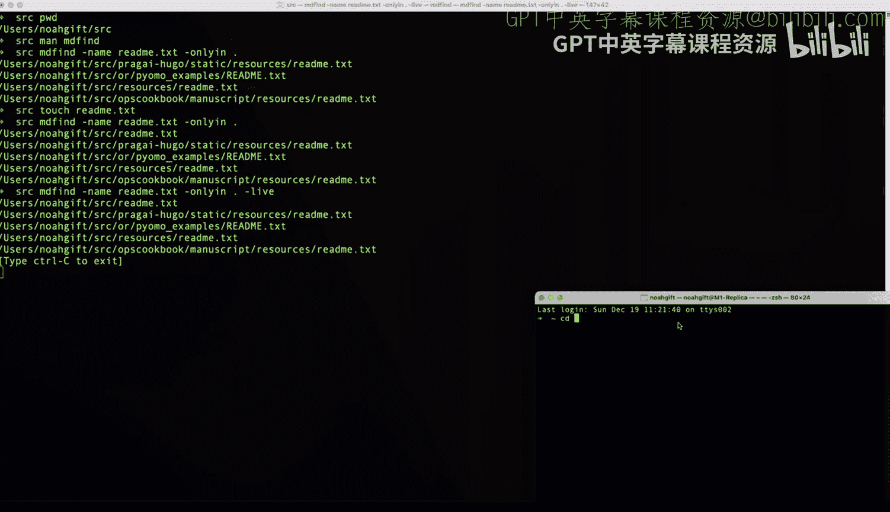
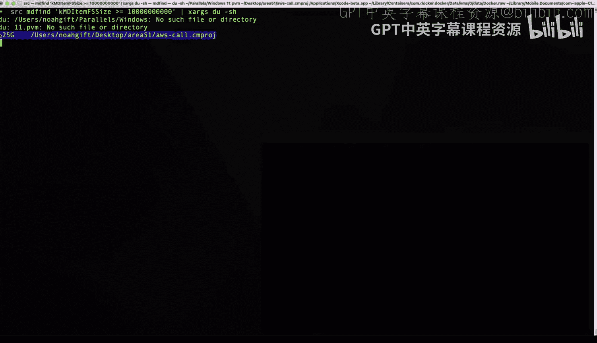

# 数据工程基础：2-4：在 macOS 上使用 `mdfind` 命令 🔍


在本节课中，我们将学习 macOS 操作系统独有的一个强大工具——`mdfind` 命令。它基于 Spotlight 元数据搜索引擎，能够快速、高效地搜索文件和目录，并支持实时更新和复杂的查询条件。

---

## 了解 `mdfind` 命令

上一节我们介绍了通用的 `find` 命令，本节中我们来看看 macOS 系统特有的 `mdfind`。首先，我们可以通过 `man` 命令查看其详细手册。

```bash
man mdfind
```

通过手册，我们可以发现 `mdfind` 提供了许多专为 macOS 设计的功能。例如，`-live` 选项允许进行实时元数据搜索，搜索结果会随文件系统的变化而动态更新。`-count` 选项可以统计匹配项的数量。我们还可以使用 `-onlyin` 选项将搜索范围限制在特定目录内。最强大的是，它能执行基于文件元数据的复杂查询。

---

## 执行基础搜索

以下是 `mdfind` 的一个基础应用示例。假设我们想在当前工作目录及其子目录中，搜索所有名为 “readme” 的文件。

```bash
mdfind -name readme -onlyin .
```

执行后，命令会列出该目录下所有包含 “readme” 名称的项目文件。这个搜索非常迅速，因为它利用了系统预建的元数据索引。

---

## 体验实时搜索

`mdfind` 的一个独特优势是实时性。如果我们在执行搜索后，立刻新建一个符合条件的文件，传统的 `locate` 命令可能无法立即发现它，因为其数据库并非实时更新。

然而，`mdfind` 配合 `-live` 选项，可以持续监控并输出新的匹配结果。我们可以打开一个终端标签页，运行以下命令进行监听：

```bash
mdfind -live -name readme -onlyin .
```

此时，命令会进入等待状态。在另一个标签页中，进入 `source` 目录并创建一个新的 `readme.txt` 文件：





```bash
cd ~/source
mkdir foo
touch foo/readme.txt
```

一旦文件创建完成，实时搜索的窗口会立即更新，显示新匹配到的文件路径。这证明了 `mdfind` 在获取最新文件信息方面的强大能力。

---

## 使用日期范围筛选

除了名称，`mdfind` 还能根据文件的创建或修改日期进行筛选。例如，我们可以搜索过去十年内修改过的 `readme.txt` 文件：

```bash
mdfind -name readme.txt -onlyin . -mtime -3650
```

如果我们想搜索未来某个日期（例如 2022 年之后）的文件，可以调整日期参数。这样，刚刚创建的新文件也会被包含在结果中，因为它符合“晚于某个过去时间点”的条件。日期筛选功能使得清理旧文件或查找特定时间段内的项目变得非常方便。

---

## 按文件大小搜索

一个非常实用但常被忽视的功能是按文件大小搜索。这对于磁盘空间管理至关重要。例如，我们可以在整个文件系统中搜索大于 10GB 的文件：

```bash
mdfind 'kMDItemFSSize >= 1e10'
```

这个查询几乎是瞬间完成的，它会列出系统中所有超过 10GB 的文件，例如一些庞大的 Xcode 模拟器或缓存文件。

---

## 结合 `xargs` 获取详细信息

上面的命令只告诉我们文件“大于某个尺寸”。如果我们想精确知道每个文件的具体大小，可以将 `mdfind` 的结果通过管道传递给 `xargs` 和 `du` 命令。

```bash
mdfind 'kMDItemFSSize >= 1e10' | xargs -I {} du -sh {}
```

`xargs` 会将 `mdfind` 找到的每一个文件路径，作为参数传递给 `du -sh` 命令。执行后，我们会得到一个人类可读的文件大小列表，例如 “25G”、“12G” 等，从而能更准确地判断哪些文件占用了大量空间。

我们还可以进一步过滤，例如只查找包含 “Xcode” 关键字的大文件：



```bash
mdfind 'kMDItemFSSize >= 1e10 && kMDItemFSName == "*Xcode*"c' | xargs -I {} du -sh {}
```

这样，输出结果会更加精确和整洁，直接显示出所有名称中包含 “Xcode” 且体积庞大的文件。

---

本节课中我们一起学习了 macOS 上 `mdfind` 命令的核心用法。我们了解了它基于元数据快速搜索的原理，实践了基础文件名搜索、体验了其独特的实时搜索能力，并学习了如何使用日期和文件大小进行高级筛选，最后还结合 `xargs` 命令来获取更详细的信息。`mdfind` 是一个功能强大、速度极快的工具，特别适合在 macOS 系统上进行高效的文件管理和检索。