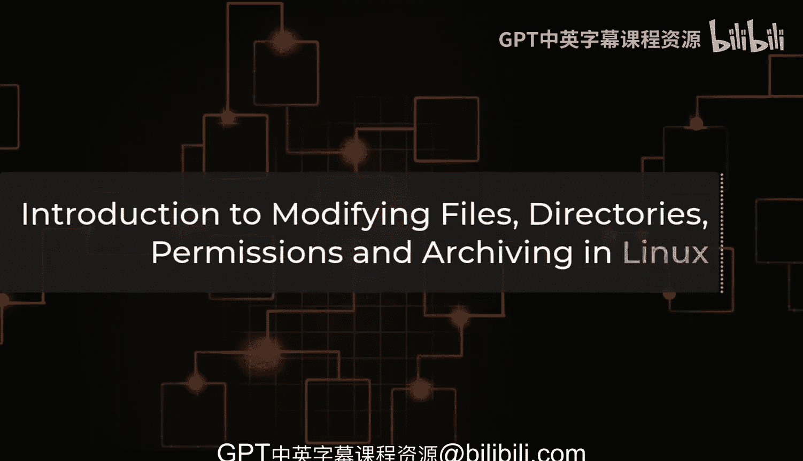
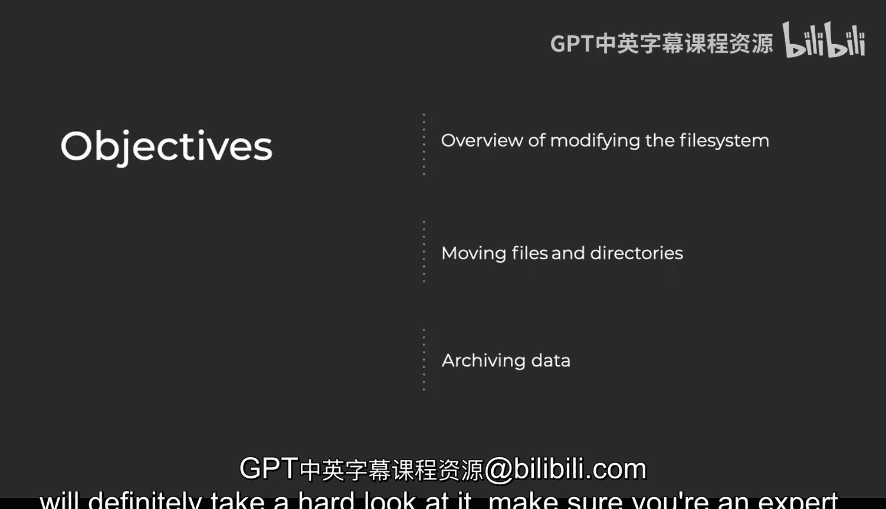

# 数据工程基础：2-4：Linux文件、目录、权限修改与归档入门 🐧


在本节课中，我们将学习在Linux终端中操作文件系统的核心技能。具体包括修改文件与目录、调整权限以及打包归档数据。这些是高效使用命令行进行数据管理的基础。



上一节我们介绍了Linux的基本命令，本节中我们来看看如何对文件系统进行更深入的操作。

## 修改文件系统

修改文件系统涉及创建、删除、重命名文件和目录。以下是几个关键命令：

*   **`touch`**：用于创建新的空文件或更新现有文件的时间戳。
    ```bash
    touch new_file.txt
    ```
*   **`mkdir`**：用于创建新的目录。
    ```bash
    mkdir new_directory
    ```
*   **`rm`**：用于删除文件或目录。使用 `-r` 选项可以递归删除目录及其内容。
    ```bash
    rm file_to_delete.txt
    rm -r directory_to_delete
    ```
*   **`mv`**：用于移动或重命名文件和目录。
    ```bash
    mv old_name.txt new_name.txt  # 重命名
    mv file.txt /path/to/destination/  # 移动文件
    ```

## 移动文件与目录

移动文件和目录是日常操作。`mv` 命令是完成这项任务的主要工具。它的基本语法是 `mv [源] [目标]`。如果目标是目录，则源文件或目录会被移动到该目录下；如果目标是文件名，则执行重命名操作。

## 归档数据

归档是将多个文件或目录打包成单个文件的过程，常用于备份或传输。以下是核心的归档与压缩命令：

*   **`tar`**：是Linux中最常用的归档工具。
    *   `-c`：创建新的归档文件。
    *   `-x`：从归档文件中提取文件。
    *   `-v`：显示处理过程的详细信息。
    *   `-f`：指定归档文件名。
    *   `-z`：通过gzip压缩或解压归档文件。
    ```bash
    tar -czvf archive.tar.gz /path/to/folder  # 创建压缩归档
    tar -xzvf archive.tar.gz  # 解压归档文件
    ```



本节课中我们一起学习了Linux文件系统操作的核心命令。我们掌握了如何使用 `touch`、`mkdir`、`rm` 和 `mv` 来管理文件和目录，并了解了如何使用 `tar` 命令进行数据的打包与压缩。这些技能是进行有效数据工程工作的基石。