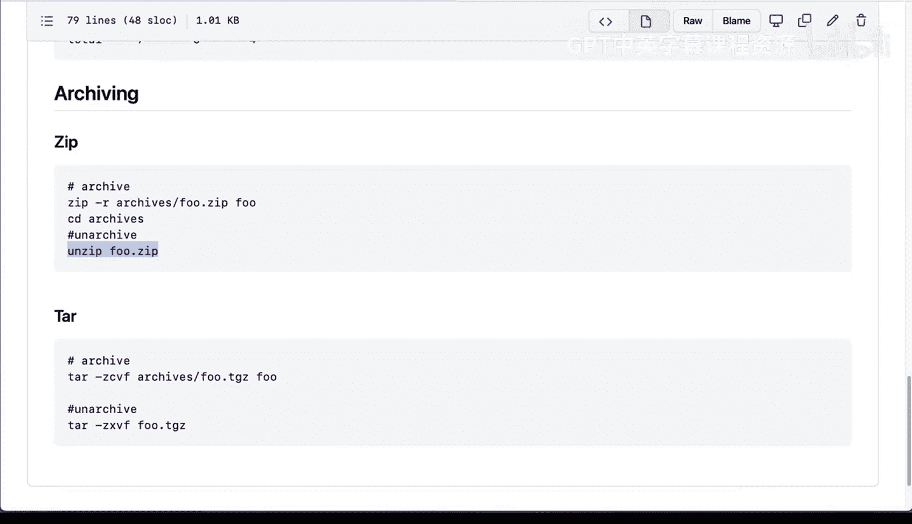
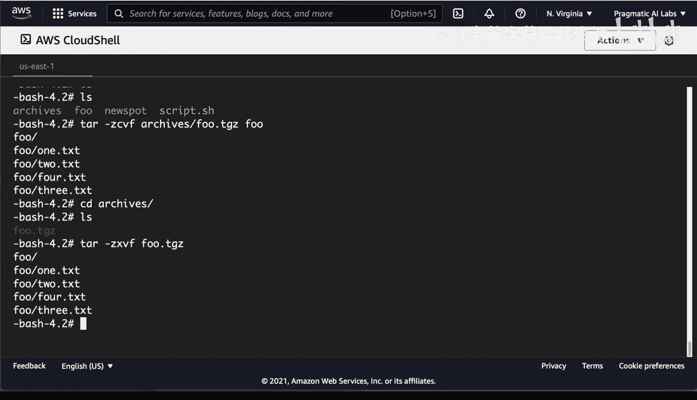
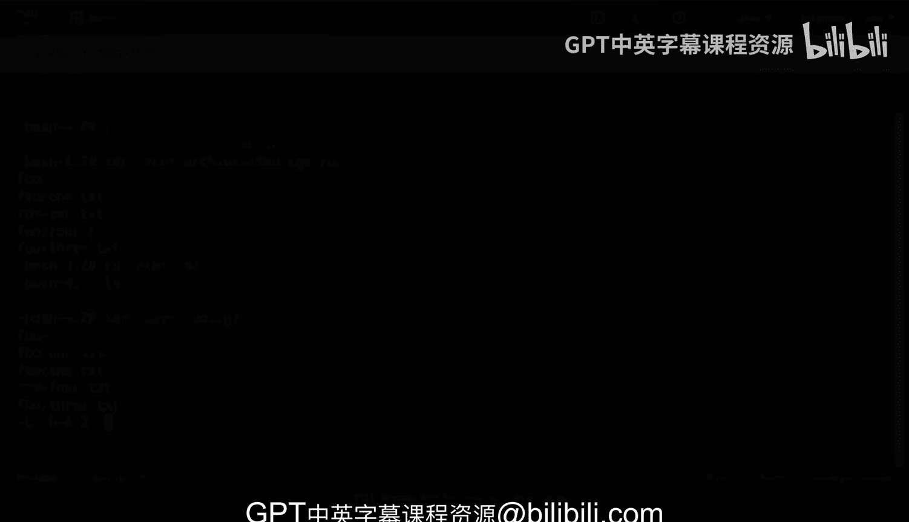

# 数据工程基础：2-4：Linux数据归档 📦


在本节课中，我们将要学习如何在Linux命令行中进行数据归档。归档是将多个文件或目录打包成一个文件的过程，常用于备份或传输数据。我们将重点介绍两种最常用的归档工具：`zip`和`tar`。

---

## 归档工具简介

上一节我们介绍了数据归档的概念，本节中我们来看看两种具体的工具。在Linux系统中，`zip`和`tar`是两种最常用的归档命令。它们都能将多个文件打包并压缩，但语法和特性略有不同。

以下是两种命令的基本操作对比：

*   **`zip`命令**：用于创建.zip格式的压缩文件。基本语法是 `zip -R [目标文件.zip] [源文件或目录]`。其中，`-R`参数表示递归地包含子目录中的所有内容。
*   **`tar`命令**：通常用于创建`.tar.gz`或`.tgz`格式的压缩包。一个常见的用法是 `tar -zcvf [目标文件.tar.gz] [源文件或目录]`。这里的`-z`表示使用gzip压缩，`-c`表示创建归档，`-v`显示过程，`-f`指定文件名。

---

## 使用 `zip` 进行归档与解档

现在，让我们通过一个具体例子来实践`zip`命令。假设我们有一个名为`food`的目录需要备份。

首先，我们可以创建一个专门的`archives`目录来存放备份文件，这是一个良好的习惯。

```
mkdir archives
```



接下来，使用`zip`命令进行归档。命令格式为：先指定目标压缩包路径，再指定要压缩的源目录。

```
zip -R archives/food_backup.zip food/
```

执行后，`food`目录下的所有内容都被打包进了`archives/food_backup.zip`文件中。这种.zip格式文件便于通过邮件等方式分享，因为它是一个通用的压缩包。

如果需要解压这个归档文件，恢复原始内容，可以使用`unzip`命令。

```
unzip archives/food_backup.zip
```

解压后，原始的文件结构就会被还原到当前目录。为了进行下一个演示，我们可以清理掉刚解压出来的文件。

```
rm -rf food/
```

---

## 使用 `tar` 进行归档与解档

清理了环境后，我们来看看功能强大的`tar`命令。它的操作逻辑与`zip`类似。

要使用`tar`创建压缩归档，我们使用`-zcvf`参数组合。同样，我们先指定目标文件名，再指定源目录。

```
tar -zcvf archives/food_backup.tar.gz food/
```

命令执行后，会在`archives`目录下生成一个`food_backup.tar.gz`文件。要解压并提取这个归档文件的内容，我们使用`-zxvf`参数组合。

```
tar -zxvf archives/food_backup.tar.gz
```

执行解压命令后，`food`目录及其文件就被完整地提取到了当前路径下。

---

## 课程总结 🎯





本节课中我们一起学习了Linux命令行下的数据归档。我们介绍了两种核心工具：`zip`和`tar`。`zip`命令简单直观，适合创建通用的.zip压缩包；而`tar`命令参数丰富，是Linux系统中最经典的归档工具，常与gzip结合使用。掌握归档（`zip -R`, `tar -zcvf`）与解档（`unzip`, `tar -zxvf`）的基本操作，能帮助你有效地备份、打包和传输数据文件。