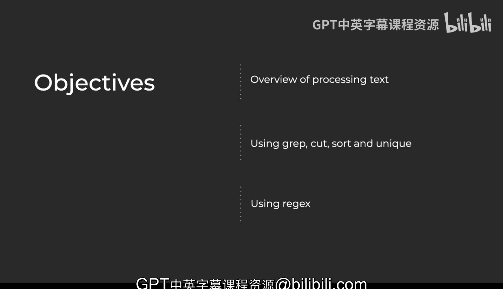

# Linux文本处理入门：2-4：Linux文本处理入门

在本节课中，我们将要学习Linux命令行中处理文本的基础知识。文本处理是使用Bash和终端最核心的方面之一，它涉及操作和分析文本流。我们将从概述开始，然后学习几个强大的命令，最后探讨如何使用正则表达式查找文本模式。

## 什么是文本处理？


文本处理指的是使用命令行工具来操作、分析和转换文本数据。这些工具通常通过管道（`|`）连接，将一个命令的输出作为另一个命令的输入，从而构建强大的数据处理流程。


上一节我们介绍了文本处理的概念，本节中我们来看看几个关键的命令行工具。

## 常用文本处理命令

以下是几个在文本处理中极其常用且强大的命令：`grep`、`cut`、`sort`和`uniq`。

### 1. `grep`：搜索文本

`grep`命令用于在文件或输入流中搜索匹配指定模式的行。其基本语法是：
```bash
grep [选项] ‘模式’ 文件名
```
例如，`grep ‘error’ log.txt`会在`log.txt`文件中查找所有包含“error”的行。

### 2. `cut`：提取字段

`cut`命令用于从文件的每一行中截取特定的部分（如列）。它通常与分隔符一起使用。基本语法是：
```bash
cut -d‘分隔符’ -f字段编号 文件名
```
例如，`cut -d‘,’ -f1,3 data.csv`会使用逗号作为分隔符，提取`data.csv`文件中每行的第1和第3个字段。

### 3. `sort`：排序文本

`sort`命令用于对文本文件的行进行排序。默认按字典序排序。基本语法是：
```bash
sort [选项] 文件名
```
例如，`sort names.txt`会对`names.txt`文件中的行进行升序排序。

### 4. `uniq`：报告或忽略重复行

`uniq`命令用于过滤或报告相邻的重复行。它常与`sort`命令结合使用，因为`uniq`只检查相邻行。基本语法是：
```bash
uniq [选项] 文件名
```
例如，`sort file.txt | uniq`会先排序文件，然后去除所有重复行。

掌握了这些基础命令后，我们可以将它们组合起来解决更复杂的问题。接下来，我们将深入一个更强大的工具：正则表达式。

## 使用正则表达式（Regex）查找模式

正则表达式是一种用于描述字符串模式的强大语言。在Linux命令行中，`grep`等工具支持使用正则表达式进行更灵活和精确的文本搜索。

一个简单的正则表达式示例是：
```
^Hello.*world$
```
这个模式匹配以“Hello”开头、以“world”结尾的任何行。

你可以使用`grep -E`来启用扩展正则表达式。例如：
```bash
grep -E ‘^[0-9]{3}-[0-9]{2}-[0-9]{4}’ data.txt
```
这个命令会在`data.txt`中查找符合美国社会安全号码格式（如123-45-6789）的行。



---

本节课中我们一起学习了Linux文本处理的基础。我们从文本处理的概述开始，然后详细介绍了`grep`、`cut`、`sort`和`uniq`这几个核心命令的用法，最后探讨了如何使用正则表达式进行模式匹配。掌握这些工具是构建高效命令行工作流和数据处理管道的关键第一步。