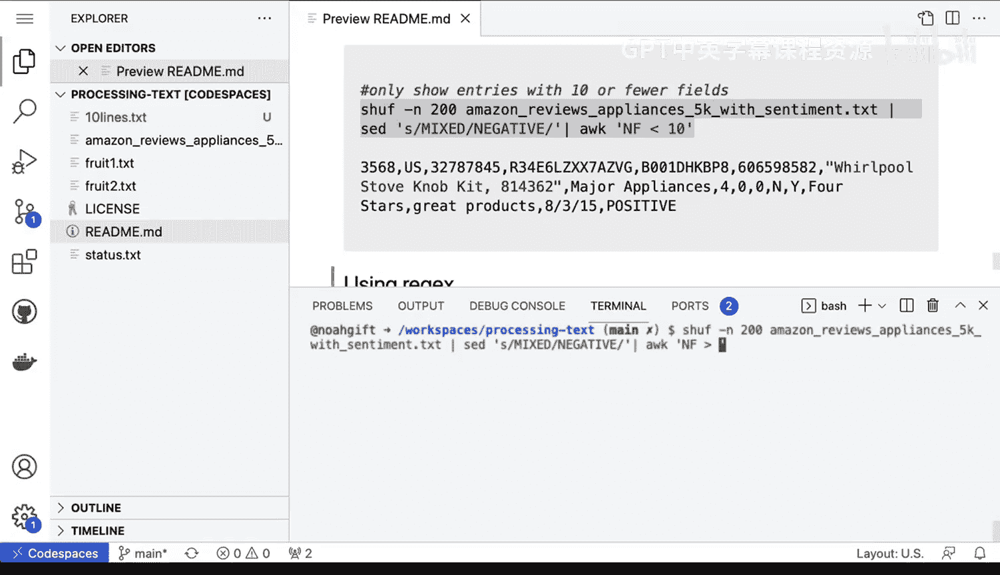

# 数据工程基础：2-4：Linux中的截断、awk与sed编辑技术


在本节课中，我们将学习Linux命令行中几个强大的流处理工具：`shuf`、`tr`、`sed`和`awk`。这些工具能帮助我们高效地处理和分析文本数据，是构建数据预处理管道的基础。

## 使用 `shuf` 命令进行随机采样

首先，我们来看看如何使用 `shuf` 命令。这是一个非常有用但常被低估的命令，数据科学家尤其需要了解它。`shuf` 命令可以从输入中随机选择行。

以下是其基本用法：
```bash
shuf -n 10 input_file.txt
```
这个命令会从 `input_file.txt` 中随机选取10行输出。如果你有一个巨大的文件（例如PB级别），而你的Python或R程序对内存敏感，使用 `shuf` 抽取一个小样本进行测试就非常方便。

要将随机采样的结果保存到新文件，可以使用重定向操作符 `>`：
```bash
shuf -n 10 input_file.txt > sample_10_lines.txt
```
然后，你可以使用 `wc -l` 命令验证新文件的行数。与按顺序选取的 `head` 或 `tail` 命令不同，`shuf` 提供了非确定性的随机采样。

## 使用 `tr` 命令进行字符转换

接下来，我们看看 `tr`（translate）命令，它用于转换或删除字符。

一个简单的例子是将小写字母转换为大写：
```bash
echo “hello world” | tr ‘a-z’ ‘A-Z’
```
执行结果是 `HELLO WORLD`。这在数据预处理中很有用，例如，在将数据输入数据库或进行机器学习之前，可能需要统一文本的大小写格式。

你可以将此功能与其他命令结合。例如，先随机采样，再转换大小写：
```bash
shuf -n 5 reviews.txt | tr ‘a-z’ ‘A-Z’
```
这构成了一个简单的数据转换管道。

## 使用 `sed` 命令进行搜索与替换

`sed`（stream editor）是一个功能强大的流编辑器，常用于文本替换。其最常见的用途是搜索并替换文本。

基本语法是：
```bash
sed ‘s/pattern/replacement/’
```
例如，将文本中的 “mixed” 替换为 “negative”：
```bash
echo “This is a mixed review.” | sed ‘s/mixed/negative/’
```
输出为 `This is a negative review.`。

假设你正在处理产品评论，希望将所有情感为 “mixed” 的标记改为 “negative”，以便进行二元分类。你可以轻松地将 `sed` 与 `shuf` 结合：
```bash
shuf -n 200 reviews.txt | sed ‘s/mixed/negative/’
```
为了验证替换是否成功，可以结合 `grep` 命令进行计数检查。`sed` 的这种简单替换功能，在构建数据清洗管道时非常实用。

## 使用 `awk` 命令进行模式扫描与处理

最后，我们介绍 `awk`，这是一种诞生于1970年代贝尔实验室的编程语言，专为文本处理设计。`awk` 的基本结构是“模式 {动作}”，即对匹配模式的行执行相应动作。

一个典型应用是根据字段数量过滤行。假设我们有一个用制表符分隔的评论文件，我们想找出字段数少于10的简短评论：
```bash
awk -F‘\t’ ‘NF < 10’ reviews.txt
```
其中，`-F‘\t’` 指定字段分隔符为制表符，`NF` 代表当前行的字段数量。这个命令会打印出所有字段数小于10的行。

反之，如果你想找出非常冗长、字段数大于300的评论，可以这样做：
```bash
awk -F‘\t’ ‘NF > 300’ reviews.txt
```
`awk` 的功能远不止于此，但它基于条件和动作的处理逻辑，使其成为过滤和转换结构化文本数据的利器。

## 总结

本节课我们一起学习了Linux中四个核心的流处理工具：
*   **`shuf`**：用于从文件中进行**随机采样**。
*   **`tr`**：用于**字符转换或删除**，如大小写转换。
*   **`sed`**：用于基础的**文本搜索与替换**。
*   **`awk`**：一种功能强大的**文本处理编程语言**，常用于基于模式的过滤和报告生成。



这些工具的威力在于它们可以像管道一样组合使用。通过灵活结合 `shuf`、`tr`、`sed` 和 `awk`，你可以构建出强大而高效的数据预处理流程，轻松应对各种文本数据处理任务。掌握这些命令行工具，将极大提升你在数据工程领域的工作效率。