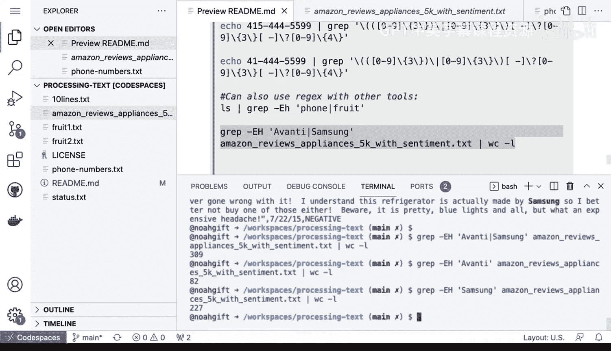

# 数据工程基础：2-4：Linux正则表达式使用 🧠


在本节课中，我们将要学习Linux中一个强大的文本处理工具——正则表达式。我们将通过具体的例子，了解如何使用正则表达式来匹配、筛选和处理文本数据，例如从混乱的文档中提取有效的电话号码，或者从大量文件中快速找到特定类型的文件。

---

## 正则表达式的超能力 💪

从事文本处理工作的人，其一项超能力就是掌握正则表达式。一个经典的例子是：你有一个包含大量电话号码的文档，其中一些号码格式混乱，你希望只提取出格式正确的有效号码。

例如，观察以下号码：
*   `919-555-1234` 看起来格式正确。
*   `919-555-123` 看起来格式错误。
*   `919-555-1234` 看起来格式正确。
*   `919-555-123` 看起来格式错误。

即使对于有几年工作经验的人来说，手动完成这项任务也非常困难且繁琐，容易出错。幸运的是，我们可以利用Linux系统中的工具轻松地自行处理。

---

## 使用 `grep` 匹配电话号码 📞

接下来，我们将通过一个命令来演示。我将使用 `echo` 命令输出一个有效的电话号码，并通过 `grep` 命令来匹配它。

命令的核心是使用正则表达式模式：`[0-9]{3}-[0-9]{3}-[0-9]{4}`。这个模式的含义是：
*   `[0-9]{3}`：匹配一个由三位数字（0到9）组成的字符串。
*   `-`：匹配一个连字符。
*   整体模式要求匹配“三位数字-三位数字-四位数字”的格式。

让我们执行这个命令：
```bash
echo "919-555-1234" | grep -E "[0-9]{3}-[0-9]{3}-[0-9]{4}"
```
运行后，它会成功匹配并输出有效的电话号码。

如果我们输入一个无效的号码：
```bash
echo "919-555-123" | grep -E "[0-9]{3}-[0-9]{3}-[0-9]{4}"
```
它将不会产生任何输出，因为模式不匹配。这正是我们想要的：只保留有效的条目，忽略无效的。

---

## 处理文件中的电话号码列表 📄

上一节我们介绍了如何匹配单个字符串，本节中我们来看看如何将这个方法应用于整个文件。我们可以将 `grep` 命令与文件读取命令 `cat` 结合使用。

假设所有电话号码都存储在一个名为 `phone_numbers.txt` 的文件中。以下是处理该文件的命令：
```bash
cat phone_numbers.txt | grep -E "[0-9]{3}-[0-9]{3}-[0-9]{4}"
```
执行后，命令会从文件中筛选出仅有的两个格式正确的电话号码。这个例子展示了如何将正则表达式集成到Shell脚本中，从而轻松处理格式混乱的文档。

需要注意的是，正则表达式可能非常复杂，需要花费时间确保其正确性。但一旦掌握，它能以极快的速度清理文本。

---

## 使用 `grep` 筛选特定文件 📁

除了处理文件内容，正则表达式还可以用于筛选文件名。例如，使用 `ls` 命令列出目录中的文件时，如果文件数量庞大，手动查找会非常麻烦。

我们可以使用 `grep` 来过滤 `ls` 命令的输出。以下命令可以找出文件名中包含“phone”或“fruit”的文件：
```bash
ls | grep -E "phone|fruit"
```
执行后，我们只看到包含这两个关键词的文件。这是一个将正则表达式与其他工具（如 `ls`）的输出流结合使用的绝佳例子。

---

## 在大型文档中搜索与统计 📊

现在，让我们看一个更实际的数据预处理例子。假设我们有一个包含数千行文本的评论文档 `reviews.txt`。

我们可以使用相同的 `grep` 模式来查找包含特定品牌（如“Avante”或“Samsung”）的评论，并进行计数。命令如下：
```bash
grep -E "Avante|Samsung" reviews.txt | wc -l
```
对于一个有5000行的文档，此命令可能会输出309，表示找到了309条相关评论。我们还可以进一步验证结果的准确性。

以下是验证步骤：
1.  统计只包含“Avante”的评论数：
    ```bash
    grep "Avante" reviews.txt | wc -l
    ```
    （假设输出82）
2.  统计只包含“Samsung”的评论数：
    ```bash
    grep "Samsung" reviews.txt | wc -l
    ```
    （假设输出227）
3.  将两个数字相加：82 + 227 = 309。这与我们组合查询的结果一致，验证了命令的正确性。

这展示了在数据进行其他复杂处理之前，使用 `grep` 进行快速筛选和预处理是一种简单有效的方法。

---

## 总结 🎯

本节课中我们一起学习了Linux正则表达式的基础应用。我们了解到：
1.  正则表达式是强大的文本模式匹配工具，尤其适合从混乱数据中提取规整信息（如电话号码）。
2.  使用 `grep -E` 命令可以执行扩展正则表达式匹配。
3.  正则表达式可以轻松地与管道（`|`）结合，处理命令输出流或文件内容。
4.  应用场景广泛，包括验证数据格式、筛选特定文件、在大型文档中搜索和统计关键词等。



花时间学习正则表达式，未来在处理文本和数据时将会获得丰厚的回报。电话号码匹配是绝佳的练习起点，而快速筛选文件则是正则表达式一个非常实用的用例。