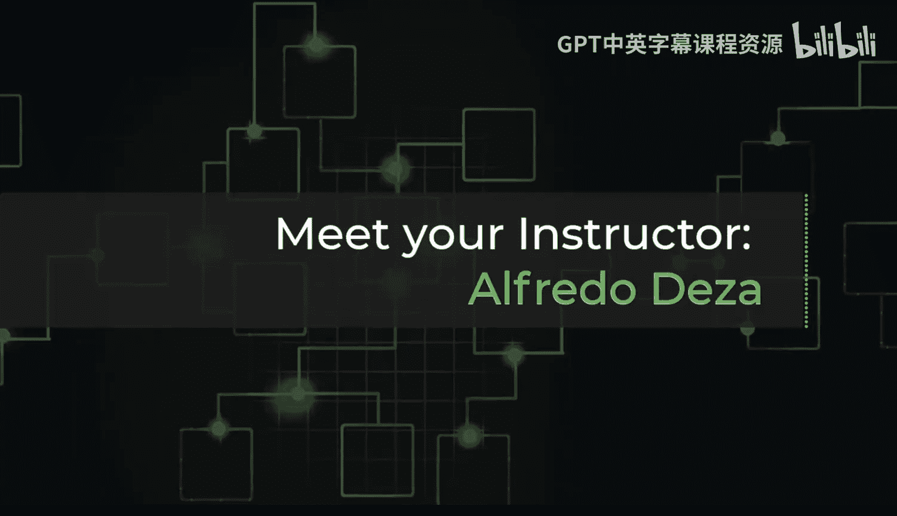
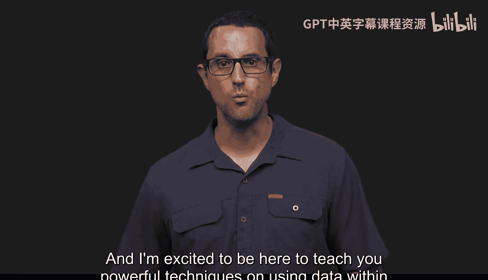

# 数据工程基础：2-4：认识你的课程讲师

## 概述
在本节课中，我们将认识本课程的讲师，了解他的专业背景和教学经验，这有助于我们理解课程内容的来源和侧重点。

## 讲师介绍

我的名字是Salreesa，我曾是一名奥林匹克运动员，目前担任云技术布道师，专注于Python和机器学习领域。

我的专业背景主要集中在系统管理、Python和DevOps方面。

我撰写了许多关于Python和机器学习的书籍。

我很高兴能在这里，教授大家如何在Python中结合SQL和数据库来使用数据的强大技术。

## 总结
本节课我们一起认识了本课程的讲师Salreesa。我们了解到他拥有奥林匹克运动员的经历，现在是专注于Python和机器学习的云技术布道师，具备深厚的系统管理、Python和DevOps背景，并且著有多本相关书籍。他将指导我们学习在Python中有效运用SQL和数据库处理数据的核心技巧。