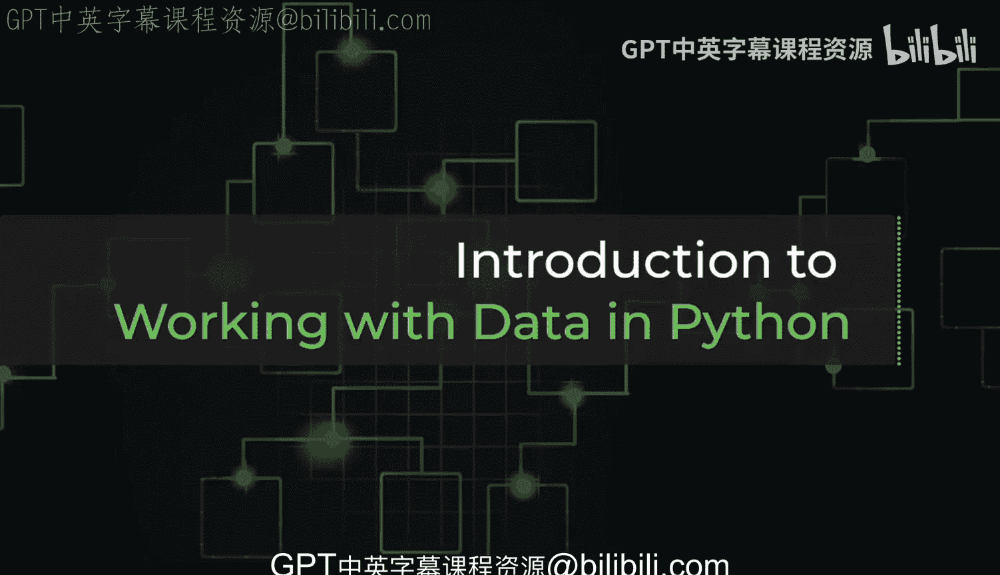
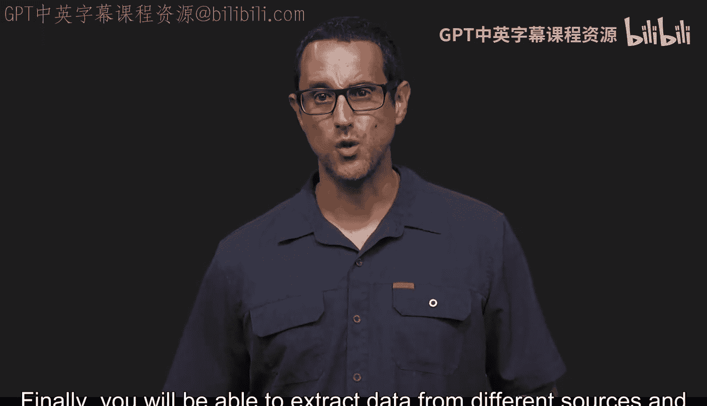

# Python、Bash和SQL数据工程基础：2-4：Python数据处理入门 🐍

在本节课中，我们将学习如何有效地使用Python的数据结构来加载、持久化和遍历数据。你将学会将这些数据结构应用于处理流行数据格式（如JSON）时遇到的不同问题。最终，你将能够从不同来源提取数据，并将其映射到Python的数据结构中。

---

## 数据结构基础

上一节我们概述了课程目标，本节中我们来看看Python中用于数据处理的核心数据结构。Python提供了几种内置的数据结构，它们是组织和存储数据的基石。

以下是三种最常用的数据结构：

*   **列表**：一种有序、可变的元素集合。使用方括号 `[]` 定义。
    *   示例：`my_list = [1, 2, 3, ‘hello’]`
*   **元组**：一种有序、**不可变**的元素集合。使用圆括号 `()` 定义。
    *   示例：`my_tuple = (1, 2, ‘world’)`
*   **字典**：一种无序的键值对集合。使用花括号 `{}` 定义，键和值之间用冒号 `:` 分隔。
    *   示例：`my_dict = {‘name’: ‘Alice’, ‘age’: 25}`

---

## 数据加载与遍历

理解了基本数据结构后，我们来看看如何将数据加载到这些结构中并进行遍历。这是数据处理的第一步。

以下是加载和遍历数据的常用方法：

*   **从文件加载**：使用 `open()` 函数和 `read()` 方法读取文本文件内容。
    *   示例：`with open(‘data.txt’, ‘r’) as file: data = file.read()`
*   **遍历列表**：使用 `for` 循环可以轻松访问列表中的每个元素。
    *   示例：`for item in my_list: print(item)`
*   **遍历字典**：使用 `.items()` 方法可以同时获取字典的键和值。
    *   示例：`for key, value in my_dict.items(): print(key, value)`

---

## 处理JSON数据

在实际工作中，JSON是一种极其常见的数据交换格式。Python的 `json` 模块使得处理JSON数据变得非常简单。

以下是处理JSON数据的关键步骤：

*   **解析JSON字符串**：使用 `json.loads()` 函数将JSON格式的字符串转换为Python字典或列表。
    *   示例：`import json; python_data = json.loads(‘{“name”: “Bob”}’)`
*   **读取JSON文件**：使用 `json.load()` 函数直接从JSON文件中读取数据并转换为Python对象。
    *   示例：`with open(‘data.json’, ‘r’) as f: data = json.load(f)`
*   **将Python对象转为JSON**：使用 `json.dumps()` 函数将Python字典或列表转换回JSON格式的字符串。
    *   示例：`json_string = json.dumps(my_dict)`

---

## 数据提取与映射

最后，我们将综合运用以上知识，学习如何从不同来源（如API、数据库或CSV文件）提取数据，并将其映射到合适的Python数据结构中，以便进行进一步的分析和处理。

以下是数据提取与映射的基本思路：

*   **确定数据源**：明确数据来自哪里（例如，一个网络API的URL，一个本地数据库，或一个CSV文件）。
*   **提取原始数据**：使用相应的方法获取原始数据（如 `requests.get()` 用于API，`pandas.read_csv()` 用于CSV文件）。
*   **清洗与转换**：将原始数据（通常是字符串或特定格式）转换为Python数据结构（如列表、字典）。这可能涉及解析JSON、分割字符串等操作。
*   **结构化存储**：将转换后的数据存储到设计好的数据结构中，为后续操作做好准备。

---

本节课中我们一起学习了Python数据处理的核心流程。我们从列表、元组和字典这些基础数据结构开始，掌握了如何加载和遍历数据。接着，我们深入探讨了如何处理常见的JSON格式数据。最后，我们了解了从多种数据源提取信息并将其映射到Python对象中的完整思路。掌握这些技能是成为一名高效数据工程师的重要第一步。