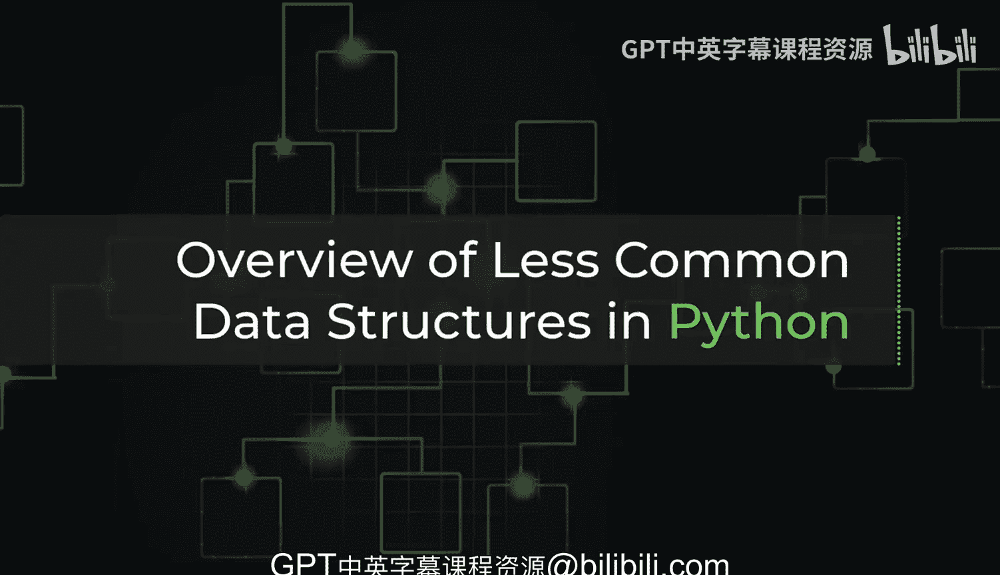
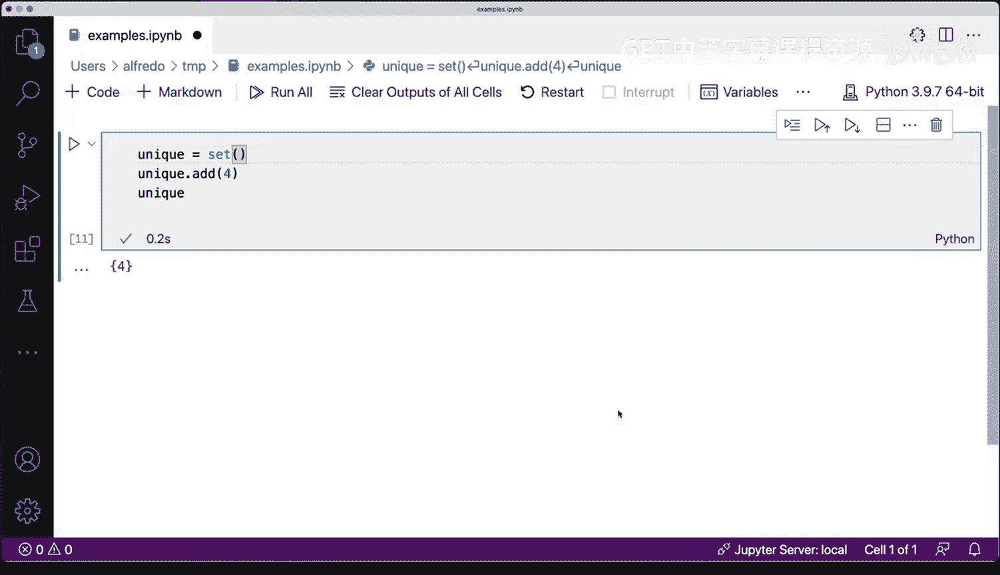

# Python数据工程基础：2-4：Python非常见数据结构概览 🐍



在本节课中，我们将学习Python中两种相对不那么常见但非常有用的数据结构：元组（Tuple）和集合（Set）。我们将了解它们的特点、创建方式以及适用场景。

---

## 元组：不可变的序列 📦

上一节我们介绍了列表等常见数据结构，本节中我们来看看元组。元组类似于一个**只读**的列表。一旦创建，其内容就无法被修改。

元组的声明方式是使用圆括号 `()`，而不是列表的方括号 `[]` 或字典的花括号 `{}`。

```python
# 创建一个元组
read_only = ("Item 1", "Item 2")
print(read_only)  # 输出：('Item 1', 'Item 2')
```

以下是关于元组的一些关键操作：

*   **访问元素**：你可以像列表一样通过索引来检索元素。
    ```python
    print(read_only[0])  # 输出：Item 1
    print(read_only[1])  # 输出：Item 2
    ```
*   **不可修改性**：尝试修改元组（例如添加、删除或更改元素）会导致错误。
    ```python
    read_only.append("Item 3")  # 这会引发 AttributeError
    ```

元组适用于存储不应被程序意外更改的数据集合。

---

## 集合：唯一元素的容器 🧺

接下来，我们探讨集合。集合的主要特性是它只包含**唯一**的元素，会自动去除所有重复项。

集合的声明方式是使用花括号 `{}`，这与字典相同，但集合内部是单个元素，而不是键值对。

```python
# 创建一个集合
unique = {1, 2, 3, 1, 1}
print(unique)  # 输出：{1, 2, 3}
print(type(unique))  # 输出：<class 'set'>
```

以下是集合的一些基本操作：

*   **添加元素**：使用 `.add()` 方法向集合中添加新元素。如果元素已存在，则不会有任何效果。
    ```python
    unique.add(1)  # 集合不变，因为1已存在
    unique.add(4)  # 添加新元素4
    print(unique)  # 输出：{1, 2, 3, 4}
    ```
*   **创建空集合**：要创建一个空集合，必须使用 `set()` 函数。直接使用 `{}` 创建的是空字典。
    ```python
    empty_set = set()
    print(empty_set)  # 输出：set()
    ```

当你需要确保容器中元素的唯一性，或者需要进行集合运算（如交集、并集）时，集合是一个理想的选择。

---

## 总结 📝

本节课中我们一起学习了Python的两种非常见数据结构：
1.  **元组**：使用圆括号 `()` 定义，是一种**不可变**的序列，适用于存储不应更改的数据。
2.  **集合**：使用花括号 `{}` 定义或 `set()` 函数创建，是一种**元素唯一**的无序集合，能自动去重。



理解这些数据结构的特点，能帮助你在数据工程任务中选择最合适的工具来高效处理数据。