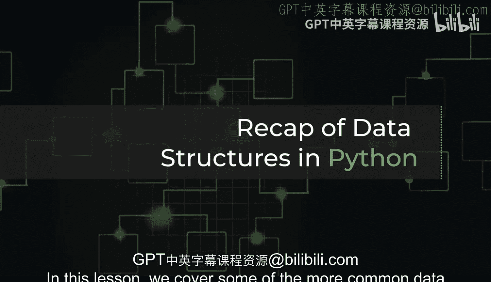

# Python、Bash和SQL数据工程基础：2-4：Python数据结构回顾 🐍

在本节课中，我们将回顾Python中一些更常见的数据结构。你将学习到列表、字典，以及根据数据处理工作的类型可能用到的元组和集合等不太常见的数据结构。

## 概述 📋

在Python中处理数据时，选择合适的数据结构至关重要。如果你需要存储一系列有序的元素，你可能会使用列表；如果你需要映射键和值，你肯定会用到字典；如果你追求元素的唯一性，集合可能更合适；而如果你需要一个类似列表的只读容器，那么元组或许是你的选择。掌握这些数据结构将帮助你更有效地管理Python中的工作负载，提升数据处理效率。

## 核心数据结构详解


上一节我们概述了Python中几种主要的数据结构，本节中我们将逐一深入探讨它们的特点和用法。

### 列表



列表是Python中最基础、最常用的数据结构之一。它是一个有序、可变的集合，可以包含不同类型的元素。

以下是列表的基本操作示例：

```python
# 创建一个列表
my_list = [1, 2, 3, ‘hello‘, 5.0]

# 访问元素（索引从0开始）
first_element = my_list[0]  # 结果为 1

# 修改元素
my_list[1] = ‘world‘

# 添加元素
my_list.append(‘new item‘)

# 删除元素
del my_list[2]
```

### 字典

字典用于存储键值对，它基于键来快速检索值，是无序但可变的集合。

以下是字典的基本操作示例：

```python
# 创建一个字典
my_dict = {‘name‘: ‘Alice‘, ‘age‘: 30, ‘city‘: ‘New York‘}

# 通过键访问值
name = my_dict[‘name‘]  # 结果为 ‘Alice‘

# 添加或修改键值对
my_dict[‘job‘] = ‘Engineer‘
my_dict[‘age‘] = 31

# 删除键值对
del my_dict[‘city‘]
```

### 元组

元组与列表类似，都是有序的集合。但关键区别在于，元组是不可变的，创建后不能修改其内容。这使其适合用作只读的数据容器。

以下是元组的基本操作示例：

```python
# 创建一个元组
my_tuple = (1, 2, 3, ‘apple‘)

# 访问元素（与列表相同）
second_element = my_tuple[1]  # 结果为 2

# 尝试修改元组会导致错误
# my_tuple[1] = ‘banana‘  # 这行代码会引发 TypeError
```

### 集合

集合是一个无序的、不重复元素的集合。它的主要用途是进行成员关系测试和消除重复项，并支持数学上的集合运算，如并集、交集等。

以下是集合的基本操作示例：

```python
# 创建一个集合
my_set = {1, 2, 3, 3, 4}  # 重复的3会被自动去除，结果为 {1, 2, 3, 4}

# 添加元素
my_set.add(5)

# 移除元素
my_set.remove(2)

# 集合运算
set_a = {1, 2, 3}
set_b = {3, 4, 5}
intersection = set_a & set_b  # 交集，结果为 {3}
union = set_a | set_b         # 并集，结果为 {1, 2, 3, 4, 5}
```

## 如何选择合适的数据结构

了解了每种数据结构的特点后，选择哪一个取决于你的具体需求。以下是选择时的关键考量点：

*   **需要有序且可变的序列吗？** -> 使用 **列表**。
*   **需要通过唯一的键来快速查找关联的值吗？** -> 使用 **字典**。
*   **需要一个保证元素唯一性的无序集合吗？** 或 **需要进行集合运算（如求交集、并集）吗？** -> 使用 **集合**。
*   **需要一个有序但创建后内容不可变的轻量级容器吗？** -> 使用 **元组**。


## 总结 🎯

本节课中我们一起学习了Python的四种核心数据结构：**列表**、**字典**、**元组**和**集合**。我们明确了列表的有序可变性、字典的键值对映射能力、元组的不可变性以及集合的元素唯一性和集合运算功能。理解并熟练运用这些数据结构，是使用Python高效管理和处理数据的基石。