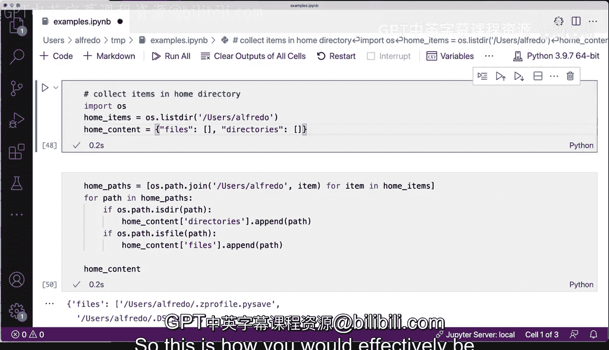

# Python、Bash和SQL数据工程基础：2-4：Python数据结构间的数据存储 📂


在本节课中，我们将学习如何遍历数据结构，并根据特定条件创建新的数据结构或将数据从一个结构移动到另一个结构。具体来说，我们将通过一个实际例子来演示：如何遍历用户主目录的内容，并将文件和目录清晰地分离开来。

## 概述

我们将从列出主目录的内容开始，然后使用Python的`os`模块来区分文件和目录。最终，我们会将这些信息存储在一个字典中，以便后续操作。

## 实现步骤

首先，我们需要导入`os`模块，并列出主目录的内容。

```python
import os

home_items = os.listdir('/users/Alfredo')
```

`home_items`现在是一个包含主目录下所有文件和目录名称的列表。然而，这些只是字符串，并非绝对路径。为了后续能准确判断它们是文件还是目录，我们需要将其转换为绝对路径。

以下是转换方法：

```python
home_paths = [os.path.join('/users/Alfredo', item) for item in home_items]
```

现在，`home_paths`列表包含了所有项目的完整绝对路径。

接下来，我们将创建一个字典来分别存储文件和目录。我们初始化一个名为`home_content`的字典，其中包含两个键：`files`和`directories`，它们的初始值都是空列表。

```python
home_content = {
    'files': [],
    'directories': []
}
```

现在，我们需要遍历`home_paths`列表中的每个路径，并根据其类型（文件或目录）将其添加到`home_content`字典的相应列表中。

以下是实现这一逻辑的代码：

```python
for path in home_paths:
    if os.path.isdir(path):
        home_content['directories'].append(path)
    elif os.path.isfile(path):
        home_content['files'].append(path)
```

通过这个循环，我们成功地将所有目录路径添加到了`home_content['directories']`列表中，将所有文件路径添加到了`home_content['files']`列表中。

## 结果验证

现在，我们可以分别访问和操作这些分组后的数据。例如，我们可以打印出所有的文件路径：

```python
for item in home_content['files']:
    print(item)
```

## 总结



本节课中，我们一起学习了如何在Python数据结构之间存储和转移数据。我们从使用`os.listdir`获取的一个简单列表开始，通过列表推导式将其转换为绝对路径列表。然后，我们创建了一个字典来清晰地分离文件和目录，并使用一个`for`循环和`os.path`模块的条件判断来填充这个字典。最终，我们得到了一个结构化的数据容器，可以方便地对文件和目录进行单独处理。这个过程展示了如何根据条件筛选数据并构建新的、更有组织的数据结构。