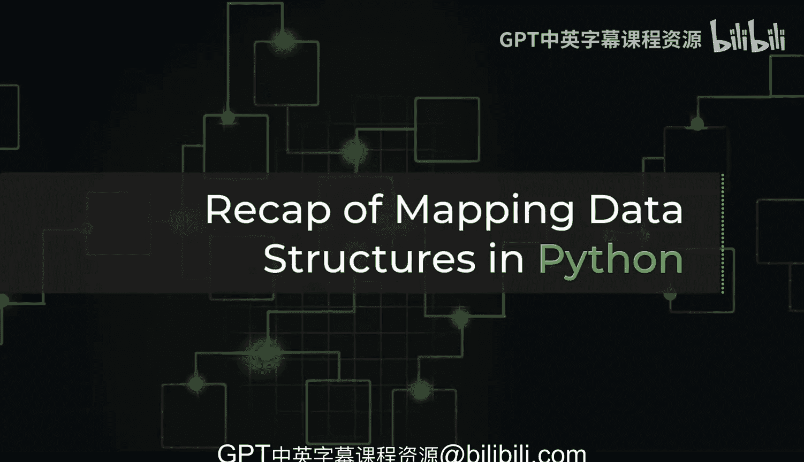

# Python、Bash和SQL数据工程基础：2-4：Python数据结构映射回顾 🗺️

在本节课中，我们将回顾Python中映射数据结构（主要是字典）的核心概念，并学习如何通过循环遍历数据来提取信息、进行分组和做出决策。这对于数据工程任务至关重要。

## 概述

我们已经学习了如何循环遍历数据、不同类型的数据结构，以及如何有效地创建新的分组和新的数据结构类型，以便在处理数据时以有意义的方式存储内容。这是必不可少的，因为在处理数据的过程中，你经常会遇到需要深入数据内部、确定其某些特征并尝试据此做出决策的情况。因此，能够通过循环遍历来提取数据，是你数据工程技能中的关键部分。


## 映射数据结构：字典



在Python中，字典是实现映射的主要数据结构。它将**键**映射到**值**，允许你通过唯一的键来快速访问、插入或删除相关联的值。

字典的创建和使用非常简单。以下是其核心语法：

```python
# 创建一个字典
my_dict = {
    "key1": "value1",
    "key2": "value2",
    "key3": "value3"
}

# 通过键访问值
print(my_dict["key1"])  # 输出: value1

# 添加或修改键值对
my_dict["key4"] = "value4"
```

## 循环遍历字典

为了检查或处理字典中的数据，我们需要遍历它。Python提供了几种遍历字典的方法。

以下是遍历字典的几种主要方式：

*   **遍历所有键**：使用 `for key in my_dict:` 或 `for key in my_dict.keys():`。
*   **遍历所有值**：使用 `for value in my_dict.values():`。
*   **同时遍历键和值**：使用 `for key, value in my_dict.items():`。

## 数据提取与决策

上一节我们介绍了如何遍历字典。本节中我们来看看如何在实际场景中应用这些循环来提取数据并基于数据特征做出决策。

例如，你可能需要检查一个字典中的所有值是否都符合某个条件（如都是正数），或者根据某些规则对数据进行分组。

以下是一个简单的示例，演示了如何遍历列表中的字典，并提取满足特定条件的数据：

```python
# 假设我们有一个包含用户信息的字典列表
users = [
    {"name": "Alice", "age": 30, "active": True},
    {"name": "Bob", "age": 25, "active": False},
    {"name": "Charlie", "age": 35, "active": True}
]

# 提取所有活跃用户的姓名
active_users = []
for user in users:
    if user["active"]:  # 检查“active”键的值是否为True
        active_users.append(user["name"])

print(active_users)  # 输出: ['Alice', 'Charlie']
```

## 数据规范化任务

在处理数据时，经常需要进行规范化操作，例如修改数据格式，或者验证数据结构是否符合要求。

例如，你可能需要确保某个列表中的所有元素都是字符串类型，或者确保一个字典包含所有必需的键。

以下是一个检查并修正数据的例子：

```python
# 一个可能包含非字符串年龄值的列表
data_list = ["25", 30, "thirty-five", "40"]

# 目标：将所有元素转换为整数，无法转换的标记为None
normalized_list = []
for item in data_list:
    try:
        normalized_list.append(int(item))
    except (ValueError, TypeError):
        normalized_list.append(None)  # 无法转换为整数，存入None

print(normalized_list)  # 输出: [25, 30, None, 40]
```

## 总结

本节课中我们一起学习了Python映射数据结构（字典）的回顾与应用。我们重点掌握了如何通过循环遍历字典来提取关键信息，以及如何利用这些技术进行数据检查和基本的规范化任务，例如筛选特定条目和转换数据类型。这项技能是数据工程的基础，能帮助你在深入探索数据集、清洗数据并使其满足分析需求方面取得进展。