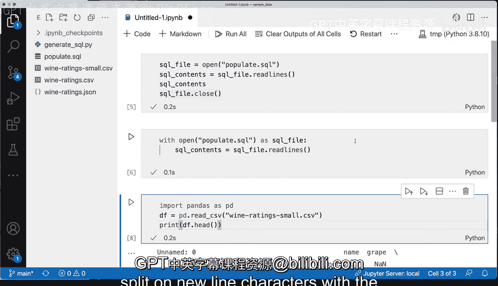

# 数据工程基础：2-4：从文件与文件路径加载数据到Python 📂


在本节课中，我们将要学习如何在Python中从文件和文件路径加载数据。根据您要处理的数据类型以及Python或其库的支持情况，这个过程可能会有些技巧性。

## 概述

我们将从最简单的纯文本文件读取开始，逐步介绍不同文件格式（如SQL、CSV）的加载方法，并比较手动管理与使用上下文管理器管理文件资源的区别。最后，我们会了解如何使用像Pandas这样的库来高效处理结构化数据文件。

## 从纯文本文件读取数据

在Python中读取常规的纯文本文件是最基础的起点。您可以使用相对路径或绝对路径来指定文件。为了确保打开正确的文件，使用绝对路径是更可靠的做法。

以下是一个简单的示例，展示了如何打开并读取一个名为`populate.sql`的SQL文件。

```python
# 打开文件
sql_file = open('populate.sql')
# 读取整个文件内容到一个字符串
sql_contents = sql_file.read()
# 处理完毕后，必须关闭文件
sql_file.close()
```

这种方法的问题在于，您必须记住在处理完文件后手动关闭它。如果不关闭，文件句柄会一直占用系统资源。

### 逐行读取文件内容

如果您需要逐行处理文件内容，使用`read()`方法将整个内容作为一个字符串返回可能不太方便。这时，`readlines()`方法是一个更好的选择。

以下是使用`readlines()`方法的示例：

```python
# 打开文件
sql_file = open('populate.sql')
# 读取所有行到一个列表中
sql_lines = sql_file.readlines()
# 关闭文件
sql_file.close()
```

`readlines()`方法返回一个列表，其中每个元素都是文件中的一行（以换行符分隔）。这使得逐行处理数据变得非常简单。

## 使用上下文管理器管理文件

为了避免忘记关闭文件，Python提供了上下文管理器，它可以通过`with`语句自动管理资源的打开和关闭。

以下是使用上下文管理器读取文件的示例：

```python
# 使用with语句自动管理文件
with open('populate.sql') as sql_file:
    sql_contents = sql_file.readlines()
# 当退出with代码块时，文件会自动关闭
```

使用`with open(...) as ...:`的语法，可以确保文件在代码块执行完毕后被正确关闭，无需手动调用`close()`方法。这是一种更安全、更简洁的文件操作方式。

## 使用Pandas库读取CSV文件

对于特定格式的文件，如CSV（逗号分隔值），使用专门的库（如Pandas）通常更加高效和方便。Pandas是一个强大的数据分析库，可以轻松处理大型数据集。

首先，需要导入Pandas库。通常我们使用`pd`作为其别名。

```python
import pandas as pd
```

导入库后，可以使用`read_csv()`函数来读取CSV文件。

以下是读取名为`wine_rating_small.csv`的CSV文件的示例：

```python
# 使用Pandas读取CSV文件
df = pd.read_csv('wine_rating_small.csv')
```

读取后，数据被加载到一个称为DataFrame的Pandas数据结构中。您可以使用`head()`方法快速查看数据的前几行。

```python
# 查看数据的前几行
print(df.head())
```

这种方法不仅代码简洁，而且Pandas提供了丰富的数据操作功能，非常适合处理表格型数据。

## 总结

本节课中，我们一起学习了在Python中从文件和文件路径加载数据的几种核心方法：

1.  **读取纯文本文件**：使用`open()`、`read()`和`readlines()`函数，并注意手动关闭文件或使用上下文管理器自动管理。
2.  **使用上下文管理器**：通过`with`语句安全地处理文件，避免资源泄漏。
3.  **利用专业库处理特定格式**：例如使用Pandas的`read_csv()`函数高效读取和处理CSV文件。



选择哪种方法取决于您的具体需求：处理通用文本文件，还是处理具有特定结构的格式化数据。掌握这些基础技能，是进行有效数据工程处理的第一步。