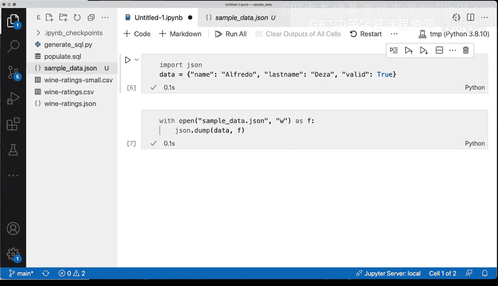

# Python、Bash和SQL数据工程基础：2-4：将Python数据保存到磁盘 💾


在本节课中，我们将学习如何使用Python的`json`模块，将Python数据结构（如字典）保存到磁盘上的JSON文件中。这是一个将程序中的数据持久化存储的基础操作。

---

上一节我们介绍了如何从文件中读取JSON数据。本节中我们来看看如何将Python数据写入文件。

首先，我们需要导入`json`模块。

```python
import json
```

接下来，我们创建一个Python字典作为示例数据。

```python
data = {}
```

以下是写入JSON文件的核心步骤：

我们将使用`open()`函数打开一个文件用于写入。这需要一个特殊的标志`'w'`，它代表“写入”模式。然后，我们使用`json.dump()`方法将数据对象写入这个已打开的文件。

```python
with open('sample_data.json', 'w') as f:
    json.dump(data, f)
```

让我们详细解释一下这段代码：
1.  `with open('sample_data.json', 'w') as f:` 这行代码打开（或创建）一个名为`sample_data.json`的文件。`'w'`标志表示我们将写入这个文件。`f`是分配给这个已打开文件的变量名。
2.  `json.dump(data, f):` 这行代码调用`json.dump()`函数。它接收两个参数：第一个是要保存的Python数据对象（这里是`data`字典），第二个是已打开的文件对象（`f`）。`dump()`函数负责将数据转换为JSON格式并写入文件。

运行这段代码后，会在当前目录生成一个`sample_data.json`文件。目前，由于`data`字典是空的，文件内容将是一个空对象`{}`。

现在，让我们用一些实际数据来填充字典，并再次保存。

```python
data = {
    "name": "Alfredo",
    "last_name": "Deza"
}
```

再次运行写入代码。请注意，由于我们使用了`'w'`模式，它会覆盖之前文件的内容。新的`sample_data.json`文件将包含转换后的JSON数据。

JSON格式与Python格式有一些区别。例如，Python中的布尔值`True`在JSON中会转换为小写的`true`。`json.dump()`方法会自动处理这些转换。

```python
data_with_bool = {"active": True}
# 保存后，JSON文件中的内容将是 {"active": true}
```



本节课中我们一起学习了如何使用`json.dump()`方法将Python数据结构保存到JSON文件。你只需要提供一个数据对象和一个以写入模式打开的文件对象即可。这是实现数据持久化、在不同程序间共享数据或为后续处理保存中间结果的关键技能。