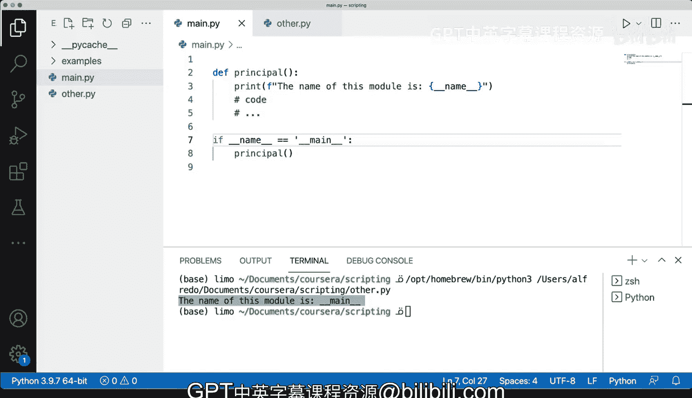

# Python、Bash和SQL数据工程基础：2-4：在Python中创建模块化脚本 🐍


在本节课中，我们将要学习如何在Python中创建模块化脚本。我们将重点理解 `__name__` 变量的作用，以及如何利用它来编写既能作为独立脚本运行，又能作为模块被其他文件导入的Python代码。

## 理解 `__name__` 变量

在Python中，每个模块都有一个内置的变量 `__name__`。这个变量的值取决于你如何运行这个Python文件。

*   当你**直接运行**一个Python文件时，该文件中的 `__name__` 变量会被设置为字符串 `"__main__"`。
*   当一个Python文件被**作为模块导入**到另一个文件中时，该文件中的 `__name__` 变量会被设置为该**模块的名字**（通常是文件名去掉 `.py` 后缀）。

这个机制是编写模块化代码的关键。

## 一个简单的示例

让我们通过一个简单的例子来观察 `__name__` 的行为。假设我们有一个名为 `main.py` 的文件，其内容如下：

```python
print(f"The name of this module is {__name__}")
```

如果我们直接在终端运行这个文件：
```bash
python main.py
```
输出将会是：
```
The name of this module is __main__
```
这是因为我们直接运行了 `main.py`，所以它的 `__name__` 被设置为 `"__main__"`。

现在，我们创建另一个名为 `other.py` 的文件，它导入了 `main` 模块：
```python
import main
```
当我们运行 `other.py` 时：
```bash
python other.py
```
输出将会是：
```
The name of this module is main
```
此时，`main.py` 是被导入的模块，因此它的 `__name__` 是其模块名 `"main"`，而不是 `"__main__"`。

## 编写模块化脚本的标准模式

理解了 `__name__` 的差异后，我们就可以编写更健壮的代码。我们不希望模块在被导入时，其顶层的代码（如打印语句、数据处理）自动执行，产生“副作用”。我们通常希望这些代码只在文件被直接运行时才执行。

以下是实现这一点的标准模式：

1.  **将主要逻辑封装在一个函数中**（通常命名为 `main` 或 `principal`）。
2.  **使用 `if __name__ == "__main__":` 条件判断**，来确保这个函数只在文件被直接运行时才被调用。

让我们重构 `main.py` 文件：

```python
def principal():
    """这是主要的执行函数。"""
    print(f"The name of this module is {__name__}")
    # 在这里编写你的主要处理逻辑
    # 例如：预处理数据、调用其他函数等

if __name__ == "__main__":
    principal()
```

现在，当我们直接运行 `main.py` 时，`principal()` 函数会被调用，输出和之前一样。但是，当 `main.py` 被 `other.py` 导入时，`principal()` 函数**不会自动执行**，因为我们没有在 `other.py` 中调用它。这避免了意外的副作用。

## 总结

本节课中我们一起学习了Python模块化脚本的核心概念。



*   我们了解了 `__name__` 这个特殊变量，它根据文件是直接运行还是被导入而具有不同的值（`"__main__"` 或模块名）。
*   我们学习了编写模块化脚本的标准模式：将主要逻辑放入一个函数（如 `main`），并使用 `if __name__ == "__main__":` 这个条件判断来调用它。
*   这种模式使得你的Python文件既可以作为一个独立的脚本运行，也可以安全地作为一个功能模块被其他代码导入和使用，是编写可复用、结构清晰的Python代码的基础。