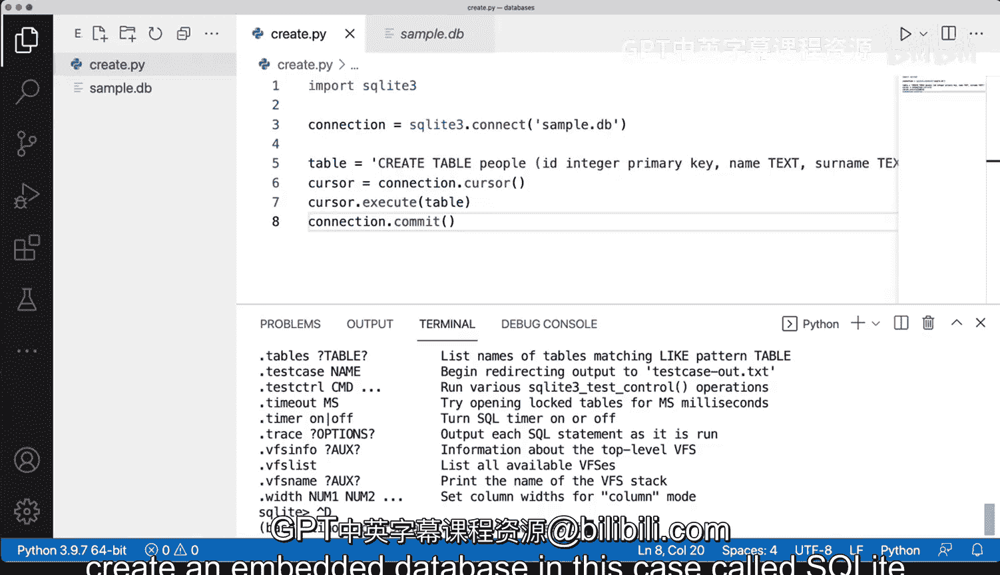

# Python、Bash和SQL数据工程基础：2-4：在Python中创建与连接SQLite数据库


在本节课中，我们将学习如何使用Python创建和连接SQLite数据库。SQLite是一个轻量级的嵌入式数据库，非常适合在Python项目中进行数据存储和管理。我们将从导入必要的模块开始，逐步完成创建数据库、建立连接、定义表结构以及执行SQL命令的完整流程。

## 导入SQLite模块

首先，我们需要导入Python内置的`sqlite3`模块。这个模块是Python标准库的一部分，因此你无需安装任何额外的库。

```python
import sqlite3
```

`sqlite3`模块在大多数Python版本中都可用，这使得跨环境工作变得非常方便。

## 建立数据库连接

导入模块后，下一步是建立与数据库的连接。我们可以选择创建内存数据库或文件数据库。

### 创建内存数据库

内存数据库是一种临时数据库，程序运行结束后数据不会持久保存。创建方法如下：

```python
connection = sqlite3.connect(':memory:')
```

使用`:memory:`作为参数可以创建一个内存数据库。这在需要快速测试或处理临时数据时非常有用。

### 创建文件数据库

如果你希望数据持久化保存到文件系统中，可以指定一个文件名来创建数据库文件。

```python
connection = sqlite3.connect('sample.db')
```

以上代码会创建一个名为`sample.db`的数据库文件。你可以根据需要为数据库文件命名。

无论是内存数据库还是文件数据库，后续的操作步骤都是相同的。唯一的区别在于数据是否持久化存储。

## 定义表结构

建立连接后，我们可以定义数据库中的表结构。这需要通过编写SQL的`CREATE TABLE`语句来完成。

以下是一个创建`people`表的示例SQL语句。该表包含`id`、`name`和`surname`三个字段。

```sql
CREATE TABLE people (
    id INTEGER PRIMARY KEY,
    name TEXT,
    surname TEXT
)
```

在这个语句中：
*   `id`字段被定义为整数类型（`INTEGER`）并设置为主键（`PRIMARY KEY`）。主键能确保每条记录的唯一性，虽然这不是强制要求，但通常是个好习惯。
*   `name`和`surname`字段都被定义为文本类型（`TEXT`），用于存储字符串数据。

## 执行SQL命令

定义了SQL语句后，我们需要通过Python来执行它。这涉及到两个关键对象：**游标（Cursor）**和**提交（Commit）**。

### 创建游标

游标是数据库编程中的一个核心概念，它像一个指针，允许我们遍历和执行SQL命令。

```python
cursor = connection.cursor()
```

我们通过连接对象的`.cursor()`方法来创建一个游标。

### 执行查询

创建游标后，使用它的`.execute()`方法来运行我们之前写好的SQL语句。

```python
cursor.execute("""
    CREATE TABLE people (
        id INTEGER PRIMARY KEY,
        name TEXT,
        surname TEXT
    )
""")
```

这里，我们将创建`people`表的SQL语句传递给`.execute()`方法。

### 提交更改

执行SQL命令后，必须调用连接对象的`.commit()`方法，才能将更改（例如创建新表）永久保存到数据库中。

```python
connection.commit()
```

如果不执行提交操作，当程序结束时，所有未提交的更改都会丢失。

## 验证数据库创建

现在，我们可以运行整个Python脚本。脚本本身可能不会在控制台输出任何内容，但它的作用是创建数据库文件。

运行脚本后，你会在项目目录中看到一个名为`sample.db`的新文件。为了验证数据库和表是否成功创建，我们可以使用SQLite的命令行工具。

打开终端，导航到数据库文件所在的目录，然后输入以下命令：

```bash
sqlite3 sample.db
```

这将启动SQLite命令行界面并连接到`sample.db`数据库。连接成功后，你可以输入SQL命令来查看或操作数据。例如，输入`.tables`命令可以列出数据库中的所有表，你应该能看到刚刚创建的`people`表。

通过命令行工具，你可以直接与数据库交互，执行查询、插入数据等操作，这为调试和验证提供了便利。

## 总结



本节课中，我们一起学习了在Python中操作SQLite数据库的基础知识。我们首先导入了`sqlite3`模块，然后建立了与数据库的连接，并区分了内存数据库和文件数据库。接着，我们编写了SQL语句来定义表结构，并通过创建游标、执行查询和提交更改这一系列步骤，成功在数据库中创建了表。最后，我们使用SQLite命令行工具验证了数据库的创建结果。掌握这些步骤是使用Python进行数据存储和管理的坚实基础。