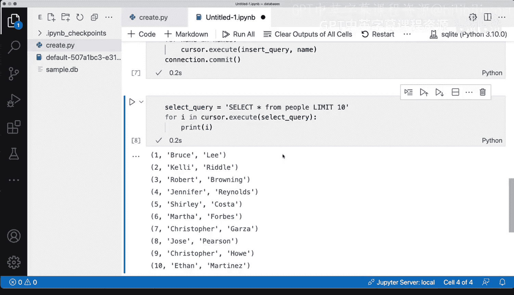

# 数据工程基础：2-4：在Python中保存与查询SQLite数据库


## 概述
在本节课中，我们将学习如何使用Python与SQLite数据库进行交互。具体内容包括：如何生成模拟数据，如何将数据插入到SQLite数据库表中，以及如何从数据库中查询数据。我们将使用Python的`sqlite3`库和`Faker`库来完成这些任务。

## 生成模拟数据
上一节我们介绍了如何创建SQLite数据库和表。本节中，我们来看看如何向表中填充数据。首先，我们需要一些数据。为了生成随机的姓名数据，我们将使用一个名为`Faker`的第三方库。

以下是安装和初始化`Faker`库的步骤：
1.  在命令行中运行 `pip install faker` 来安装库。
2.  在Python代码中导入并初始化`Faker`。

```python
from faker import Faker
fake = Faker()
```

接下来，我们生成100个随机的全名。由于我们的数据库表设计为存储“名”和“姓”两个字段，我们需要确保生成的数据符合这个格式。

```python
# 生成100个随机全名
names = [fake.name().split() for i in range(100)]
# 过滤出恰好包含两个部分（名和姓）的姓名
names = [name for name in names if len(name) == 2]
```

## 连接数据库并插入数据
现在我们已经有了数据，下一步是将其插入到之前创建的数据库表中。首先，我们需要建立与SQLite数据库文件的连接。

以下是建立数据库连接和定义插入查询的代码：
```python
import sqlite3
# 连接到已存在的数据库文件
connection = sqlite3.connect('sample.db')
cursor = connection.cursor()

# 定义插入数据的SQL语句，使用问号作为占位符
insert_query = "INSERT INTO people (name, surname) VALUES (?, ?)"
```

为了将数据插入数据库，我们需要遍历姓名列表，并使用游标执行插入操作。最后，必须提交事务以使更改生效。

以下是执行数据插入的循环代码：
```python
for name in names:
    cursor.execute(insert_query, name)
# 提交事务，保存所有插入的数据
connection.commit()
```

## 查询数据库验证结果
数据插入完成后，我们需要验证操作是否成功。最好的方法是从数据库中查询数据。

我们可以执行一个简单的`SELECT`查询来获取表中的记录。为了避免输出过多数据，我们使用`LIMIT`子句限制返回的行数。

以下是执行查询并打印结果的代码：
```python
# 定义查询语句
select_query = "SELECT * FROM people LIMIT 10"
# 执行查询
cursor.execute(select_query)
# 获取并打印所有结果
results = cursor.fetchall()
for row in results:
    print(row)
```

运行此代码后，你将看到类似 `(1, ‘John’, ‘Doe’)` 的输出，其中第一个数字是SQLite自动生成的ID，后面两列是我们插入的名和姓。

## 在命令行中验证
为了进一步确认数据已正确存储，我们可以在系统命令行中直接使用`sqlite3`工具打开数据库文件并执行相同的查询。

操作步骤如下：
1.  打开终端或命令行。
2.  导航到数据库文件所在的目录。
3.  运行命令 `sqlite3 sample.db`。
4.  在SQLite提示符下，输入 `SELECT * FROM people LIMIT 10;`。

你应该能看到与Python中查询结果一致的数据，这证明了我们的Python代码成功地与SQLite数据库进行了交互。



## 总结
本节课中我们一起学习了使用Python操作SQLite数据库的核心流程。我们首先使用`Faker`库生成了模拟数据，然后通过`sqlite3`库连接到数据库，使用参数化查询安全地插入了数据，并通过查询验证了插入结果。最后，我们还对比了在命令行中直接查询数据库的结果，确保操作的一致性。掌握这些步骤是进行数据存储和检索的基础。