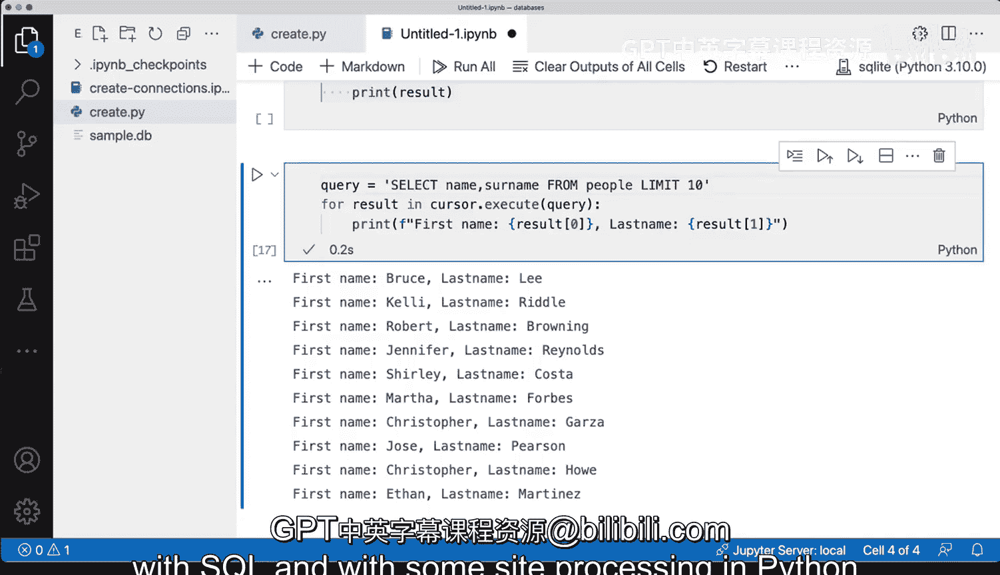

# 数据工程基础：2-4：使用SQL在Python中提取唯一数据


在本节课中，我们将学习如何结合使用SQL和Python来提取和处理数据库中的唯一数据。我们将重点介绍如何构建SQL查询来获取特定数据，以及如何在Python中处理和呈现这些查询结果。

## 概述

SQL语句的强大之处在于能够精确地获取你所需的数据。在构建查询时，有多种方法可以实现这一目标。本节将通过具体的代码示例，展示如何使用SQL的`SELECT`、`ORDER BY`和`WHERE`子句来提取数据，并演示如何在Python中执行这些查询并处理返回的结果。

## 构建基础查询

首先，我们定义一个基本的SQL查询，从`people`表中选择所有数据，并按姓名降序排列。这有助于我们以字母顺序查看数据。

```python
query = "SELECT * FROM people ORDER BY name DESC"
```

接下来，我们执行这个查询并遍历结果。

```python
for result in cursor.execute(query):
    print(result)
```

执行上述代码后，输出会从以“Z”开头的姓名开始，一直显示到以“A”开头的姓名。这是一种数据排序方式。

## 提取特定字段

如果我们只对特定的列感兴趣，可以在`SELECT`语句中明确指定字段名，而不是使用`*`。

```python
query = "SELECT name, surname FROM people ORDER BY name DESC"
```

运行修改后的查询，我们将只获得姓名和姓氏两列的数据。

## 使用WHERE子句过滤数据

为了获取更具体的数据，我们可以使用`WHERE`子句来添加过滤条件。例如，我们只想获取名为“James”的记录。

```python
query = 'SELECT name, surname FROM people WHERE name = "James"'
```

注意，在Python字符串中定义SQL查询时，如果外层使用了单引号，内层应使用双引号来避免转义问题。执行此查询将返回所有名为“James”的条目。

## 处理查询结果

查询结果返回后，我们可以在Python端进行进一步处理。例如，我们可以更友好地格式化输出，而不是直接打印整个元组。

以下是处理单个结果记录的示例。我们假设查询只返回一条记录，并分别提取姓名和姓氏。

```python
# 假设 ‘result‘ 是包含单条记录的元组，例如 (‘James‘, ‘Hopkins‘)
first_name = result[0]  # 索引0对应名字
last_name = result[1]   # 索引1对应姓氏
print(f"First name: {first_name}, Last name: {last_name}")
```

需要特别注意，我们应该对查询返回的`result`对象进行操作，而不是原始的`cursor`对象。`result`包含了从数据库获取的实际数据。

## 性能考量

在Python端处理数据（如循环、格式化）通常比在SQL查询中完成相同操作要慢。这是因为数据库引擎在处理和过滤数据方面经过了高度优化。

因此，一个重要的原则是：**尽可能利用SQL查询的力量来完成数据筛选和聚合，将结果集最小化后再传递给Python**。这样可以显著提高效率。

然而，有时为了代码的**可读性**和**可维护性**，在Python中进行一些简单的后处理也是可以接受的，尤其是在对性能要求不高的场景下。

## 总结



本节课我们一起学习了如何使用SQL在Python中提取唯一数据。我们介绍了如何通过`SELECT`语句选择特定字段，使用`ORDER BY`进行排序，以及利用`WHERE`子句进行条件过滤。同时，我们也探讨了如何在Python中接收和处理SQL查询返回的结果，并比较了在SQL端与Python端处理数据的性能差异。记住，为了效率，应优先在SQL查询中完成复杂的数据操作。