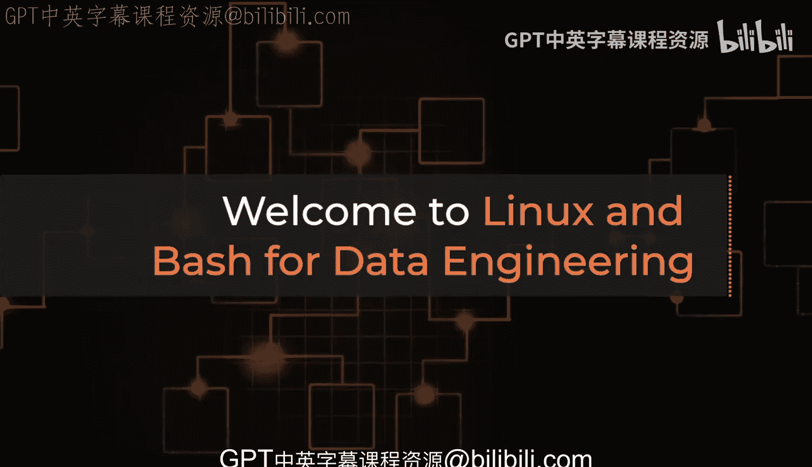

# 杜克大学｜Python、Bash和SQL数据工程基础2-4Python Bash and SQL Essentials for Data Engineering p01 01_01_02_Linux与Bash数据工程入门.zh_en -BV1XS421X7tw_p1-

Hello， my name is Noah Gift。 I'm your instructor for the course， Linux and Bsh for Data engineering。

In this course， you'll learn how to build solutions using Linux tools。

You'll also learn how to use both bash and ZSH configurations and the syntax to interact and control Linux。

This course is ideal for beginners， as well as intermediate students interested in applying ba scripts to data science。

 machine learning and data engineering。 Students should have familiarity with Linux。

By the end of this course， you'll be able to do the following。Utilize Linux tools to build solutions。

 develop bash synt and configuration to configure and control Linux and construct bash scripts。

