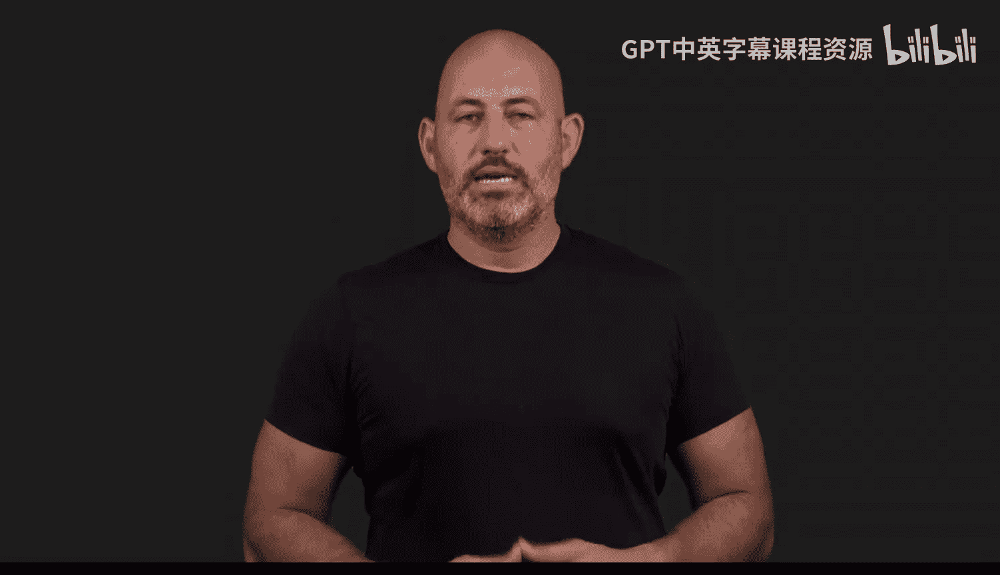

# 杜克大学｜Python、Bash和SQL数据工程基础2-4Python Bash and SQL Essentials for Data Engineering p02 02_01_03_认识课程讲师诺亚·吉夫特.zh_en -BV1XS421X7tw_p2-

Hello， my name is Noah Gift。 I'm one of the instructors for the Coursera Specialization Foundations for Data Engineering。

 I'm an adjunct professor in both the Duke Mids and E E Department。

 I have over 20 years experience in the software industry with stints and Saas， social media。

 film and games and roles ranging from consulting CTO， individual contributor。

 CTtoO and head of M L and AI。 I'm the author of over eight books。

 including Python for Devops and practical M Lops， as well as another Duke Coursera specialization。

 Cloud computing for data。😊，I'm excited to share my knowledge with you。

 Let's go ahead and get started。

