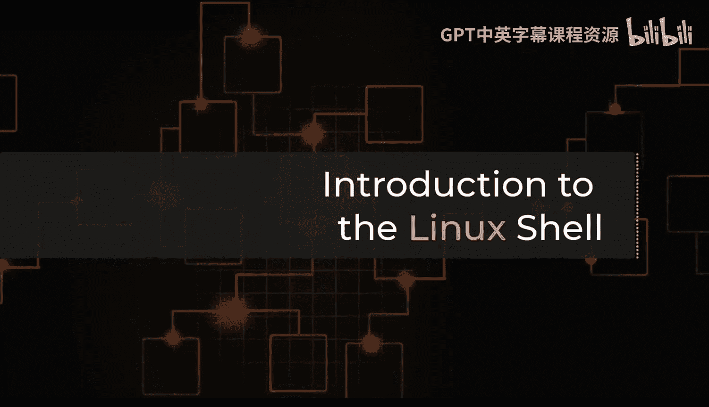
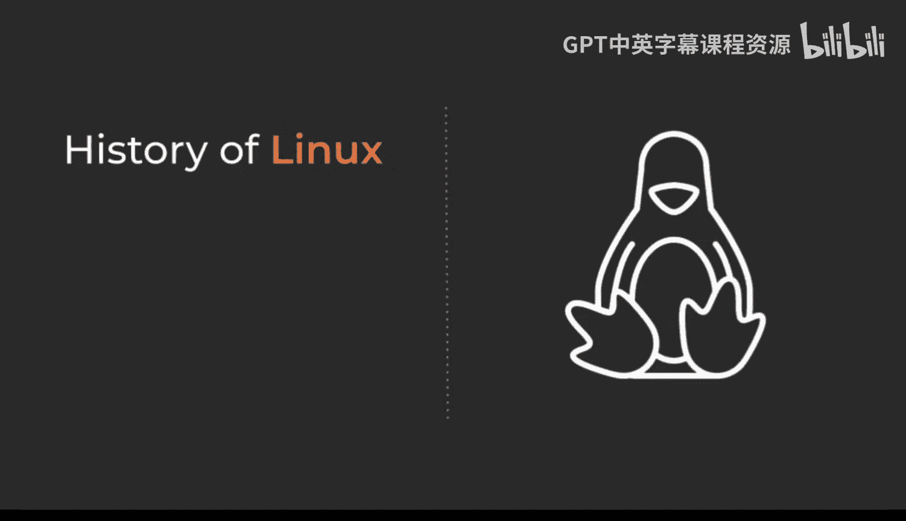
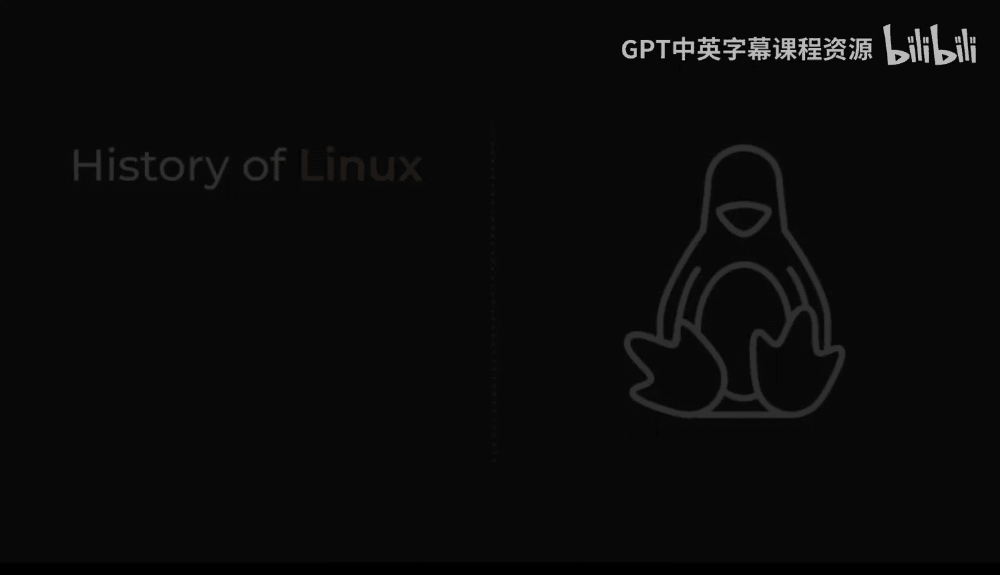

# 杜克大学｜Python、Bash和SQL数据工程基础2-4Python Bash and SQL Essentials for Data Engineering p05 05_01_03_Linux Shell简介.zh_en -BV1XS421X7tw_p5-

In this week we talked through using the Linux shell the Linux She is an environment that is really pervasive now in cloud computing。

 it's almost impossible to not come across the Linux shell if you're doing data engineering if you're doing data science you're going to come across a Linux shell even if it's in let's say a Jupipyter notebook in cloud computing in particular it's the most deployed target that you'll deal with if you're using containers you're going to have some kind of Linux environment as well it was started off as a student project in the 90s and today it's over let's say 28 million plus lines of code so let's dive into the details and talk a little bit more about how the Linux shell can be helpful to you。

In this lesson， we cover using the Linux shellll， one of the most important core components of modern cloud computing and machine learning。

What is Linux， how do you get started， that's really the first thing we're going to cover and what's important about Linux is that it's really a pervasive technology in terms of an execution environment for any code that you're working with。

We'll also get into introducing the shell environment。

 so what are some of the key things about a shell that are important。

 what can you do to make it easier for yourself with automation or you know shortcuts。

And then finally， we'll talk about different Cloud shellll environments。

 What's interesting is once you know one Cloud shellll environment。

 you typically can move into another one quite easily。 So there's AWS Cloud 9。

 which is a Cloud shellll environment。 There's also an AWS Cloudhell。 There's Google Cloudhell。

 There's Azure Cloudhell。 There's even your own terminal。 on your machine。

 We compare those different environments and see how you can actually optimize each of those workflows so that you have the most productive experience。

Now Linux itself has been around for quite some time we'll also talk about the history of Linux。

 it was started in '91 by Linus Travaldis who went to the University of Helsinki。

 he was frustrated with proprietary software and developed what is today one of the most successful open source projects of all time Well with that let's go ahead and get started and will dive deeper into both Linux and the history of Linux。

