# 杜克大学｜Python、Bash和SQL数据工程基础2-4Python Bash and SQL Essentials for Data Engineering p06 06_01_04_Linux安装与访问.zh_en -BV1XS421X7tw_p6-

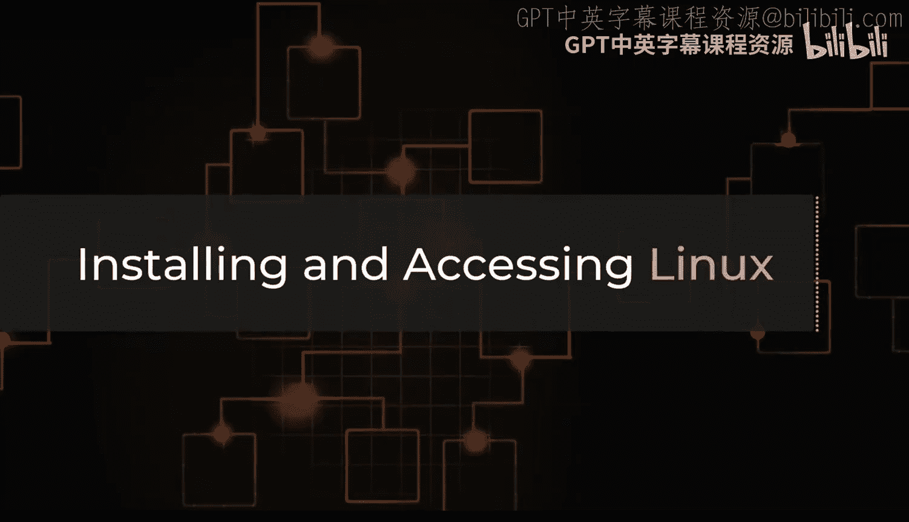

Let's go ahead and get started with Linux Linux is one of the most popular operating systems on the planet If you're going to deploy code most likely it's going be deployed to a Linux environment in the cloud or your own physical data center a bountu and Red Hat Linux or two of the most popular versions there's also cloud specific versions of Linux like for example。

 Amazon Linux in this tutorial what we're going to talk about is how to get started with Linux how do you install it what are some of the options you you can use anything from let's say your desktop with parallels or a cloudbased environment launching a VM or even using your physical workstation with Docker to actually use Linux so we'll try a few of those different flavors out and then from there you'll be able to choose which flavor and distribution and technique for Linux is best for you Let's go ahead and get started let's go ahead and get started with how to install Linux really this is the first step in using the Linux operating system and first。

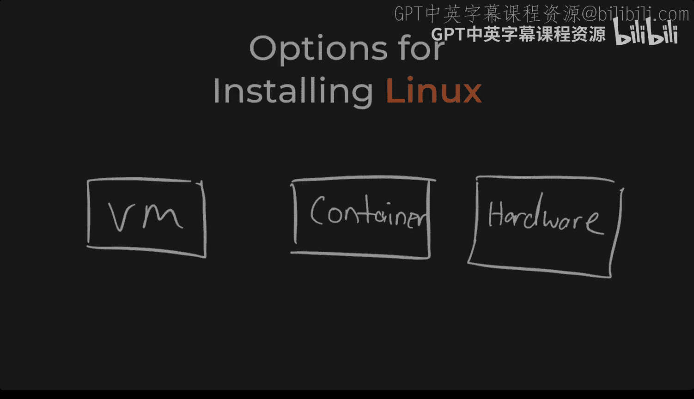

There's a few options to talk about， there's a VM right this is one of the more popular options here and with a VM you can actually do this in the cloud and this is a very common way to use Linux and really is common because ultimately that's where you're going to deploy your device another option is a VM on your desktop and that's really nice because you can actually use software like parallels or VMware or maybe some open source or free version virtualization software and that will work very nicely with desktop Windows Linux or OS10。

Another option here is a container， and there is software called Docker that allows you to run containers on your desktop machine and that's a great way to actually get started with it。

It has a very good workflow for dealing with containers and using them for development。

 Another method would be to use something like Kubernetes and use that inside of a cloud platform and this is also very common as well is that people will go through and use maybe an Amazon Kubernetes instance or a Google Kubernetes instance and a cloud somewhere and actually deploy containers that way yet another way is just physical hardware so you could install Linux on your laptop in fact I have a Dell laptop that's got Linux installed。

And I use that whenever I want to test out some specific kind of configuration。

 so there's lots of ways to really use the Linux operating system and it's up to you to choose where the location is that you're gonna install it and fortunately we're going go through step by step and show you each one of these methods Let's take a look at this Vmware software called parallels desktop So this parallels desktop allows me to use different virtual machines in this case we have abuuntu 1804 which will take a look at it in a second I could also use Mac 10 install old versions of it。

 I can install a Windows but a lot of times this is where you're going start off with if you're going to be using Linux Now notice here below we see that I have 1804 here Now how would actually use this a couple things to point out if we look at this icon here notice I told it that I have six processors I'd like it to use and 10 gigs Ram you can adjust that you can adjust things like。

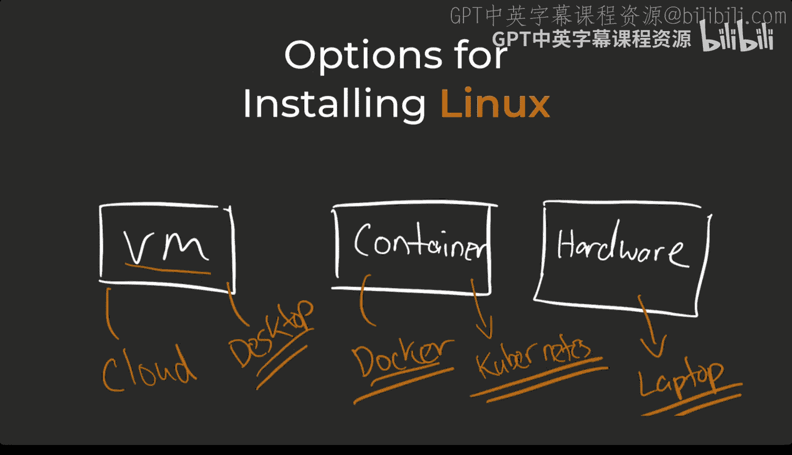

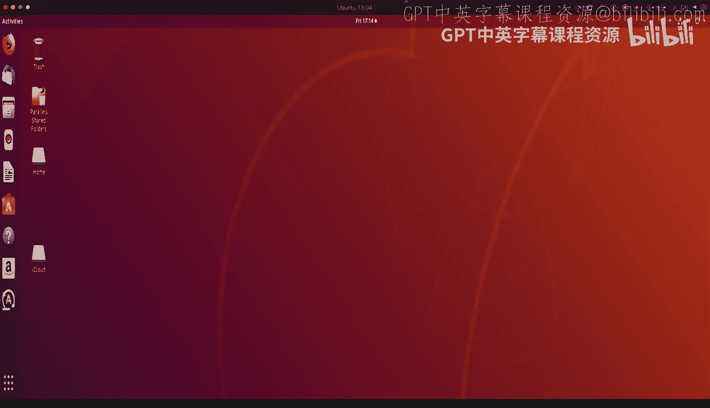

Graphics as well， there's all kinds of things that you can do to you know really treat this guest as a fullfledged citizen of your desktop now a lot of times what you'll do if you're a data engineer and you want to go in and start doing some things with Linux。

As you'll open up a terminal and I just go through here and I search for this and I find a terminal and then potentially from here I'd want to go through and manipulate something I'd want to run the LS command for example or run the top command to see what's happening on my operating system or if I wanted to。

 we could take a look at this， I could CDD into a desktop。

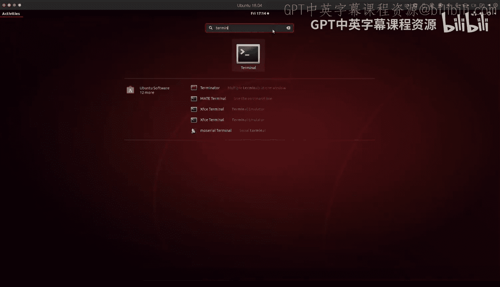

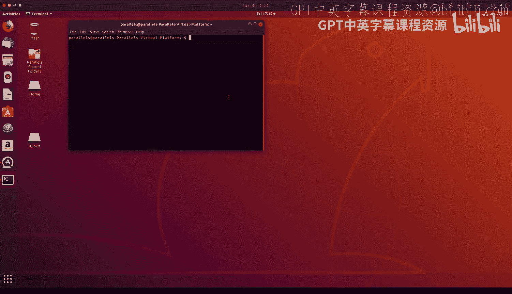

Right here。And then what I could do here is notice that I have this。Parallel shared folders。

 I could actually create a file and would say hello。

There we go and now you see that that file was created on my desktop。

 so there's a lot you can do with the terminal using a virtual machine on abuuntu。

 you can install software， update it and really have the full simulation of what it would be like to run Linux and this is what most people do when they first start using abuuntu。

Now in addition to doing the playing with this ourselves from a pre-built virtual machine。

 let me show you real quick how you could add your own， so if we go to plus here。

 notice that it gives me the ability to get Windows 10 from Microsoft to install it from a DVD or transfer it but also if we scroll down here for free systems。

 look I could download abuuntu Linux if I wanted to。

 let's go ahead and try that out and notice that abuuntu 20。04。

2 is the latest one and you can see how big it is we can just go ahead and click download and because I have 2 gigfi connection here。

 this should be extremely fast and I'm able to download a new version of abuuntu and actually play around with it so let's go ahead and take this for spin and see how easy it is to get abuuntu installed on our operating system。

Okay great。 It looks like Abuuntu was able to download in just a few seconds under a minute for me and now it's unarchiving it and and we're gonna go through an installation process。

 Now again， this is typically where the process would be for you if you're going to use abuuntu on your desktop。

 get some kind of virtualization software， download it directly into this and then go ahead and get started Now you can also go through here and actually adjust if you wanted to how much hardware you'd like to give to this particular virtual machine and typically you'll need to do that by downloading the software first so here we go you're going be required to change a password I'm going to go ahead and put a password in here type it in again。

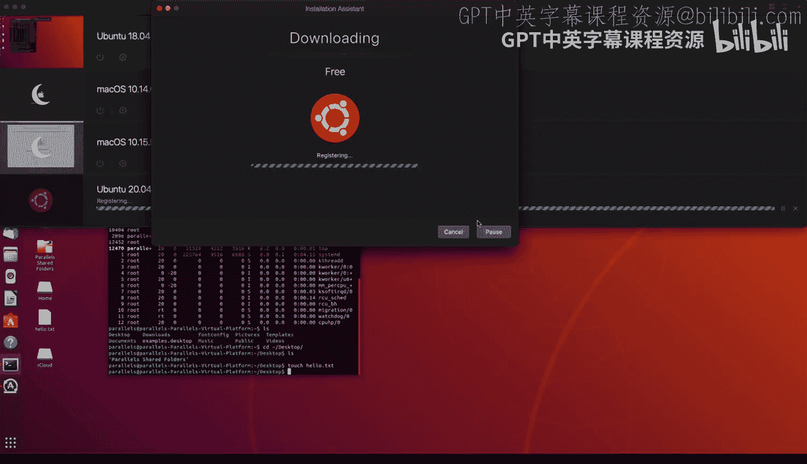

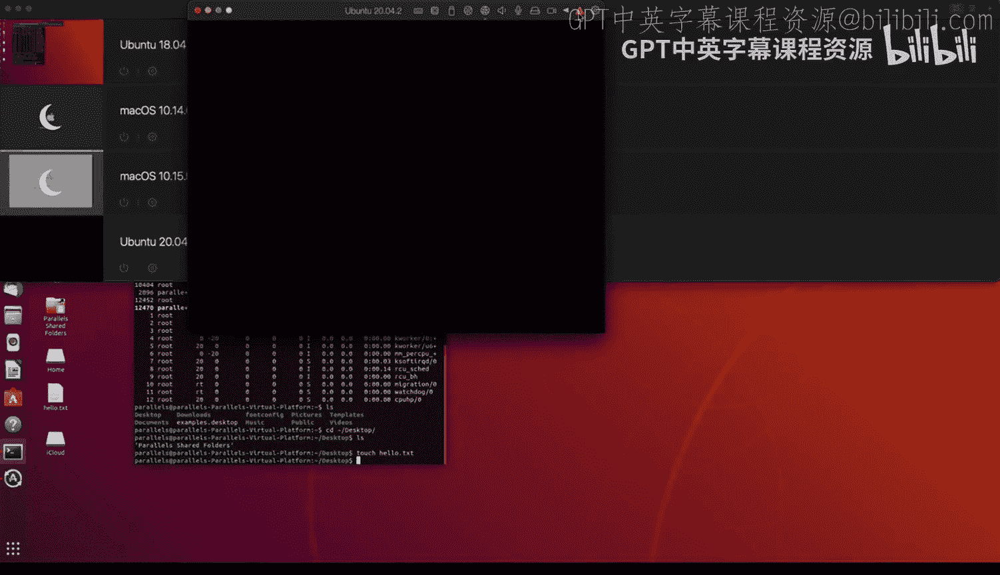

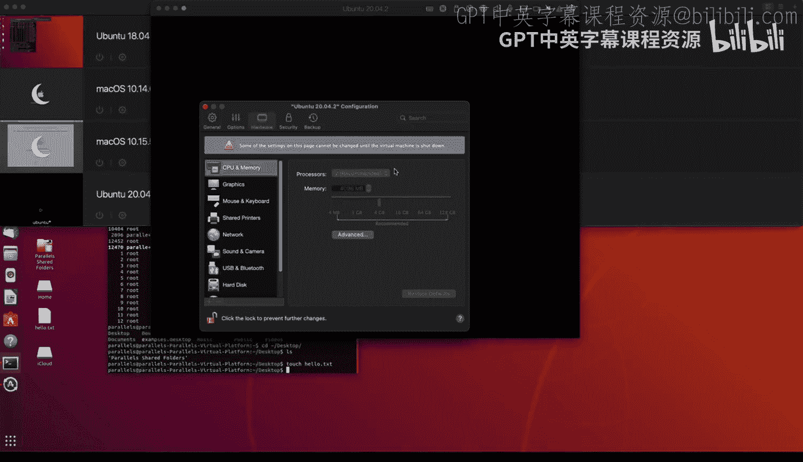

And then once I first do that installationulation， it's going to go through here and just set everything up for me。

 so it's actually fairly trivial to actually go through here and set up abuuntu and you can walk walk through this whole set up yourself and from here you're ready to go now in this particular scenario here because I'm using a software called parallels I'm going to install some tools but it would be very similar with other commercial software but in a nutshell very simple process and now we can move on to Docker so let's go ahead and do that。

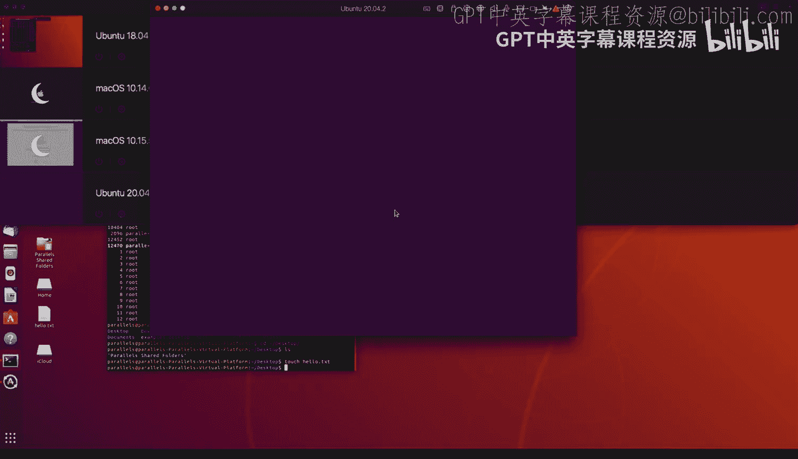

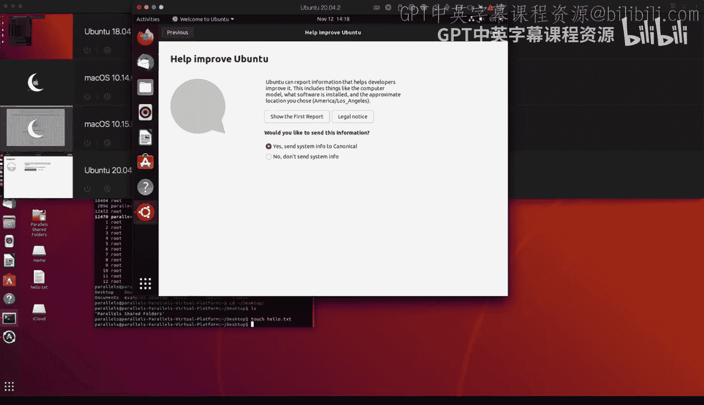

Now let's take a look at method2， which is Docker Its software you install on your desktop in here we see the Docker configuration and notice if I go through here and I click on this icon here。

 it gives me the ability to tweak things a little bit so you can see do I want to start Docker when I log in also if I go to resources I can choose how many CPUs I want to dedicate to Docker and how much memory I have a pretty powerful machine so I can dedicate a lot of resources to it。

 and then also I could choose whether I want to do Kubernetes which is a container management system or do software updates Now because I have Docker running right here。

 what's nice is in this terminal right here under OS 10。

I can just type in type in Docker P and it'll show me what's running and at this point we have nothing running。

 so let's go ahead and run a bountu container， so I'll type in Docker run IT。

And then do abuuntu and notice it's able to look to see if the Docker container is local。

 it isn't now we can see that it's actually giving me access to Docker and if I type in you name。

Dash a look at this is running Linux。 So even though this is OS 10。

 I'm actually able to shell right into Linux and play around with it and do whatever ever I need to do。

 So this is in a way， probably the simplest possible method to use a bountu or to use some kind of a Linux operating system is to run it in Docker。

Notice again， if I go through and I say Docker P now we've actually got a container running。

 So there's a lot to like about this Docker method and it's something I use quite a bit。

 Now let's move on to a third method which is actually using the cloud itself to launchbuuntu virtual machine or a other type of Linux virtual machine。

 So I'm going to go ahead and move this over here and cover this up。

 and let's actually move into Amazon cloud here。 So we'll go to Amazon console and what's great about this Amazon console。

😊。

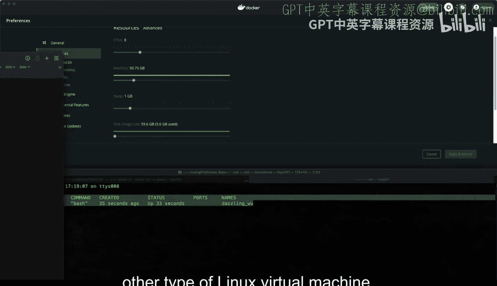

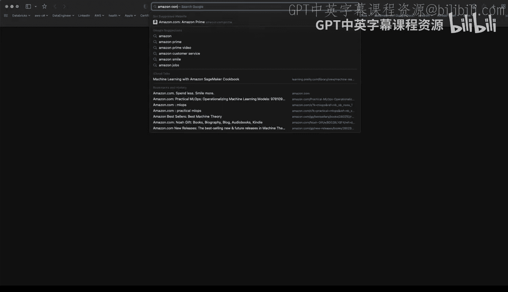

Is if I go through here and I say sign in that。We're able to authenticate quickly。

Here we go And then from here I can look I can just launch a virtual machine。

 So this is really kind of the defaults of the operating system。

 you know you know when you run into the cloud is go in launch a virtual machine and if we look at this look I can even launch OS 10 I can launch other things but I want to go through and do Linux because that's going to be the same deployed environment as what I would build as a data engineer that's going and select this and notice it's going give me some options here about what to choose let's just go ahead and say review and launch。

And we'll go through here and just launch this thing Now I can go ahead and say sure I acknowledge this yeah I want to go ahead and use this instance and then again it just very quickly goes through and launches the instance and I can actually watch this thing spin up and we notice that it's an a pending state and eventually what will happen is that it will give me the ability if I wanted to to just shell right into this machine via the SSH protocol Now in this case I'm not going to actually launch it because I've already gone through here and used it in the past but and I can go through here and say stop instance。

And I could just tell this thing， hey， you I actually don't want to launch it Now there's another way we could do a launch an instance as well on the AWs cloud and this is called cloud 9。

 It's something I use quite a bit and this is even easier because it's specifically designed for doing cloudbased development and if we go through here and we say let's go ahead and do Linux let's go go ahead and say next step and notice that it's going to create the virtual machine for me I'm going to use a micro instances and I could use abuuntu if I wanted to or I could do Amazon Linux this is probably what I would recommend if you're going to do something in the cloud use their cloudbased Linux we go ahead and we say next step it'll take just a second to launch this now notice here that you can see it's going to open up a shell which again we have a Linux terminal and from here I could start to develop software run commands。

 do data engineering anything I want to I'm able to do。

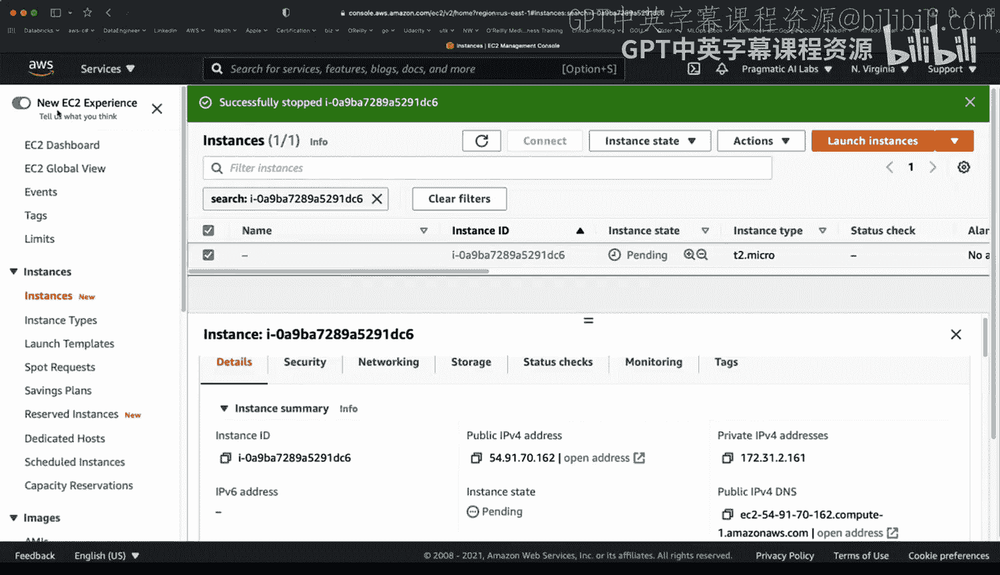

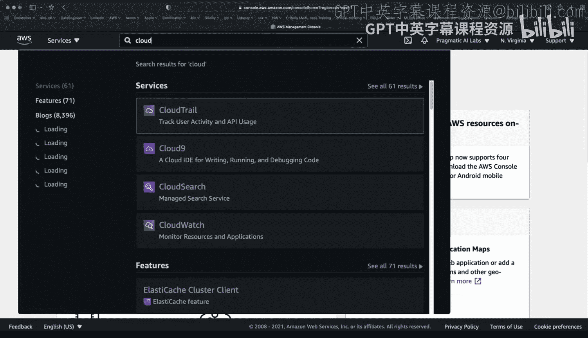

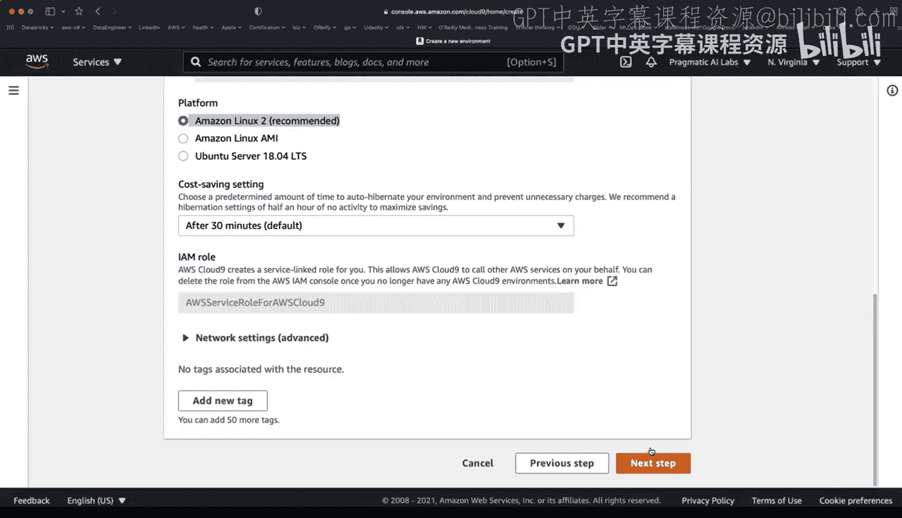

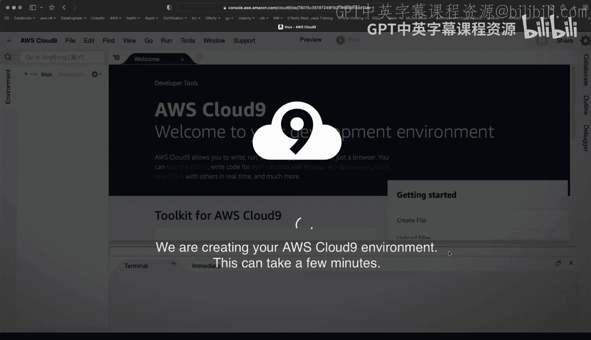

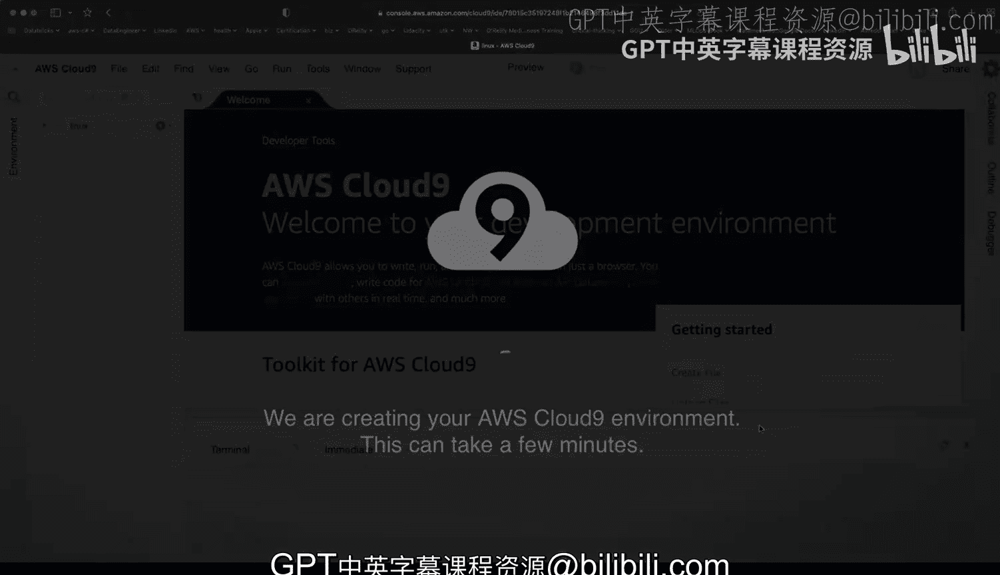