# 杜克大学｜Python、Bash和SQL数据工程基础2-4Python Bash and SQL Essentials for Data Engineering p08 08_01_06_Linux Shell环境对比.zh_en -BV1XS421X7tw_p8-

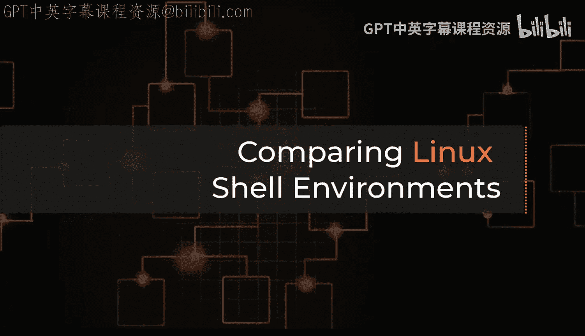

Let's talk through how to compare terminals， there is your local terminal this could be， for example。

 OS 10 and what's nice about this is you can customize it and install things like a ZSAT shell or you could go in here and install thirdparty package managers like B and we'll do that in a little bit or another thing you can do is you can actually go into these cloudbased environments and what's nice about the cloudbased environments。

With GCP AWS Azure is that they all have these methods for you to use their tools。

 so in the case of AWS you'll get access to the AWS bash tools the same with Azure and really it's the place that I like to use when I'm developing software on a cloud platform so as a upcoming bash expert that's one of the things I would recommend is use the right environment for the situation you're in if you're on AWS use AWS Cloud shellll if you're doing some local development know your local OS10 machine or Windows machine with Linux installed those are great choices but pick the right environment for the job at hand。

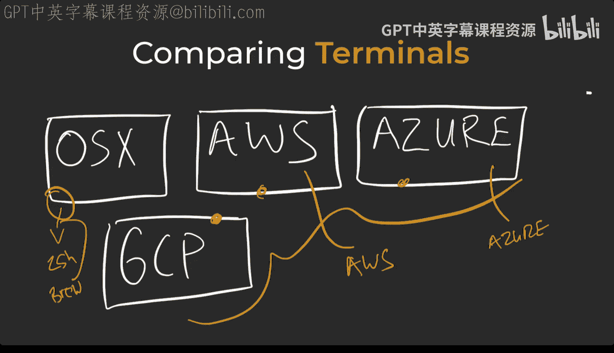

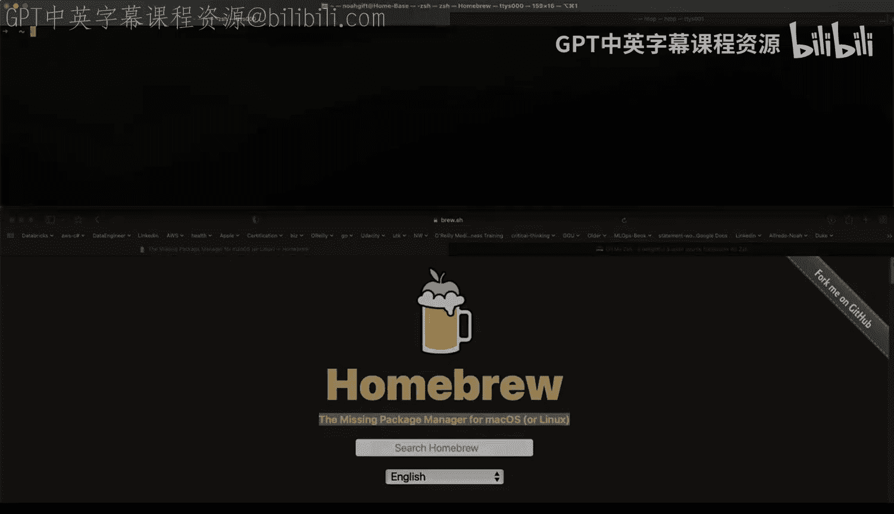

Let's take a look at an OS10 shell here， you can see that I've got a shell open here and below it I have a web browser window that says Homebrew Homebrew is a missing package manager for OS 10 very common for software developers to use it you'll see references to it in documentation for an open source project and the idea here is to supplement what comes installed on OS10 Let's take a look at a native OS10 BS utility here we go empty find this is a very great search utility that allows you to quickly find things on a file system。

So for example， if I type in text， it finds all kinds of text documents all over the file system very。

 very quickly because it looks at metadata， I can also look at the help for this and I can do dash help and you can see I can look for you all kinds of really cool things by using this builtin utility another thing that comes with OS10。

Is the standard top utility right where I can look at what's running on a machine。

 how much energy it's taking etc ce， and it's a pretty nice tool but what if I wanted to supplement it with an advanced version well what I could do is if I go through here and I copy this command。

 I could say you basically brew install right here and it would ask me to install this home brewrew since I've already got it installed I don't need to do it but I can actually show you what it would do if you installed it from this brewant utility H top right here。

 we could go through here it says， oh look it's already installed but it's outdated。

Which is really nice， it goes through， finds the latest dependency and once it's installed。

 it's as simple as it'll be put into my environment and I can just type in Htop so in this case it says you'll need to run pseudo Htop okay let's go ahead and do that let's go ahead and run that command and let's see what the difference is what's really cool about this is you can see it breaks down all of the processors I have I have 32 cores here it shows all of those and it also allows me to you know look at maybe a tree version of things so if I go through here and I look at a tree。

I can go through and look at the help menu there's all kinds of really cool things that this has that the other top utility doesn't have so that's really the idea here is that you can install these thirdpart tools like homebrew to enhance your local experience with OS10 now similarly if we take a look at this in this shell if I quit this I'm going to look at another utility called O my zsH this is very very common as well for people to use the ZsH terminal because it has a lot of auto completion inside of it so if I click on this button it'll go and give me a similar command and we go like this and I just throw this in here and what's nice about it is it'll go through here and say look you've already install it I don't need to install it or if you did install it it would actually ask you for the first time to go through and configure it out so what I would go to next year is I would look。

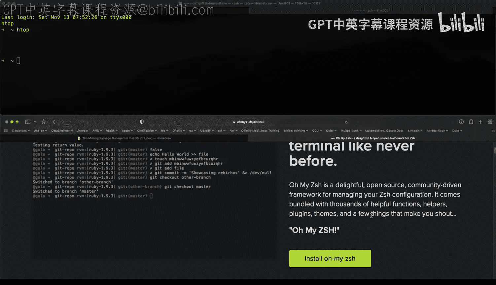

My dot zshRC file。And once it's set up， what's nice about this？

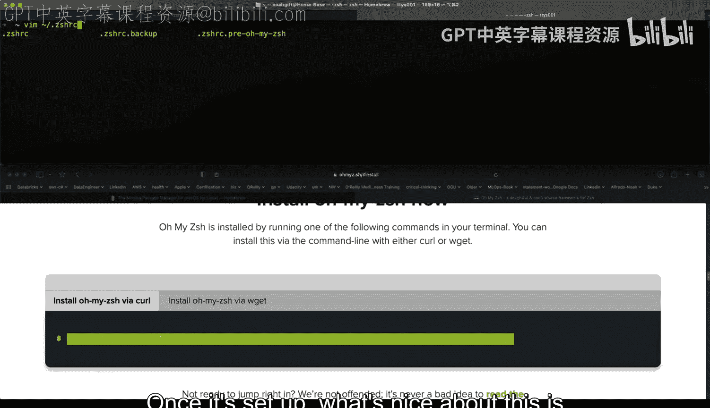

Is that it will actually allow me to tweak it and add additional things to it and what's really cool about the ZSH environment here is that it gets rid of things that are maybe a little bit tedious so normally if I wanted to change it to a directory I'd have to type in CD but with Z shellll you don't even have to type in the CD command anymore it's called autoCd so it has a lot of really fancy shortcuts here that are really useful and in this case I go to the home directory automatically by just typing in Tilde so when you're using OS10 I think two utilities that are very helpful would be Homebw and the other one would be O my ZSH。

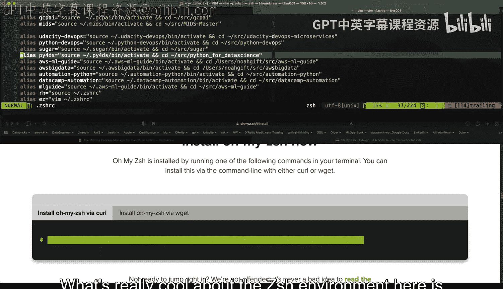

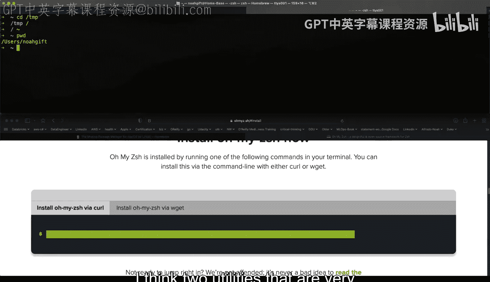

Let's take a look at another environment， this AWS Cloud shellll and notice right up here we have an icon for Cloud Shell if I click on it。

 what'll happen is it'll open up a cloud environment provision it temporarily for me。

 and this is really a common pattern across all cloud providers they give you a shell that will be provisioned it's free and it will have a set of tools bash utilities that will allow you to interact with its cloud platform。

 so this is really important to know about when you're learning baes that all cloud environments have the same concept。

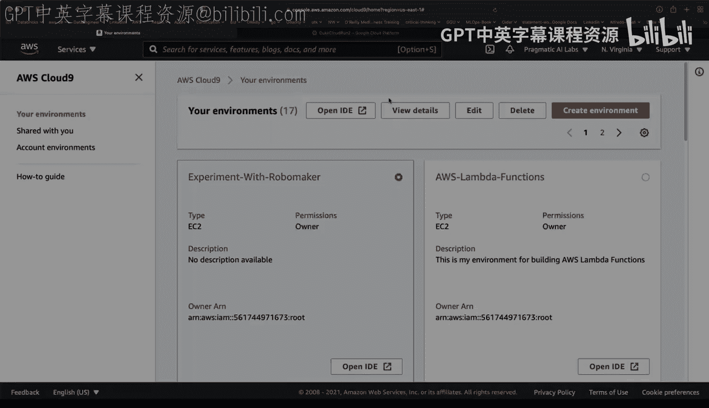

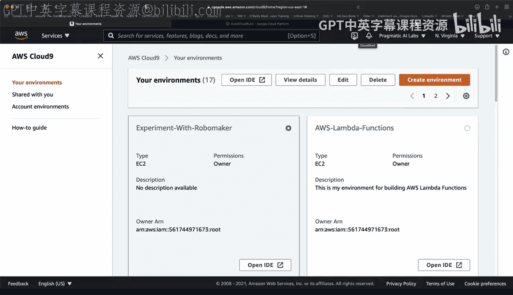

Okay， let's take a look at this shell here you can see that it has AWS already installed right so the AWS interface。

 I can do all these things inside and there's a whole list of really complicated services and fun things you can play with in a nutshell what I like to do to start with is show this is if I want to list the storage resources I have I can type in AWSS3LS。

And this will list all of the buckets that I have in my account these are basically like cloud storage buckets and what's great about this is I could then go through and use a utility like WC and I could count the lines inside of here and we can see there's 101 buckets right so that's in a nutshell the important thing about AWS for now。

 another thing to be aware of is if I go to DRC which is the default environment I could go through here and I could put some kind of thing inside of here like I could put in a command that says hey this shows loading the shell。

And I could put in echo command， I loaded the shell。

And what's nice about this is if I go through and I want to load this。

 I would just type in source tilde/。baashrc。And then basically look you can see it says I ran that command so this is a great way to customize your environment put shortcuts via aliases or maybe environmental variables now let's take a look at the Google Cloud very similarly it's got this icon right here and in this case I've opened up a shell here I can do the same thing right I could go into my B RRC file here。

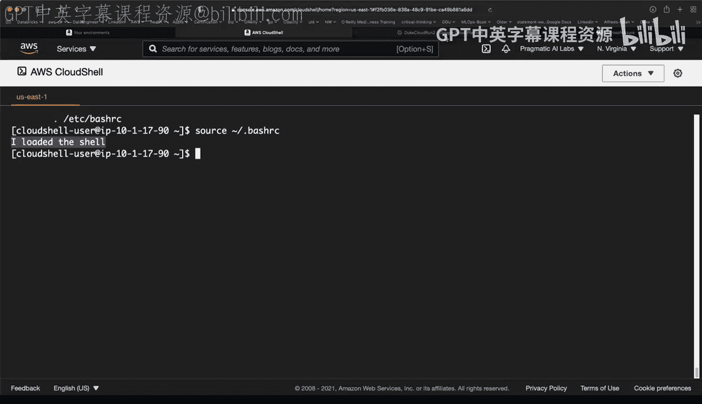

And I could put some kind of command， I could do a shift。

Down here and just say changing the bash R sea。Right here and then I could do the same thing。

 I could say， hello， this is my shell。And this is what's great about this is every time I open up a new terminal。

 it'll actually load that inside， now how would I test that out。

 well I could just go through here and I could open up a new terminal here。

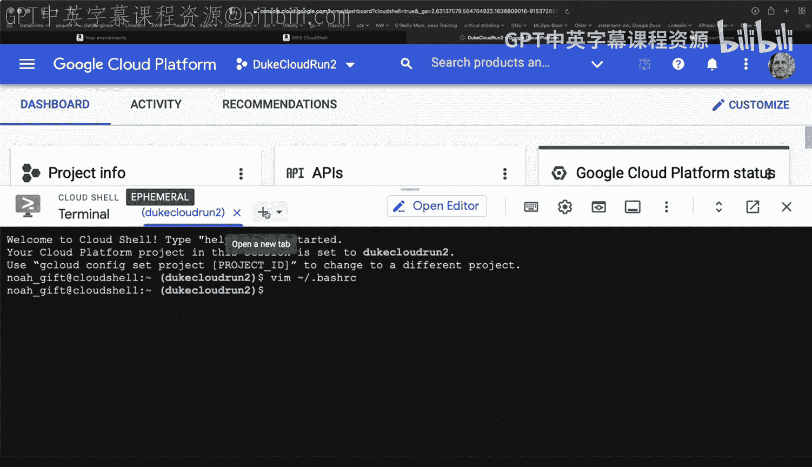

There we go it says this is my shell so similarly if I go to Azure it's got the same concept。

 it's got a Cloud shellll， I could go through here and I could again use the AZ commands here to do different things。

 talk to storage， connect to things I could also go through and edit my BRC file here and put something similar if we go to the bottom。

 we could say you know。

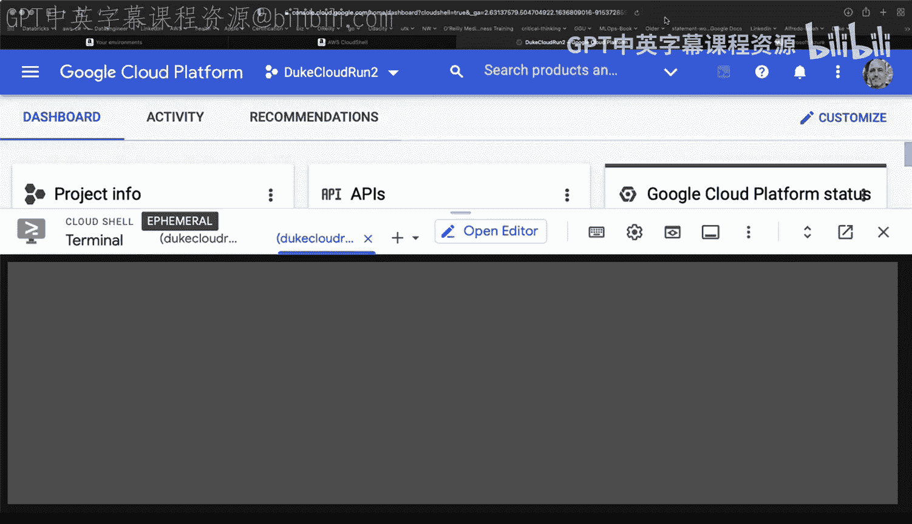

Adding comments， echo。Azure shell loaded。Right there we go and then I could save this and then again if I wanted to play around with this。

 I could go through here and open up a new shell if I wanted to or toggle back and forth or I can just source it in this case I'll say bash or C source it there we go Azure is loaded so really they're all very。

 very similar and once you understand bash you have the keys to mastering many different cloud environments and your own local environment。

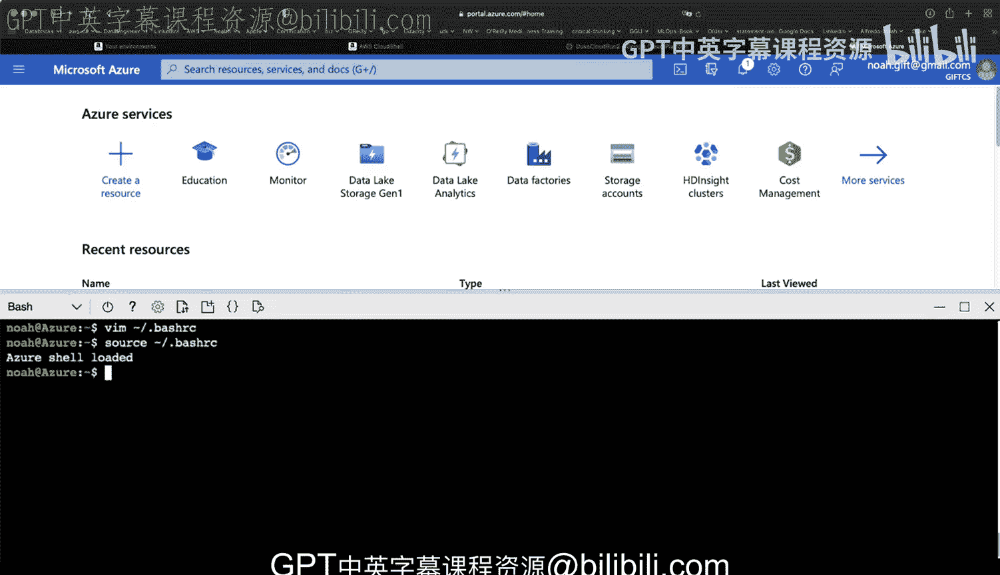