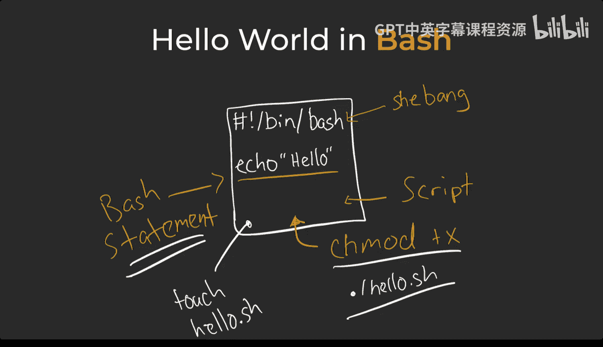
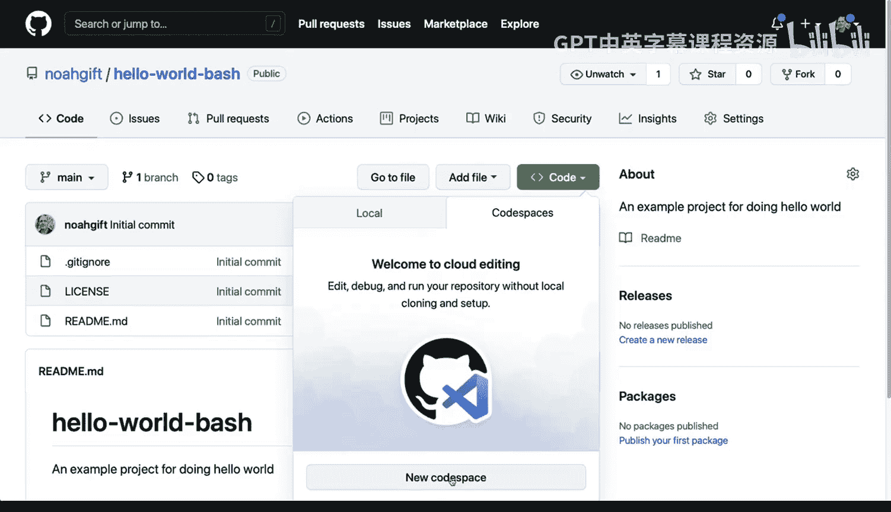
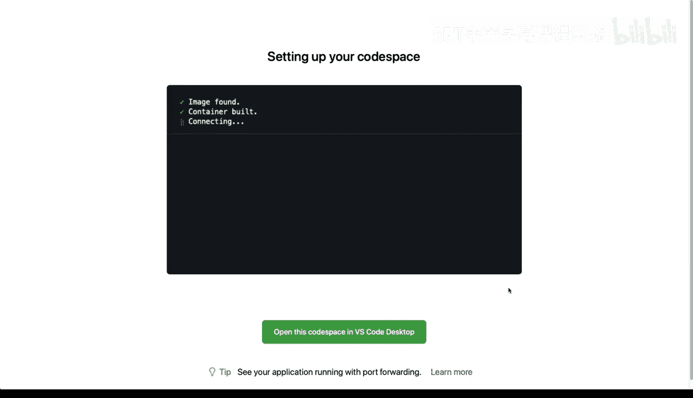
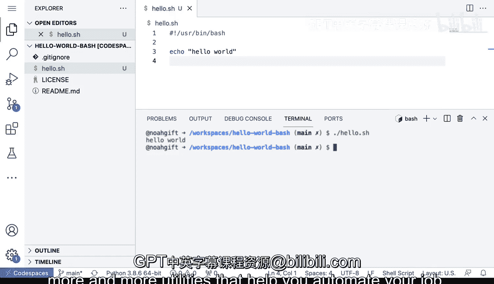

# 杜克大学｜Python、Bash和SQL数据工程基础2-4Python Bash and SQL Essentials for Data Engineering p09 09_01_07_编写Hello World Bash脚本.zh_en -BV1XS421X7tw_p9-

Here is an example of a bash hellello world script and I divided this up into the different components。

 so first here we have actually the script file itself and you can usually do this you know create an empty one for example。

 by typing in the touch command。And we'll do this in a second and type in touchhello。sh。

That's what I like to do because it's a great way to just make a empty file and use whatever text editor is most convenient。

 whether it's VIm could be one example or maybe in the case of GitHub codespaces。

 the codespaces interpreter。Now the bash statement itself is really this command it' just a command that you would type in from the shell。

 could be any command， it could be the LS command， it could be the CD command。

 whatever it is you want to do you put it inside of here and then this top part you can see this is a hashmark exclamation point/ bin/lashbsh this is called the Shibang line and the reason for this line is to tell the script。

 what actually utility to use to run this so in the case of Python it would be Python in the case of bash it would be bash if it was pearl would be pearl and so this just really tells your script what to do so that later you can run it without having to specify ba now the final thing you'll need to do is actually make your script executable and so this is done using the command chma this stands for change in modify the permissions and so in this case by adding the plus X flag this makes the script executable。

Once you've done all these things， then you can do dot slash hello。

S H And the beautiful thing about this is that I can write C， I can write bash， I can write pearl。

 All these things all work the same way because you can actually tell this script what interpreter to use and this is really the power of Uni is you don't really care what language was written in a tool that you use and you can pipe that tool into other programs So let's go ahead and get started and build this out。

All right， let's get into GitHub here and I'm going to use a new repo to demonstrate how to do a Hello world Ba script and so to start with just name this real quick。

 put out a quick description here。And again， I like to make these Github reos so that later you can follow along and come back and know get get yourself unstuck if you need to So this is what I typically do at a get ignoregnore with Python which I do a lot of work with Python so that'll work good at a Cative Commons license that's great okay once I've got this thing set up here now I can actually open up Giub code spaces Now you don't have to use codespaces you can use know OS 10 or a。

Maybe a cloudbased development environment， but I like codespaces because of how easy it is to immediately get into building code。

 Additionally， what's nice is it's got a pre-built bash environment for us and it's really trivial to get started。

 So I think the first thing I'll do here is clean this up a little bit so it's easier to look at maybe make it a little bit larger and once I've done that really I'm ready to go so I can actually start building out my hello world script here what I typically like to do is touch a file and that just creates an empty file that you'll see in the Expr。

 So let's go ahead and do that we'll say touch hello dosh and notice on the left here now it appears and notice that it appears in the right format So my explorer can tell that it's a bash format。

The first thing that we're going to need to do is add a Shibang line so that our script is easier to run really that's the main reason here is let's do less work。

 let's add a hash， let's add a exclamation， let's add user bin bash and now we're ready to go because I don't have to type in bash every time I run this script and also the people that are using my utility。

 who cares what I wrote it in right they really don't need to know that let's go ahead and execute a command now。

Called Hollow World And this is really the essence of bash scripting and why it's the easiest possible way to write a script because it's whatever you type on the bash terminal is exactly what you put in the command so there we go see it's the same thing。

 It could be the LS command。 It could be a C command， It could be maybe dis size command。

 very easy to write scripts because you just do whatever you're doing on the terminal and then put it into a file Now in our case here。

 now that we've got this command， the other thing we're going to do is make it executable and that's what this Chima plus X command would do First though。

 let's take a look at the permissions。 if you do an LS dash L。

This will show us that the root user on the left， the group in the middle and then the user all can't execute it。

 they don't have the X flag。 They can only read or write。

 and this is something that is really common when you're building the utility is you'll want to make the utility available to anybody that uses it right like for example。

 the LS command， anybody in the system can use that。

Notice when I do Chama+X it globally makes it available as an executable file for every single type of user on the system now all I need to do is do dot/helello and it will run the script and really this is the beauty of building this kind of a workflow is that it makes it simple to now use this as part of a suite of tools。

 for example data engineering tools or machine learning tools and really this is it it's to write abas script you add your Bline makes it executable and then add in your statements and then from here you can just keep building more and more utilities that help you automate your job。

