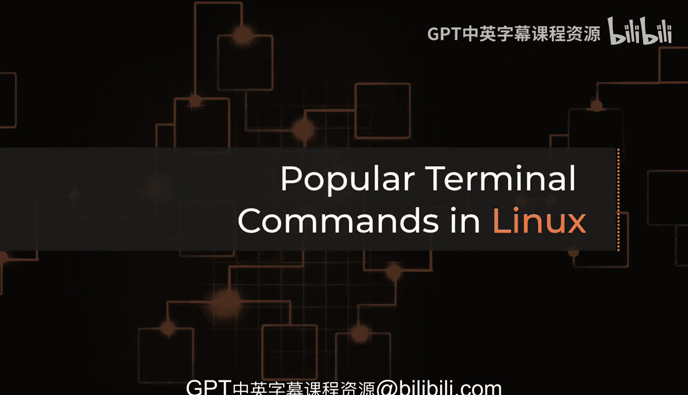
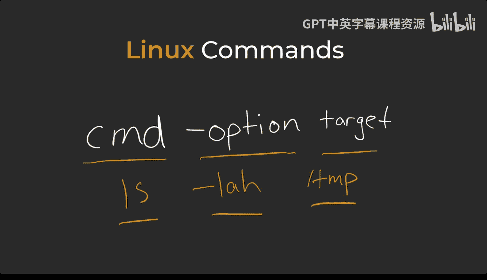
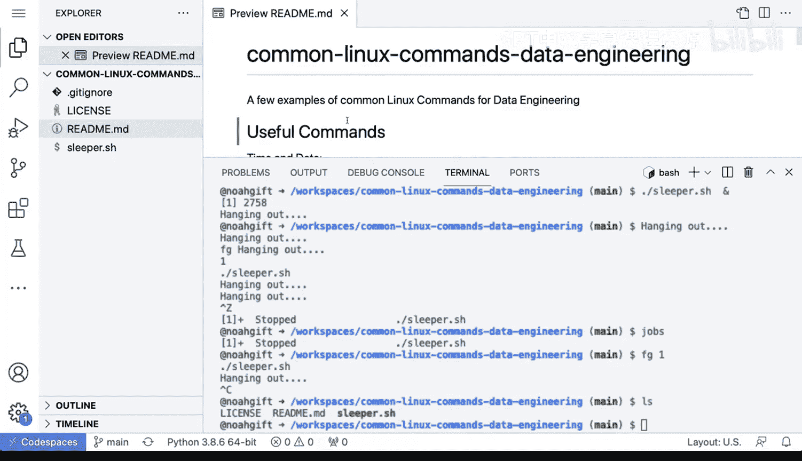
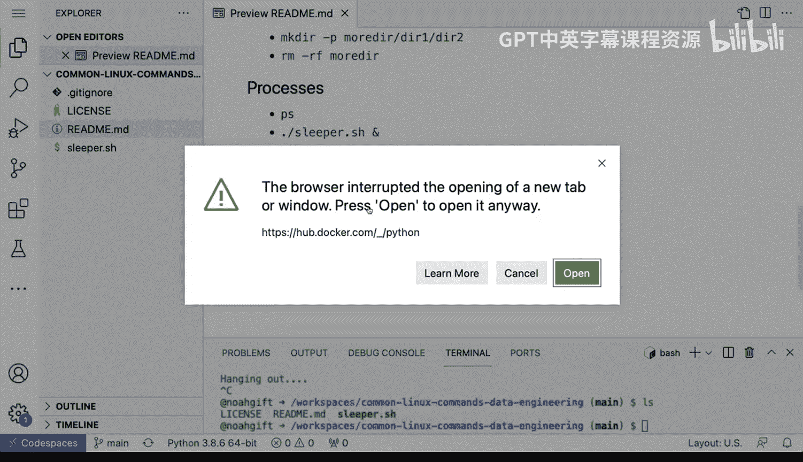
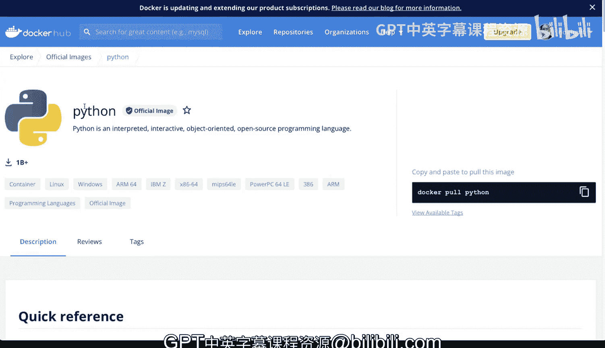
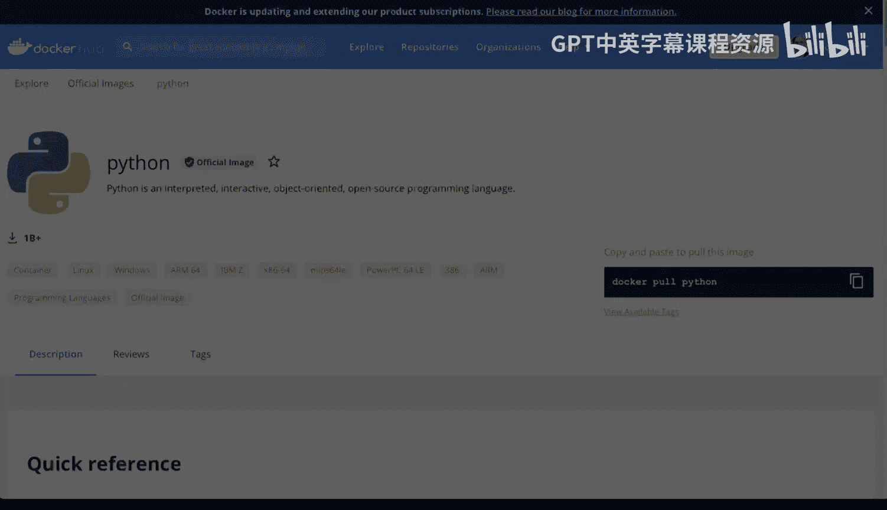

# 杜克大学｜Python、Bash和SQL数据工程基础2-4Python Bash and SQL Essentials for Data Engineering p10 10_01_08_Linux常用终端命令.zh_en -BV1XS421X7tw_p10-

Let's look at a typical Linux command here， you can notice that there's a core structure。

 there's a command。There's an option and there's a target， there also could be a destination。

 but in general we'll see this command option target。 What's a good example。

 Let's take a look at the LS command。 You could type in an option which could be LH。

And also you could look at the target， let's say you wanted to look inside of the temp directory。

This is an extremely common command structure， you'll see it over and over again and once you understand it。

 you can really run any type of command on Linux so let's go through and do some basic Linux commands here and practice how to be an expert in Bsh。

Here are a list of common Linux commands。 This is one of the best ways to become an expert at Bash is to just play around with what you can do。

 So first let's start off with a couple of time and date commands I'm going go down into this GiHub codespace is and I'm going to type in Cal and notice how nice this is it shows me exactly what the date is today it's highlighted in the square and then I can also see what the month is and see the rest of the dates in this particular month if I go ahead and I type in date it'll show me as well the current date right here and the actual current time so lots of really useful commands are are just sitting here inside of bash for you to play around with and you can look at some of those if you type in which date you can see that they're all mostly located in this user bin location so what we could do in fact。

Is if we use CD into user， then。We can do an LSl and you can see a list of all the different commands that you could play around with this is a great way to learn bash start playing around these commands。

 type them in one by one and eventually you'll become an expert just through the practice of really looking at these commands and running them now let's be a little bit more focused here though and let's run into back into our directory which I was inside of here which is。

Workspace。Here we go。And we can go into this。Now notice here that I also could go through here and find out what the disk usage is on my machine。

 and I can do that by using the DF H， the H option makes it human readable。

 so if I run it without that， it shows me in a less human readable form。If I do H。

 now I can see it's in gigabytes or megaytes， and that's what the G stands for。

 And so I can see what percentage of this particular workspace is full， you can see that。

Only 35% is full。 I've only used 11 of a possible 32 gigs， right。

 so I have lots of a room to play around。 There's a great command for data engineers to be experts in。

😊，Another one that's pretty handy is this if I wanted to type in DSS SH and do user bin。Star。

 this could show me how big each one of these tools are in the user bin directory which could be pretty helpful right I can see which ones potentially have a lot of output that they could do or which one is actually a really small utility likewise you could also do this in a current working directory and find things like large image files。

Another one that's pretty helpful is the top command。

 I do this quite a bit if I'm running programs and what's nice about the top command is it'll show me really what's happening with the system。

 you know I can see here here this node process which is probably something that the Gitthub codespaces uses is actually running and I can see other things as well like SSHD which is an SSHD and other commands。

If I do Q， it gets me out of there。Now let's take a look at how to explore the shell a little bit here as well So what you could do is you could just type in PwD and this shows me the full working path to where I'm at this is very handy to put into a script or maybe to pass into an environmental variable so that I can later come back to this location another command here you see as La lah and what this does is it shows me a long listing so it shows me all of the information about the Unix permissions what group user also the size of the file at the same time so this is a very handy way to kind of look around right and again if I go to user bin here and I do the same command I do LS LaH you can see here I've got all this really useful information about what's happening Now let's also take a look at this which is the CD temp command here and if I。

That what it's going to do is it's going to move me into this location if I type in CD Tilde。

 then you can see I move back into home codespaces so really the CD command allows me to move around the file system and if I want to go back to the workspaces here we can do that we can do s workspaces。

There we go and I can go back into this directory。Another one that's pretty handy as well is this command which and so in this case。

 if I type in which Python 3 look it says user bin Python3， this is actually the location。

Where I can actually find that Python executable and the Python 3 executable， if I type it in。

 you can see I can run some commands， I can do stuff with it。

So really it's a great way of finding out how to actually interact with a location of an executable or if I'm using the right executable。

 sometimes there'll be multiple versions like in the case of Python。

 if I type in which Python notice this is a completely different Python。

 which is potentially not what I want， it's all up to me as the bash user to figure out which version of Python I want to use。

Now， a couple other things we can do is basically viewing files， this is very， very common， you know。

 if I want to go through here and I want to say， you Etsy password， for example。

 notice this shows all the passwords on the system and the users。

And if I want to use the cat command， it's very similar。

 the difference between these two is less will' pate the results and cat will just print the whole thing out so if you have a huge file。

 less is a little bit better because you can kind of scroll up and down right so if we go back again and I do the up arrow here。

Notice how I can kind of go through here and click return or I can do up arrow and I can go back and go down arrow up arrow right and this is the great way of navigating things with less where cat will just print it all out。

 Now I also could count the lines of a file this comes out to be very handy a lot of times if I go through here and I say you Etsy password notice this。

 I can see that that file has 27 lines in it so those are just a few of the things that are really helpful in in kind of exploring things in the file system。

 Now let's take a look at a few other things that you can do。 and in particular。

 one of the things you can do is modify files and directories。

 So a great way to do this would be to run this command touch new file Txt。 and once I do that， look。

 I can see right here， I'm able to put some stuff inside and I can say hello。

 you know my name is Bob。Or whatever I want to put inside of here and then if I use that same command again cat you can see here I'm able to print that out so it's a really good workflow to touch a file here and then modify it I can also make a directory and you can see this and there we go look here's a directory and what's nice about this directory is again I created it from the terminal and I could actually move this new file in there so let's go ahead and do that let's say MV which is the move command and I'll say new file。

And。And I'll say move that into new dirt now this is how you can see how there's a source and a target。

 so again this is a command， a move command， this is the source argument and this is the destination so put it inside of this directory。

And if I go through here and I look inside there we go。

 we can see that that new file is actually located inside of that directory。

 so it's pretty handy and that's actually an easy way to rename files as well and let's see how we can actually do that。

 So if I go into this new dirt real quick。And I want to rename this。

 What I could do is I could say MV and I could say new file and I could say new file2。

 just like this。 there we go。 And now look I'm able to actually you know rename the file by using the move command。

 So a very， very handy command to be an expert and。

The other thing that I'll maybe close with here is if we go up a directory here。

 we can also create multiple directories at the same time by typing in makeDP and you can put a whole path and it will create all of these directories at the same time let's go ahead and do that。

There we go。 And look at this。 We can see that this is actually able to create multiple subdirecties at the same time。

 So this can be really great for， you know creating scripts that modify the file system。 Finally。

 if I want to remove everything all simultaneously， Here we go。 I can just say RM RF。

 and I can actually delete that whole directory tree as well。

 So modify directories and files is very straightforward and powerful with the bastiontax。😊。

Let's wrap things up here by looking at processes and so if we go through here and we look at PS notice that we have bash running。

 which is no surprise， we have a terminal， but one of the things that we can do is if I go through here and I say for example。

 Python and I just leave that open and I open up a new terminal here and I type in PS。

 what are we going to see we should be able to see that there's a Python process if we go through here and we say G Python there we go and look we do in fact see that that process is running in Python so that's another really handy thing that you can do is actually look at what's happening on the file system and what's happening on a process level by using PS。

Now I'm going to go through and show you a command here called sleepleer and this uses the sheb line。

 it's got a wall true statement which means it runs forever and what it's going to do is its just going to print out hanging out and the sleep and it's just going do this over and over again let's go ahead and run it real quick let's go through here and say sleeper you can see here it hangs out it's hanging out it's hanging out it's just going to print that forever Now if I want to kill this I can do control C that'll kill the process but I can also do something different which I can do control Z。

And that will stop it now if I type in jobs here。Notice that it will show me that there's a process that's actually stopped and this is something that happens all the time maybe you're working on machine learning or data engineering and you want to have some process run at some point and for some reason you need to stop it you don't have to kill it you can just stop it by just doing control Z and then if you want to run it run it again you just type in FG for foreground and then type in the name of the process ID in this case or the job I in this case it's one and if I type in foreground1 there we go we've got it running it again so it's a really extremely handy way to to work with。

You know， processes now there's another way and I'm just going to kill this for a second。

 So if we go to the sleeper command and I say Ampersan that sends it to the background。

 you can see that it's running you know over and over again if I do control Z here it doesn't do anything because it's running in the background and so what we would want to do here。

Is actually do FG1， and this will actually bring it back to the foreground。

 And now if I do control C， it elects it。 So that's one of the nice things about background foreground is if you again send it to the background。

 it'll be running the way to get out of this as you type in FG space 1。

And then it comes back to the foreground。 You either can put it to sleep again right here。 stop it。

 or you could go through here and put it back into the foreground。 So I'll go ahead and say jobs。

Again here you see that here's this one and I can say foreground one， and that can do control C。

All right， now let's take a look at the final thing I wanted to cover。

 which is really this concept of looking from the experts and following their advice and in particular we can see this Python process here let's go ahead and take a look at this。

 there's a Docker hub image for Python and these are experts that are writing a bunch of bash code here and if I look at the latest tag here。

And I take a look at this what's nice about this is it shows me a bunch of experts doing expert things with Python and bash and notice that they use a syntax here that says and and to ampersands and this says that if this command works successfully then run the next commands if it doesn't stop notice as well we see this arm RFf you can see that a lot of the commands that we played around with they're actually here inside of this bash configuration file for Docker so this is one of the best ways to learn is to go through some really popular open source library in this case this would be the Docker one you could look at in genetics HP you could look at Ruby any other language go through here and find out what they're doing and then follow those best practices when you're writing bash scripts。

