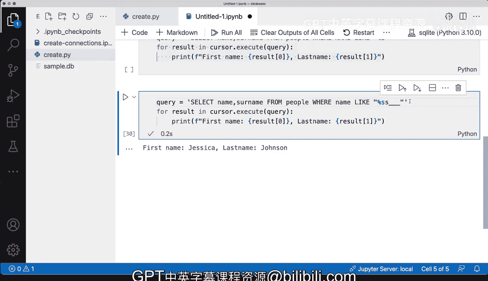

# 杜克大学｜Python、Bash和SQL数据工程基础2-4Python Bash and SQL Essentials for Data Engineering p100 33_02_05_Python中使用SQL进行搜索.zh_en -BV1XS421X7tw_p100-

Searchching in SQL statements， it's always fun and useful。

 I remember a while ago when I was starting to learn SQL statements and databases in generals I used SQL statements and databases to find file duplicates。

 so it was interesting to use the power of SQL and SQL light actually to find duplicate in the file system。

 but we can see how that can work over here when I use the same same database as before。

 and when I use a few things that you can do to find things when whenever data is not。You know。

 very deterministic and you want to find certain items。

 given some sort of notion of what that data would look。

 then you can rely on SQL statements and I'll show you exactly how when I start by using our same query select when I use。

What was it name and。When I use surname。From people。And then we're going to be doing。

Where name and the key， the key feature here from the SQL statement that we're going to use is the like statement。

 So select names surname from people were named like。And we are going to be using。

The percent character first。 So something like see， for example， you， that means like a wild card。

 So we we want to say， hey， like， I don't know。 I think that。This is where name where name like say。

 for example， you want to find anything that ends in E。Alright， and and then what you do is again。

 we're gonna to use our loop here when I print when a loop over the the cursor and when I print the first name and the last name。

 So let's run these and we're getting。First names that ends in ES。

 so that means the percent means anything。That it's a wild card， anything and everything。

 and then ES is specifying the tail end of that text， in this case。

 anything that ends in ES is valid， so what happens if I put another percent here？

What youll get might be surprising。So we're getting a few extra characters and why or or results rather。

 So why is that， that is because the percent over here means。

Anything before ES is valid and the next percent means anything after ES is valid。

 that's why Wesley is valid because ES is right there in the middle we have a W and then L E Y and that matches so you're using it's almost like like a very simple regular expression except it' not a regular expression but you can definitely use that to kind of like fine tune your query we can do say for example。

 anything that starts with a J and do it like that。And we're going to get way， way more results here。

 and you can see all of the first names are starting with a J。So that's， that's pretty useful。

 But aside from that， you can also use the。The underscore。

 And this is something also that's equal light supports。 So what is the deal with underscore。

 So you can do。You can do something like these。And that means hey。

 anything before these and then at least one character and then ending on an S。 So。

 so all of these matches that description。 But what if we can do that will let's try and do。

Let's try and do。Let's try and do this and see what happens。So we're going shift。

 we're going to shift our search， so we're saying anything that any two characters at the tail end。

 so I have two underscores there and then an S and anything before that that means that O and N are the two characters and then we have an S so that matches and then if we add one more let's see what we get we're getting even more results because we're saying hey anything before an S and then three characters so let's count H P and E so these will match same with Jessica。

How about we do double doubleS there and then run these then we'll only get Jessica so these two wildcard whenever you are searching are useful when you're trying to execute some efficient queries and you're dealing with massive amounts of data and you want to use queries to kind of like filter filters through that and so these are two things that you can use when searching。

