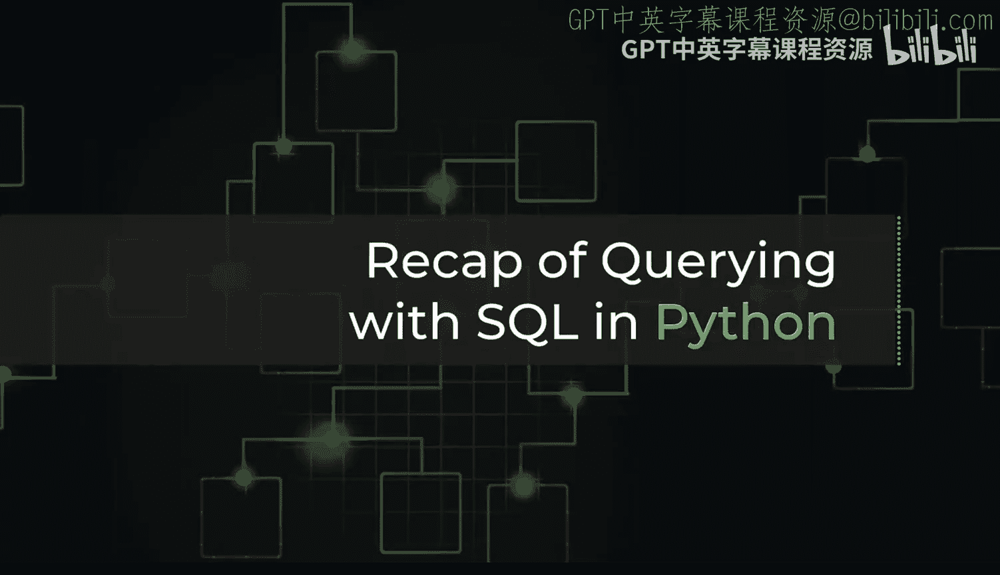

# 杜克大学｜Python、Bash和SQL数据工程基础2-4Python Bash and SQL Essentials for Data Engineering p101 34_02_06_Python中SQL查询回顾.zh_en -BV1XS421X7tw_p101-

In this lesson we've seen how you can do some basic SQL queries against the database。

 but we've also seen how you can do very efficient searches and very performance searches using SQL against a SQL light database now although we've covered SQL Li3 which is an embedded database you can apply these same concepts with other databases like Postgrel SQL and MySQL data processing can be done in the Python side and now you know that that comes at a performance cost like if you're able to do things mostly with a SQL query that will be more more performanceant but you can definitely do a little bit of data processing on the Python side so now you're ready to expand that knowledge。

 build on those SQL queries and start working with data more efficiently。

