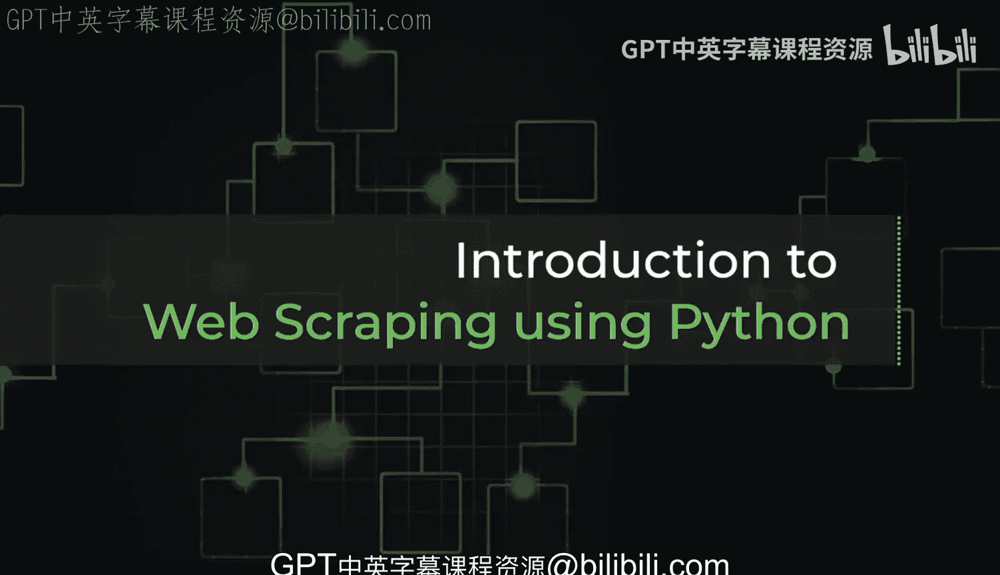

# 杜克大学｜Python、Bash和SQL数据工程基础2-4Python Bash and SQL Essentials for Data Engineering p102 35_03_02_使用Python进行网络爬虫入门.zh_en -BV1XS421X7tw_p102-

This week， you'll learn how to efficiently extract data from the web。

You'll learn how to use a scraping library to read data from websites and identify and extract specific values from it。

Then you will use techniques to find and isolate key data from HTML。And finally。

 you will persist the parse data into a database using SQL。

