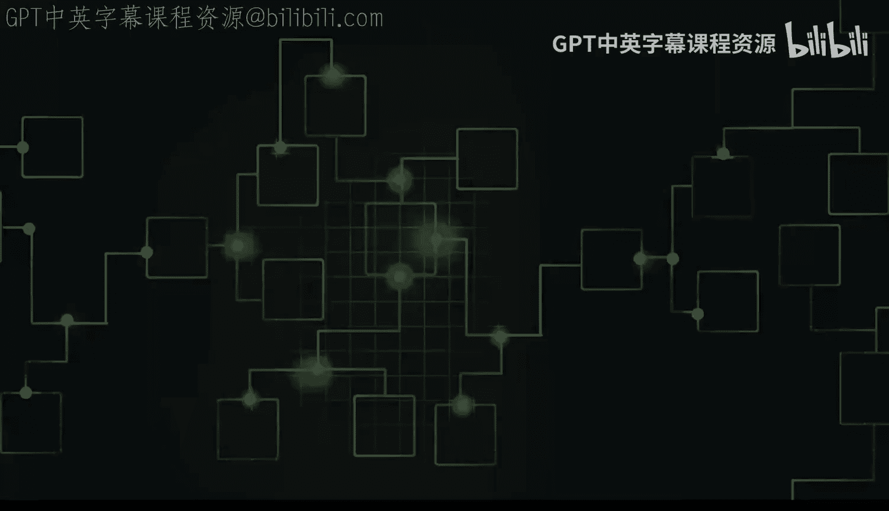
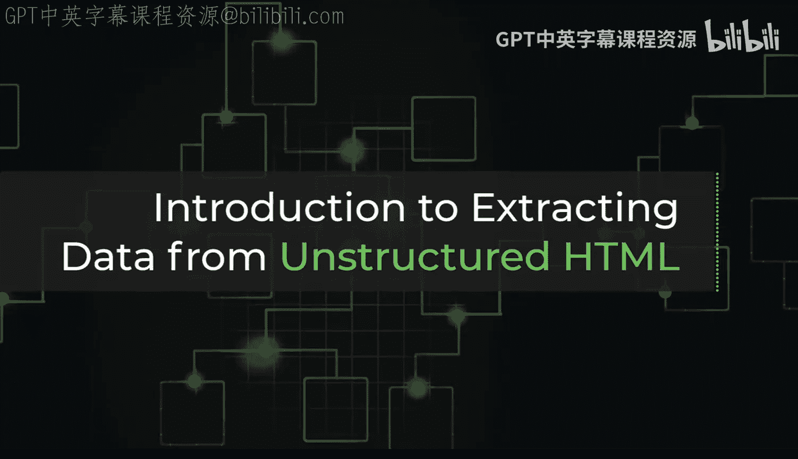

# 杜克大学｜Python、Bash和SQL数据工程基础2-4Python Bash and SQL Essentials for Data Engineering p103 36_03_03_从非结构化HTML提取数据入门.zh_en -BV1XS421X7tw_p103-

Scraing data from the web should be like a last resource。

 you should always prefer touching on APIs or finding if there's a nice way to extract data from web services。

Sometimes this is impossible and we have unstructured HTML all over the place and there's no other way than to read that data by using a web scrapper and web scraping techniques like we will see here and then once you can extract that data。

 well you can normalize it and put it into other formats like JON or CSB。

 then you can do further data engineering on that data that you've effectively extract it from unstructured HTML which can be really difficult we'll see how we can deal with that difficulty in order to extract that data and work with it。

