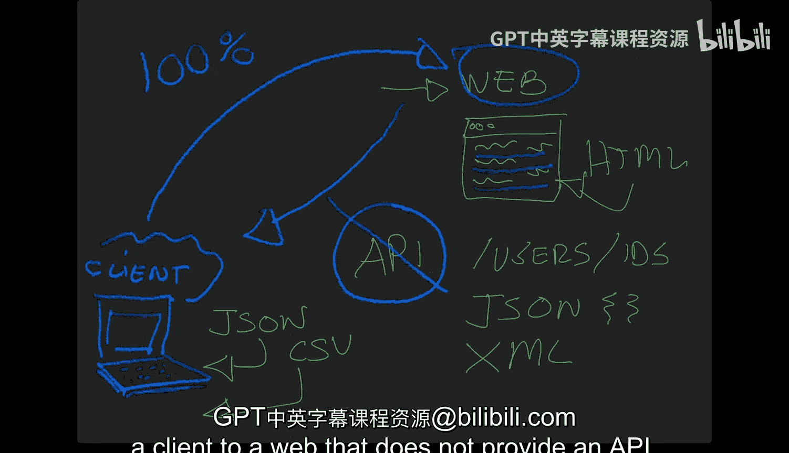

# 杜克大学｜Python、Bash和SQL数据工程基础2-4Python Bash and SQL Essentials for Data Engineering p104 37_03_04_网络数据面临的挑战.zh_en -BV1XS421X7tw_p104-

So what are some of the challenges when dealing with web scraping。

 so sometimes you may have something like like a website that has unstructured data like in HTML over here。

And and that HTML might be difficult to extract now you don't have an API。

 so an API is basically not not feasible。 it's not available for you， ideally。

 you would have an API which would give you like a nice URL， like say， for example， users。And say。

 for example， I and then you could retrieve Is and APIs can expose data over J， you know。

 nicely formatted JN and then you would have。You could extract data， manipulate data with JN。

 and or sometimes even XML， which is another popular format there for exposing。

 but if you don't have access to an API，How do you， how do you retrieve。

 how do you retrieve that interesting data？That is available from， from the web over here。 Well。

 if you have a client。You have a computer over here。

And then the client can access the web just like an API。

 but you would need to read all of that data that is present here on the website from the HTML so this is kind of complex and it requires the client to go reach out to the web and read 100 percent of that website and then do some heavy parsing and only then come back and then make sense of that HTML。

 restructure it in a way that makes sense and normalize it and make it structured and only then can you have actual JO here coming back to the client and saving it persistent it in either a file or a database and even then perhaps transform it as。

CB as well so you can also have CSB going back to the client so effectively you start getting rid of the requirement of requiring or having an API that exposes the data。

 but this is very complex right they has like a very high level of complexity。

And these are some of the challenges when doing some web scraping from a client to a web that does not provide an API。

