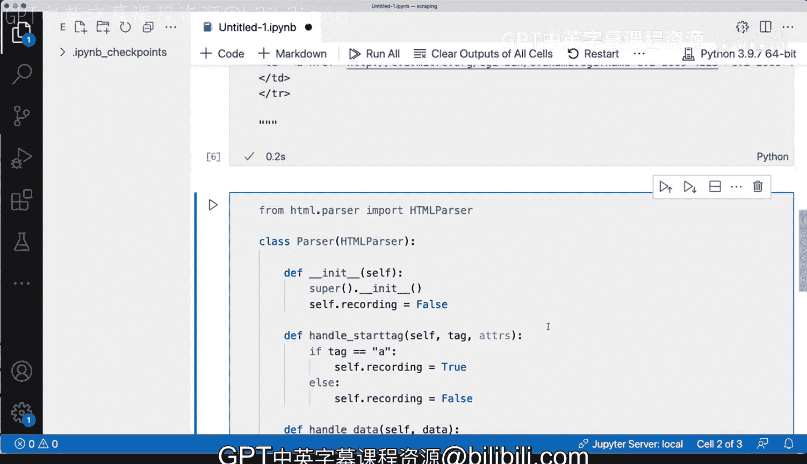

# 杜克大学｜Python、Bash和SQL数据工程基础2-4Python Bash and SQL Essentials for Data Engineering p105 38_03_06_使用HTMLParser在Python中解析HTML.zh_en -BV1XS421X7tw_p105-

Newer versions of Python in this case， Python 3 half HTML parser capabilities。

 I have visual Studio code here， and what I have here as content is lots of table rows and table data。

Basically extracted from my page that is representing HTML data with CVEs。

 which are common vulnerability。Is that are representing a vulnerability in a piece of software。

 So let's just assume， for example， that you want to extract the value of the A tag here In this case。

 that would be this thing here is CV 20094186。 So how you do that Well first let's run that cell。

Let's go back to the to the left and we have the content here。 triple codes is pretty extensive。

 So it's very horrible， really So you want to parse that how you do that。

 Well HTML parser works with a class So I have here like the bare bones class you create this parser class you inherit from HTML pars parser which we imported from the parser module over here。

 you create the init you have to use super。 and one trick that I use is the selfred。

 So I've set that to false So what is going on here。 Well， basically we need to tell。This parser。

 when it finds a tag and we're going to do that in handle star tag。

 So that means that every single tag it finds it will you will get that here and you will check we want to check if we're getting the the a tag so。

We are going to be doing something like this， if tag equals。A。We're going to say self recording。

 We want to record the data。 is going to be true。 You're going see why this is critical here。 else。

 I'm going to say else self recording。Equals false。 So now I。That's just saying the start of a tag。

 So something interesting that we want to look at in this case， the a tag。Now。

Handled data will be able to tell us， like， if we're。If we're self recording。

We can say something like print。 and I use F strings here found。嗯。A tag info。

 I'm going to do curly brackets here。And then here when I use data right。

 so I'm going to run these and see what happens so that well we're going to execute this so that the code exists and next we're going to call it。

So the way you call it is you create an instance of our class， so pars is our class over here。

 that's what we've named it。And next， we're going to。Pass the content into feet。 and we'll see。

 we'll see what happens there。 I'm going to run it。And we're getting some， some values here。

 But you can see that some of these don't have anything in them。 So what's going on well。

The HTML parser is kind of tricky to deal with， so what we need to do is we need to rely on setting a false statement here said according to false every time we're done extracting what we want。

So I'm going to run this again。And that should make it better。

So now you can see here that now whenever the a tag is found recording is set to false so it's only capturing exactly what we need So that's it really that's all you need to parse with HTML parser here's the class again。

 we've created a class we've set up the in it we've found the start tag in this case a is the tag that we want to look at and handle data sets itself recording to false once it's done and then you can see it works perfectly so that's how you will use HTML the HTML parser。

Class in the Barer module。

