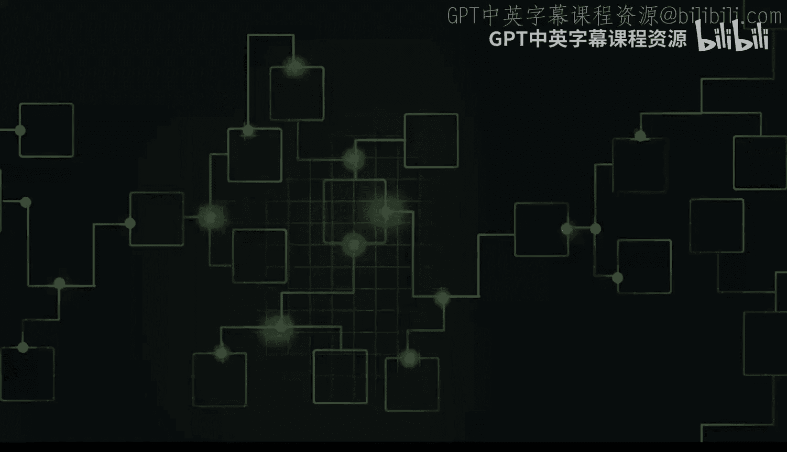
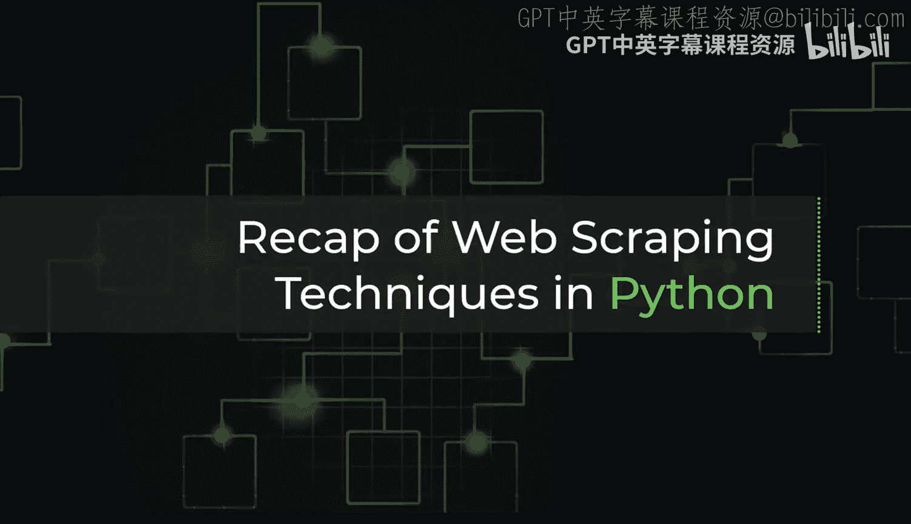

# 杜克大学｜Python、Bash和SQL数据工程基础2-4Python Bash and SQL Essentials for Data Engineering p106 39_03_07_Python网络爬虫技术回顾.zh_en -BV1XS421X7tw_p106-

In this lesson we covered some of the techniques that you can use to scrape data from Unstructureed HTML by using Python itself。

 the standard library and using HTML parser to do that you don't need to install any libraries and this should be a pretty straightforward way to extract data once you find some instructorstructure HTML now you also saw some of the difficulties in using HTML parser and the class based approach。

